  
  
  
  
  
  
  
  
  
  
  
  
  
  
  
  
  
  
  

# 🌈 logos — Repo-wide Animated SVG Set

Animated SVG logos for the folder READMEs outside `neural_lab/`: one
**banner** (800×220, header of each README) and one **avatar** (128×128,
footer of each README) per section. Pure-SMIL animation only (no CSS, no
JS, no external resources), so the logos animate on GitHub and in any
standards-compliant viewer. Motifs: terminal (scripts), shield (.github),
books (covers), brackets (src), palette (assets), database (data), gauge
(evaluation), rocket (experiments), spectrum (features), bulb (hypotheses),
oscilloscope (instrumentation), target (predictors), trophy (results),
archive cube (storage, runs), checklist (tests), frames (2D charts),
wireframe cube (3D charts), document stack (reports).

| Pattern | Usage |
|---|---|
| `<name>.banner.svg` | top header of the corresponding README, `width="760"` |
| `<name>.avatar.svg` | footer navigation block, `width="56"`, or standalone icon |

The `neural_lab`-specific set (9 sections: neural_lab, research,
tinygpt_formula, scripts, data, model, scaling, colab, science) lives in
[`neural_lab/assets/logos/`](../../neural_lab/assets/logos/README.md).
Regenerate both sets with the maintainer's `gen_neural_lab_logos.py`
(single source of truth); the files are committed artifacts.

[← back to assets](../README.md)
