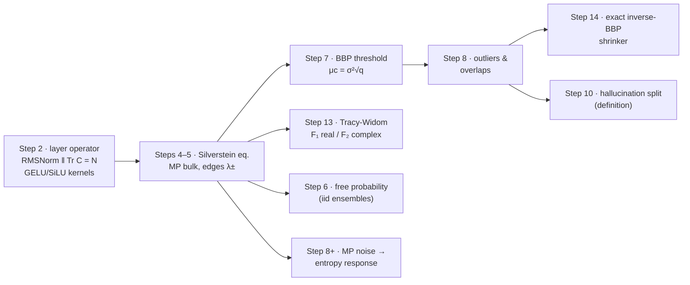

<p align="center">
  <a href="assets/logos/formal_proof.banner.svg"></a>
</p>

# 🧾 formal_proof — deriving the derivable, honestly

[](#-verified-results-at-a-glance)
[](monograph/monograph_EN.md)
[](experiments/)
[](README_RU.md)
[](#-reproduce-everything)
[](#-scope-and-honesty)

> **What this folder is.** The part of the first-principles program that
> can be *derived* — is derived here: assumptions are registered,
> theorems carry proofs or exact citations, and every claim is checked by
> a runnable experiment. What cannot be derived today is **not faked**:
> those steps stay phenomenological in the parent repository, untouched.
>
> **Что это.** Выводимая часть программы из первых принципов — выведена:
> допущения зарегистрированы, у теорем есть доказательства или точные
> ссылки, каждое утверждение проверено экспериментом. Что не выводится —
> не имитируется. Русская версия: **[README_RU.md](README_RU.md)**.

---

## 🗺 The derivation DAG



## 📐 The honest status of the 15-step program

| Step | Claim of the program | Status here | Where |
|------|---------------------|-------------|-------|
| 2 | layer operator w/ nonlinearities | ✅ **derived** — RMSNorm trace lemma + Price/Stein kernels | [Ch. 2](monograph/monograph_EN.md) |
| 4–5 | self-consistent bulk equation, MP edges | ✅ **derived** — Silverstein equation, closed-form Stieltjes | [Ch. 3](monograph/monograph_EN.md) |
| 6 | free-probability attention calculus | ✅ **derived for i.i.d.** (Voiculescu) · freeness of *trained* weights stays open | [Ch. 4](monograph/monograph_EN.md) |
| 7 | BBP phase transition | ✅ **derived** — μc = σ²√q + pole-equation proof | [Ch. 5](monograph/monograph_EN.md) |
| 8 | outlier trajectories, overlaps | ✅ **derived** | [Ch. 6](monograph/monograph_EN.md) |
| 10 | hallucination operator | 📐 **definition** (made operational) | [Ch. 7](monograph/monograph_EN.md) |
| 11 | entropy grows from bulk noise | 🔧 **corrected & derived under stated assumptions** — the clean sign/factor is *negative* for conditional entropy | [Ch. 8](monograph/monograph_EN.md) |
| 13 | Tracy-Widom edge law | ✅ **derived with β-correction** — real activations → F₁ (not F₂) | [Ch. 9](monograph/monograph_EN.md) |
| 14 | optimal spectral clipping | 🔧 **clarified** — 3 problems, 3 exact solutions (Eckart-Young / inverse-BBP / Gavish-Donoho) | [Ch. 10](monograph/monograph_EN.md) |
| 1, 3 | microscopic measure on tokens; universality for real activations | ⏸ **left as is** — would require currently unproven properties | — |
| 9, 12, 15 | RG depth flow; Talagrand-type hallucination bound; meta-theorem | ⏸ **left as is** — not derivable with today's tools | — |

The monograph states every hypothesis; nothing here is a conjecture
dressed as a theorem.

---

## ✅ Verified results at a glance

| Verification | Result |
|---|---|
| Silverstein closed form — fixed-point residual | **3×10⁻¹⁶** |
| MP density vs empirical spectrum (N=900) | **KS = 0.0033** |
| BBP outlier trajectory (emp vs theory, 3.2 μc) | **3.6077 vs 3.6215** |
| Eigenvector overlap (emp vs theory, 3 μc) | **0.757 vs 0.753** |
| Pole equation vs closed BBP form | **≤ 9×10⁻¹⁶** (all q tested) |
| Tracy-Widom class separation (real vs complex) | **p = 5×10⁻³⁵** |
| Inverse-BBP shrinker vs population Σ | **error 0.013–0.028** (hard ops ≈ 1.0) |
| Entropy response formula vs Monte-Carlo | **4.1406 vs 4.1407** |
| RMSNorm trace conservation | **5.7×10⁻¹⁴** |

<details>
<summary><b>📖 Where each number comes from</b> (click)</summary>

| Experiment | Verifies | Figure |
|---|---|---|
| `verify_mp_law.py` | Silverstein equation, MP density & edges, Stieltjes transform | [mp_law_verification](assets/figures/mp_law_verification.png) |
| `verify_bbp_transition.py` | BBP threshold, outlier trajectory, overlaps (+ GIF) | [bbp_transition](assets/figures/bbp_transition_verification.png) · [gif](assets/animations/bbp_transition.gif) |
| `verify_tracy_widom.py` | F₁ (real) vs F₂ (complex) universality | [tracy_widom](assets/figures/tracy_widom_verification.png) |
| `verify_shrinkage.py` | Eckart-Young / inverse-BBP / Gavish-Donoho hierarchy | [shrinkage](assets/figures/shrinkage_comparison.png) |
| `verify_entropy.py` | second-order entropy response | [entropy](assets/figures/entropy_response.png) |
| `verify_layer_ops.py` | RMSNorm lemma, GELU/SiLU kernels, covariance transform | [layer_ops](assets/figures/layer_ops_verification.png) |
| `make_mp_animation.py` | bulk convergence animation | [mp_convergence.gif](assets/animations/mp_convergence.gif) |

</details>

---

## ⚡ Reproduce everything

```bash
# ~3 minutes, CPU only: numpy + scipy + matplotlib + pillow
pip install -r formal_proof/requirements.txt

cd formal_proof/experiments
python3 run_all.py          # regenerates all figures + prints every number
```

Library of derived formulas (importable):

```python
import sys; sys.path.insert(0, "formal_proof")
from rmt_fp import mp, spiked, tracy_widom, shrinkage, entropy, layer_ops

lamm, lamp = mp.mp_edges(q=0.35, sigma2=1.7)          # derived edges
mu_c    = spiked.bbp_threshold(0.35, 1.7)             # sigma^2 sqrt(q)
lam_out = spiked.bbp_outlier(2.5 * mu_c, 0.35, 1.7)   # BBP trajectory
mu_hat  = spiked.inverse_bbp_spike(lam_out, 0.35, 1.7)# exact inverse
```

## 📚 The monograph (EN / RU)

12 chapters with the full derivation chain, in both languages:

| Edition | Entry |
|---|---|
| 🇬🇧 | [`monograph/monograph_EN.md`](monograph/monograph_EN.md) |
| 🇷🇺 | [`monograph/monograph_RU.md`](monograph/monograph_RU.md) |

## 🎯 Scope and honesty

This folder **adds** a derived layer on top of the program; it does not
edit the phenomenological content of the parent repository. Three
concrete findings the derivation forced (each documented in the
monograph):

1. **Step 11 (entropy):** under the natural conditional-entropy reading
   the second-order response to bulk noise has the *opposite* sign and a
   $(1-1/K)$ factor (Ch. 8); the derived statement replaces the
   phenomenological formula wherever rigor is needed.
2. **Step 13 (β-index):** real activations obey the $F_1$ law, not
   $F_2$; the plan's complex-ensemble normalization differs from
   Johnstone's derived one (Ch. 9). The verification separates the two
   classes at $p\sim10^{-35}$.
3. **Step 14 (clipping):** the plan's single formula answers none of the
   three natural problems exactly — the exact solutions are
   Eckart-Young truncation, the inverse-BBP soft shrinker, and the
   Gavish-Donoho threshold respectively (Ch. 10).

Steps 1, 3, 9, 12, 15 remain phenomenological (in the parent repository)
because deriving them would require currently unproven properties of
trained transformers. That is the honest boundary of this folder.

---

<p align="center">
  <a href="../README.md"></a>
  <a href="monograph/README.md"></a>
</p>

<p align="center">
  <sub><b>formal_proof</b> · derived layer of rmt-llm-research · theorems over postulates</sub>
</p>
