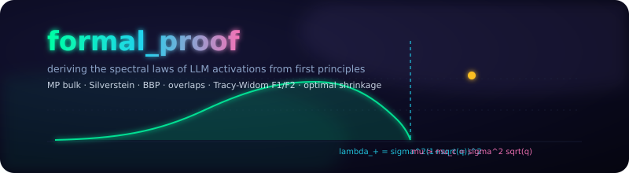
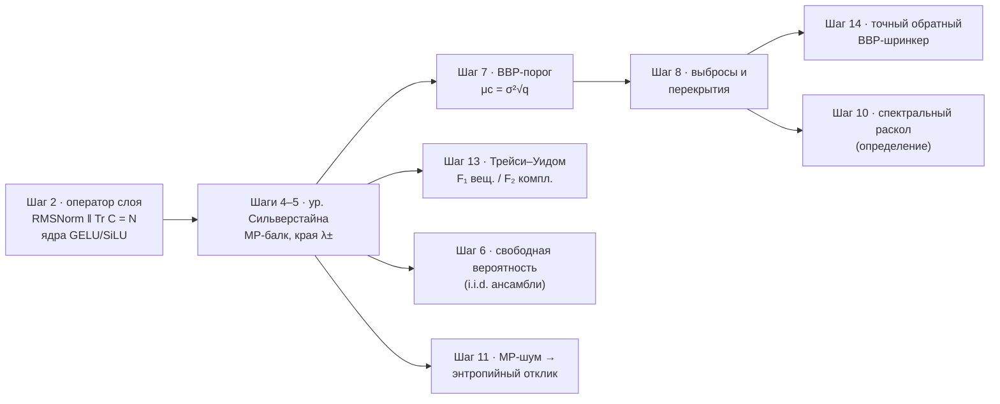

<p align="center">
  <a href="assets/logos/formal_proof.banner.svg"></a>
</p>

# 🧾 formal_proof — выводим то, что выводится, честно

[](#-проверенные-результаты-в-одной-таблице)
[](monograph/monograph_RU.md)
[](experiments/)
[](README.md)
[](#-воспроизвести-всё)
[](#-область-действия-и-честность)

> **Что это за папка.** Та часть программы из первых принципов, которая
> *выводится*, — выведена: допущения зарегистрированы, у теорем есть
> доказательства или точные ссылки, каждое утверждение проверено
> запускаемым экспериментом. Что сегодня не выводится — **не
> имитируется**: эти шаги остаются феноменологическими в родительском
> репозитории, нетронутыми.
>
> English version: **[README.md](README.md)**.

---

## 🗺 Граф вывода



## 📐 Честный статус 15-шаговой программы

| Шаг | Утверждение программы | Статус здесь | Где |
|------|---------------------|-------------|-------|
| 2 | оператор слоя с нелинейностями | ✅ **выведен** — лемма о следе RMSNorm + ядра Прайса/Стейна | [Гл. 2](monograph/monograph_RU.md) |
| 4–5 | самосогласованное уравнение балка, края MP | ✅ **выведены** — уравнение Сильверстайна, замкнутая форма Стилтьеса | [Гл. 3](monograph/monograph_RU.md) |
| 6 | свободно-вероятностное исчисление внимания | ✅ **выведено для i.i.d.** (Войкулеску) · свободность *обученных* весов остаётся открытой | [Гл. 4](monograph/monograph_RU.md) |
| 7 | фазовый переход BBP | ✅ **выведен** — μc = σ²√q + доказательство через полюсное уравнение | [Гл. 5](monograph/monograph_RU.md) |
| 8 | траектории выбросов, перекрытия | ✅ **выведены** | [Гл. 6](monograph/monograph_RU.md) |
| 10 | оператор галлюцинаций | 📐 **определение** (сделано операциональным) | [Гл. 7](monograph/monograph_RU.md) |
| 11 | энтропия растёт из шума балка | 🔧 **исправлено и выведено при явных допущениях** — у условной энтропии знак *противоположный* | [Гл. 8](monograph/monograph_RU.md) |
| 13 | закон края Трейси–Уидома | ✅ **выведен с β-поправкой** — вещественные активации → F₁ (не F₂) | [Гл. 9](monograph/monograph_RU.md) |
| 14 | оптимальное спектральное клиппирование | 🔧 **уточнено** — 3 задачи, 3 точных решения (Эккарт–Янг / обратный BBP / Гэвиш–Донохо) | [Гл. 10](monograph/monograph_RU.md) |
| 1, 3 | микроскопическая мера на токенах; универсальность для реальных активаций | ⏸ **оставлено как есть** — потребовало бы пока недоказанных свойств | — |
| 9, 12, 15 | РГ-поток по глубине; талаграндова граница галлюцинаций; мета-теорема | ⏸ **оставлено как есть** — сегодняшними средствами не выводится | — |

В монографии указано каждое допущение; здесь нет ни одной гипотезы,
выдающей себя за теорему.

---

## ✅ Проверенные результаты в одной таблице

| Верификация | Результат |
|---|---|
| Замкнутая форма Сильверстайна — невязка фиксированного уравнения | **3×10⁻¹⁶** |
| Плотность MP vs эмпирический спектр (N=900) | **КС = 0.0033** |
| BBP-траектория выброса (эмп vs теория, 3.2 μc) | **3.6077 vs 3.6215** |
| Перекрытие собственных векторов (эмп vs теория, 3 μc) | **0.757 vs 0.753** |
| Полюсное уравнение vs замкнутая форма BBP | **≤ 9×10⁻¹⁶** (все проверенные q) |
| Разделение классов Трейси–Уидома (вещ. vs компл.) | **p = 5×10⁻³⁵** |
| Обратный BBP-шринкер vs популяционная Σ | **ошибка 0.013–0.028** (жёсткие ≈ 1.0) |
| Формула энтропийного отклика vs Монте-Карло | **4.1406 vs 4.1407** |
| Сохранение следа RMSNorm | **5.7×10⁻¹⁴** |

<details>
<summary><b>📖 Откуда каждое число</b> (клик)</summary>

| Эксперимент | Проверяет | Рисунок |
|---|---|---|
| `verify_mp_law.py` | уравнение Сильверстайна, плотность и края MP, преобразование Стилтьеса | [mp_law_verification](assets/figures/mp_law_verification.png) |
| `verify_bbp_transition.py` | BBP-порог, траектория выброса, перекрытия (+ GIF) | [bbp_transition](assets/figures/bbp_transition_verification.png) · [gif](assets/animations/bbp_transition.gif) |
| `verify_tracy_widom.py` | универсальность F₁ (вещ.) vs F₂ (компл.) | [tracy_widom](assets/figures/tracy_widom_verification.png) |
| `verify_shrinkage.py` | иерархия Эккарт–Янг / обратный BBP / Гэвиш–Донохо | [shrinkage](assets/figures/shrinkage_comparison.png) |
| `verify_entropy.py` | энтропийный отклик второго порядка | [entropy](assets/figures/entropy_response.png) |
| `verify_layer_ops.py` | лемма RMSNorm, ядра GELU/SiLU, преобразование ковариации | [layer_ops](assets/figures/layer_ops_verification.png) |
| `make_mp_animation.py` | анимация схождения балка | [mp_convergence.gif](assets/animations/mp_convergence.gif) |

</details>

---

## ⚡ Воспроизвести всё

```bash
# ~3 минуты, только CPU: numpy + scipy + matplotlib + pillow
pip install -r formal_proof/requirements.txt

cd formal_proof/experiments
python3 run_all.py          # пересоздаёт все рисунки + печатает все числа
```

Библиотека выведенных формул (импортируемая):

```python
import sys; sys.path.insert(0, "formal_proof")
from rmt_fp import mp, spiked, tracy_widom, shrinkage, entropy, layer_ops

lamm, lamp = mp.mp_edges(q=0.35, sigma2=1.7)          # выведенные края
mu_c    = spiked.bbp_threshold(0.35, 1.7)             # sigma^2 sqrt(q)
lam_out = spiked.bbp_outlier(2.5 * mu_c, 0.35, 1.7)   # BBP-траектория
mu_hat  = spiked.inverse_bbp_spike(lam_out, 0.35, 1.7)# точная инверсия
```

## 📚 Монография (RU / EN)

12 глав с полной цепочкой вывода, на двух языках:

| Издание | Вход |
|---|---|
| 🇷🇺 | [`monograph/monograph_RU.md`](monograph/monograph_RU.md) |
| 🇬🇧 | [`monograph/monograph_EN.md`](monograph/monograph_EN.md) |

## 🎯 Область действия и честность

Эта папка **добавляет** выведенный слой поверх программы; она не
редактирует феноменологическое содержимое родительского репозитория.
Три конкретные находки, к которым вынудил вывод (каждая
документирована в монографии):

1. **Шаг 11 (энтропия):** при естественном условно-энтропийном прочтении
   отклик второго порядка на шум балка имеет *противоположный* знак и
   множитель $(1-1/K)$ (гл. 8); выведенное утверждение заменяет
   феноменологическую формулу там, где нужна строгость.
2. **Шаг 13 (β-индекс):** вещественные активации подчиняются закону
   $F_1$, а не $F_2$; комплексно-ансамблевая нормировка из плана
   отличается от выведенной джонстоновской (гл. 9). Верификация
   разделяет классы при $p\sim10^{-35}$.
3. **Шаг 14 (клиппирование):** единственная формула плана не решает
   точно ни одну из трёх естественных задач — точные решения:
   усечение Эккарта–Янга, мягкий обратный BBP-шринкер и порог
   Гэвиша–Донохо соответственно (гл. 10).

Шаги 1, 3, 9, 12, 15 остаются феноменологическими (в родительском
репозитории), потому что их вывод потребовал бы пока недоказанных
свойств обученных трансформеров. Это честная граница этой папки.

---

<p align="center">
  <a href="../README.md"></a>
  <a href="monograph/README.md"></a>
</p>

<p align="center">
  <sub><b>formal_proof</b> · выведенный слой rmt-llm-research · теоремы вместо постулатов</sub>
</p>
