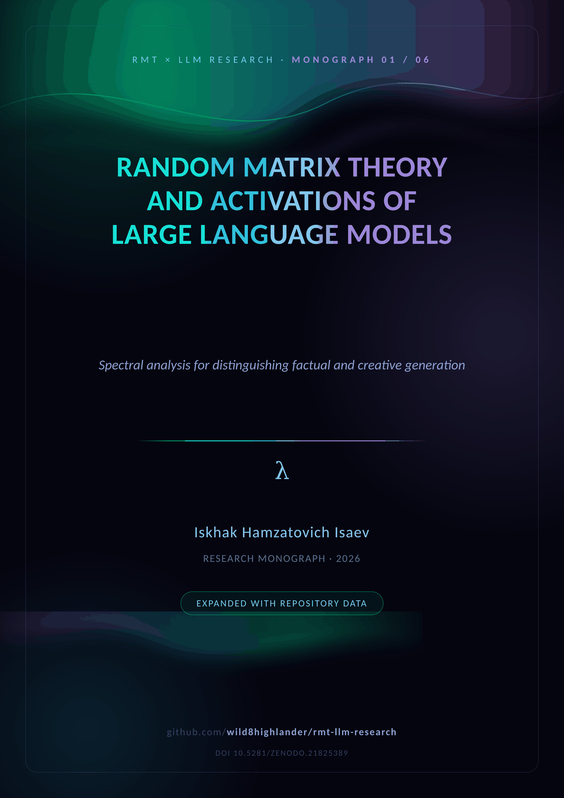
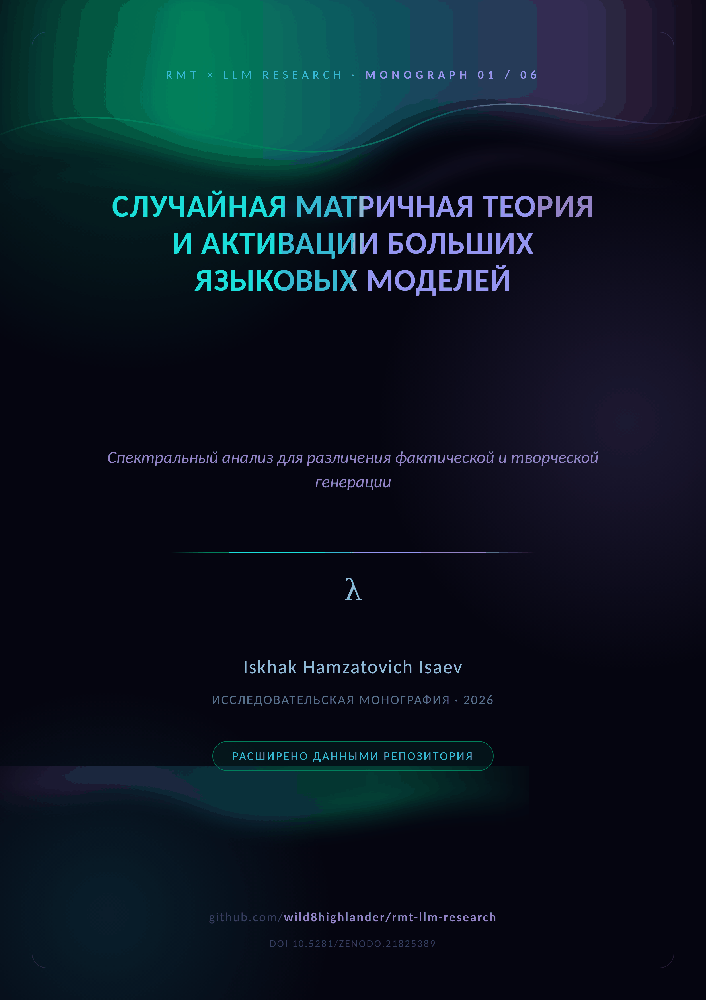

  

# 🧭 M01 · Spectral Analysis

  <em>The foundational monograph — from the Marchenko–Pastur law to the free-energy analogy</em>  
    
  
  

  
  &nbsp;&nbsp;&nbsp;
  

**The foundational monograph of the project.** Eight chapters carry the reader
from the Marchenko–Pastur law through the BBP phase transition and Tracy–Widom
statistics to the free-energy analogy `F = U − TS_spec` and the renormalization-group
flow across transformer layers. Every distribution has an executable
counterpart in `src/rmt_llm/`, and the Aurora supplement makes the pairing explicit.

| Key fact | Where it lives |
|---|---|
| MP bulk edges `λ± = σ²(1 ± 1/√q)` | `marchenko_pastur.mp_bounds` |
| BBP critical spike `θ_c`, outlier `λ_max(θ)` | `bbp_transition.py` |
| Tracy–Widom F₂ with moments | `tracy_widom.py` |
| Spectral entropy → bound/gas modes | `thermodynamics.spectral_entropy` |
| RG flow `rg_flow_lambda` → fixed point | `thermodynamics.py` |

**Aurora supplement (Part II).** Theory → module map for 7 concept families, the
polyglot laboratory (7 languages × en/ru) and the 480-test perimeter, a figure
atlas (MP, entropy, heatmap, dashboard), the measured-results registry, the
notation cross-reference and the reproduction checklist, plus the full
repository map.

---

## 📦 Inside the folder

| File | Content |
|---|---|
| `RMT_LLM_Spectral_Analysis.docx` | the study + Aurora supplement (English) |
| `RMT_LLM_Spectral_Analysis_RU.docx` | the same edition in Russian |
| `cover plates` | [`assets/branding/covers/cover_M01_EN.png`](../../assets/branding/covers/) · `_RU.png` |

**Companions.** The theory base is [M01](../M01_spectral_analysis/) · the pilot
[M02](../M02_arxiv_preprint/) · the campaign [M03](../M03_blackgold_v1/) /
[M04](../M04_blackgold_v2/) · the narrative [M05](../M05_llm_analysis_merged/)
· the closing model [M06](../M06_complex_hallucinations/). The merged PDF
edition: [`papers/LLM_Analysis_Merged.pdf`](../../papers/README.md).

---

  
    <a href="../README.md">← monographs</a> · <a href="README.md">top</a> · <a href="../README.md">↑ parent</a> · <a href="../../README.md">🏠 repository root</a> · <a href="../M02_arxiv_preprint/">🚀 ArXiv Preprint →</a>
  

