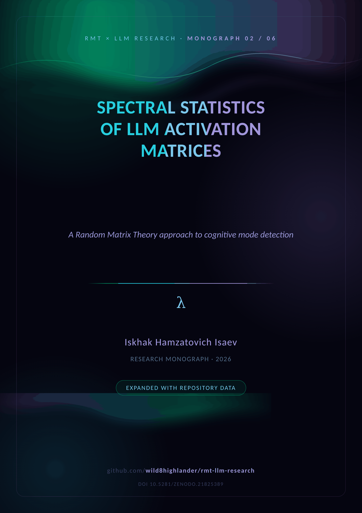
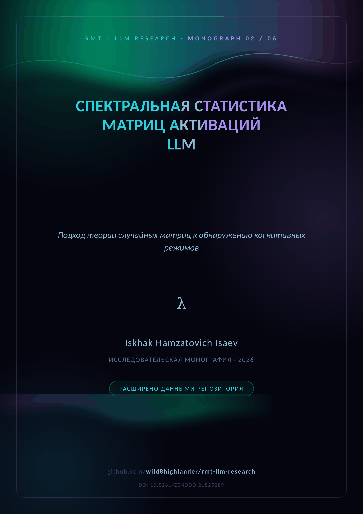

  

# 🚀 M02 · ArXiv Preprint

  <em>The pilot study — spectral statistics of GPT-2 activation matrices</em>  
    
  
  

  
  &nbsp;&nbsp;&nbsp;
  

**The arXiv-style pilot.** GPT-2 small (117M, `N_HIDDEN=768`, `T_SEQ=32`, 12
layers) is probed under factual and creative prompt sets; the nine-experiment
spectral suite is computed layer by layer, then repeated on the real model via
`probe_real_gpt2.py`. The preprint ends with three unexpected findings —
including the absence of a visible BBP spike in the real residual stream and
GOE-like spacing statistics.

| Pilot constant | Value |
|---|---|
| Model | GPT-2 small (117M) |
| Hidden width / sequence | `N_HIDDEN=768` · `T_SEQ=32` |
| Layers analysed | 12 |
| Suite | 9 experiment families |
| Real-model probe | `laboratory/python/lab_en/probe_real_gpt2.py` |

**Aurora supplement (Appendices A–F).** Cell-by-cell Colab → repository
migration table, the metric inventory with exact functions, polyglot ports and
test coverage, a figure atlas (MP, Tracy–Widom, ROC), the measured registry and
the reproduction path.

---

## 📦 Inside the folder

| File | Content |
|---|---|
| `RMT_LLM_Arxiv_Preprint.docx` | the study + Aurora supplement (English) |
| `RMT_LLM_Arxiv_Preprint_RU.docx` | the same edition in Russian |
| `cover plates` | [`assets/branding/covers/cover_M02_EN.png`](../../assets/branding/covers/) · `_RU.png` |

**Companions.** The theory base is [M01](../M01_spectral_analysis/) · the pilot
[M02](../M02_arxiv_preprint/) · the campaign [M03](../M03_blackgold_v1/) /
[M04](../M04_blackgold_v2/) · the narrative [M05](../M05_llm_analysis_merged/)
· the closing model [M06](../M06_complex_hallucinations/). The merged PDF
edition: [`papers/LLM_Analysis_Merged.pdf`](../../papers/README.md).

---

  
    <a href="../M01_spectral_analysis/">← ← 🧭 Spectral Analysis</a> · <a href="README.md">top</a> · <a href="../README.md">↑ parent</a> · <a href="../../README.md">🏠 repository root</a> · <a href="../M03_blackgold_v1/">🥇 BlackGold v1 →</a>
  

