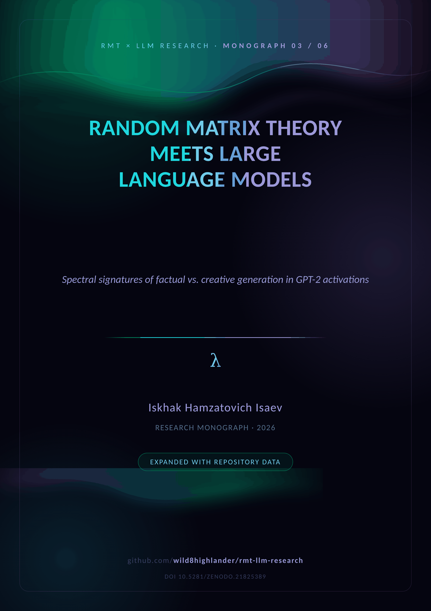
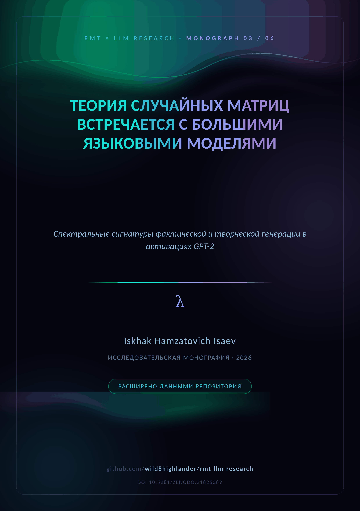

  

# 🥇 M03 · BlackGold v1

  <em>RMT meets large language models — the full experimental campaign, version 1</em>  
    
  
  

  
  &nbsp;&nbsp;&nbsp;
  

**Version 1 of the full preprint.** Beyond the pilot's ground truth, v1 runs
the advanced experiments: the temperature sweep as a spectral phase transition,
cross-layer spectral transfer, IPR profiles across layers, prompt-length
dependence, and the theoretical extensions — free energy, RG flow,
information-theoretic connections and the BBP schematic.

| Advanced experiment | Repository entry |
|---|---|
| Temperature sweep (§5.1) | `run_full_lab.py` — merged `temperature` parameter |
| Cross-layer transfer (§5.2) | `research_3d.py` + `charts_3d.py` |
| IPR across layers (§5.3) | `dyson_brownian.py` eigenvector diagnostics |
| Prompt-length dependence (§5.4) | `corpus_builder_v3.py` |
| Empirical SFF & heatmap (§7) | `circular_ensembles.form_factor`; `gen_charts.py` |

**Repository supplement (Appendices A–F).** Architecture split (mathematical vs
empirical layer), the experiment-to-command map, a figure atlas (Dyson BM, BBP
spike, heatmap, dashboard), the verification registry and the repository map.

---

## 📦 Inside the folder

| File | Content |
|---|---|
| `RMT_LLM_BlackGold_Preprint_v1.docx` | the study + repository supplement (English) |
| `RMT_LLM_BlackGold_Preprint_v1_RU.docx` | the same edition in Russian |
| `cover plates` | [`assets/branding/covers/cover_M03_EN.png`](../../assets/branding/covers/) · `_RU.png` |

**Companions.** The theory base is [M01](../M01_spectral_analysis/) · the pilot
[M02](../M02_arxiv_preprint/) · the campaign [M03](../M03_blackgold_v1/) /
[M04](../M04_blackgold_v2/) · the narrative [M05](../M05_llm_analysis_merged/)
· the closing model [M06](../M06_complex_hallucinations/). The merged PDF
edition: [`papers/LLM_Analysis_Merged.pdf`](../../papers/README.md).

---

  
    <a href="../M02_arxiv_preprint/">← ← 🚀 ArXiv Preprint</a> · <a href="README.md">top</a> · <a href="../README.md">↑ parent</a> · <a href="../../README.md">🏠 repository root</a> · <a href="../M04_blackgold_v2/">🥈 BlackGold v2 →</a>
  

