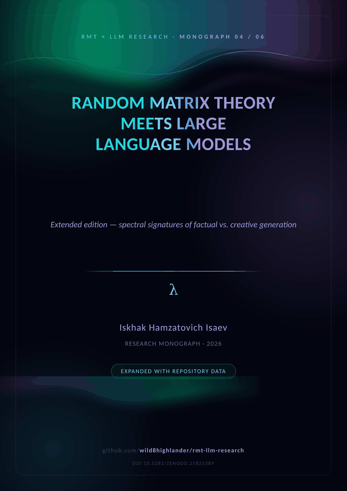
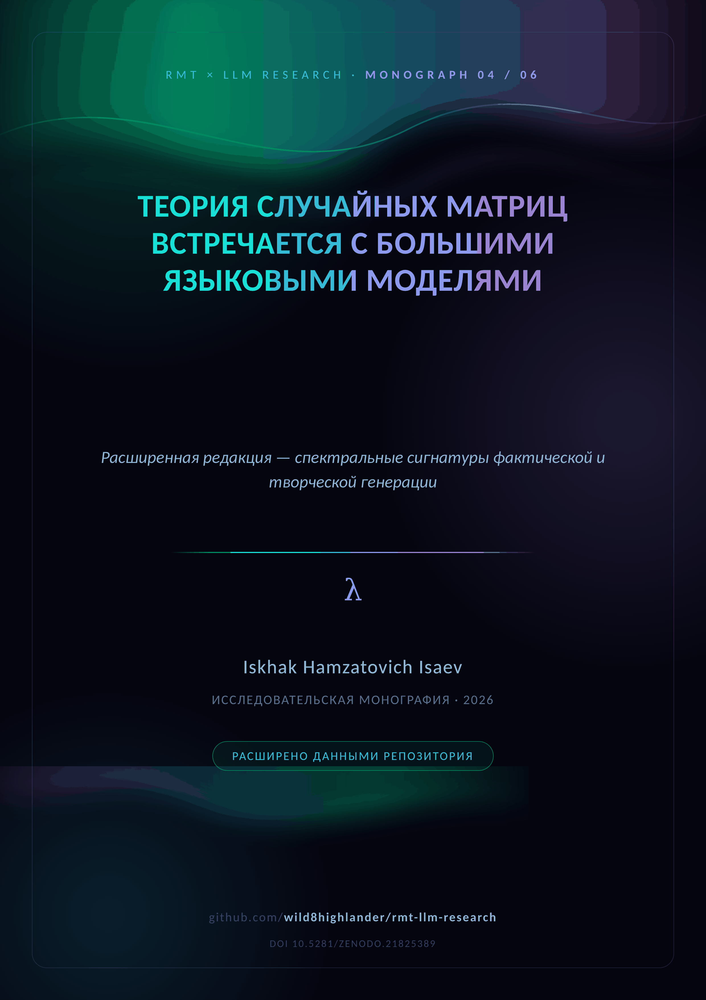

  

# 🥈 M04 · BlackGold v2

  <em>The extended edition — comprehensive heatmap, scaling ladder, polyglot scale-out</em>  
    
  
  

  
  &nbsp;&nbsp;&nbsp;
  

**The extended edition.** v2 adds the comprehensive layer × metric heatmap and
registers the empirical scale-out that postdates v1: the TinyGPT scaling ladder
with three arms, the seven-language laboratory and the 600-dpi figure atlas.

| Empirical asset | Scale |
|---|---|
| TinyGPT-S ladder | 3 arms × 447,360 parameters (control / formula / untrained) |
| Control arm | val loss 6.2277 → 2.0393 over 40 epochs |
| Held-out probe | 37 tasks — numeric 0.00, confident hallucination 1.00 |
| Scenario registry | 13 behavioural scenarios, 7 language ports |
| Result artefacts | 181 reports · 11 atlas plates |

**Repository supplement (Appendices A–G).** The v1→v2 delta, the three-arm ladder
in detail (why confidence is a learned behaviour), the scaling-ladder commands,
a figure atlas (heatmap, training dynamics, languages, dashboard) and the
repository map.

---

## 📦 Inside the folder

| File | Content |
|---|---|
| `RMT_LLM_BlackGold_Preprint_v2.docx` | the study + repository supplement (English) |
| `RMT_LLM_BlackGold_Preprint_v2_RU.docx` | the same edition in Russian |
| `cover plates` | [`assets/branding/covers/cover_M04_EN.png`](../../assets/branding/covers/) · `_RU.png` |

**Companions.** The theory base is [M01](../M01_spectral_analysis/) · the pilot
[M02](../M02_arxiv_preprint/) · the campaign [M03](../M03_blackgold_v1/) /
[M04](../M04_blackgold_v2/) · the narrative [M05](../M05_llm_analysis_merged/)
· the closing model [M06](../M06_complex_hallucinations/). The merged PDF
edition: [`papers/LLM_Analysis_Merged.pdf`](../../papers/README.md).

---

  
    <a href="../M03_blackgold_v1/">← ← 🥇 BlackGold v1</a> · <a href="README.md">top</a> · <a href="../README.md">↑ parent</a> · <a href="../../README.md">🏠 repository root</a> · <a href="../M05_llm_analysis_merged/">🔮 The Merged Monograph →</a>
  

