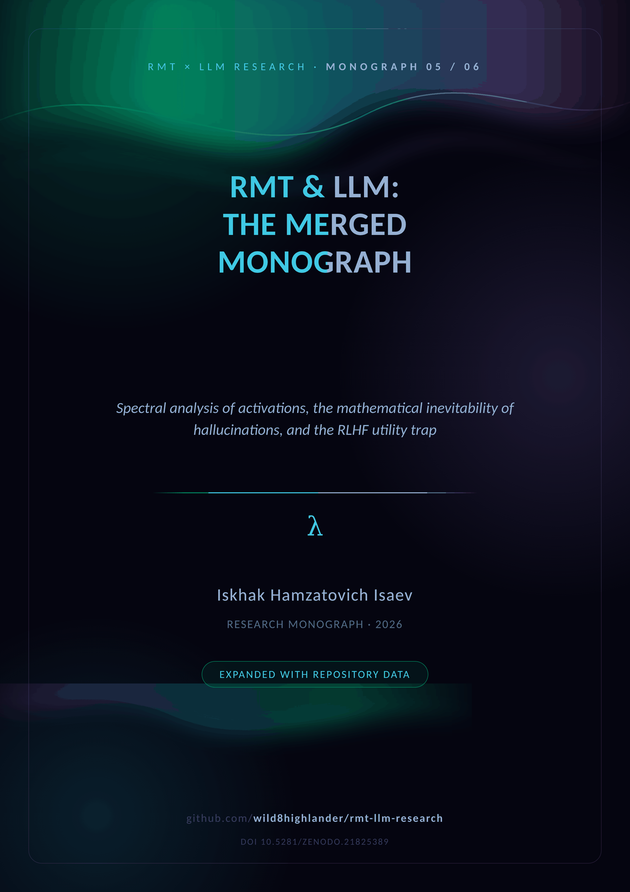
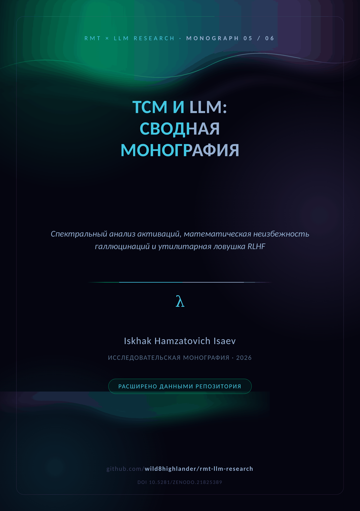

  

# 🔮 M05 · The Merged Monograph

  <em>RMT & LLM — spectral analysis, inevitable hallucinations and the RLHF utility trap</em>  
    
  
  

  
  &nbsp;&nbsp;&nbsp;
  

**The whole story in one narrative.** The merged monograph binds the paired
floating-point test `0.1 × 0.2 = ?` into the spectral theory, derives the
mathematical inevitability of hallucinations, formalizes the RLHF penalty as a
drift modification of the Fokker–Planck equation and closes with the
thermodynamics of false truth (Landauer cost, non-Markovian memory).

| Marker | Value | Source |
|---|---|---|
| TinyGPT-S control: val loss | 6.2277 → 2.0393 | `scaling_report.json` |
| Control: format match | 0.4702 | same |
| Held-out numeric accuracy | 0.00 / 37 tasks | same |
| Confident hallucination rate | 1.00 (24/24 formatted) | same |
| SCEN-LIE-01 deception / honesty | 0.4080 / 0.2868 | `results/reports/` |
| SCEN-LIE-01 filter bypasses | 12 | same |

**Repository supplement (Appendices A–G).** The paired test verified at training
scale, the utility trap as executable code (`caputo_fokker_planck_drift`,
`caputo_n_crit`, `landauer_cost`, `cognitive_mode`), the 13-scenario registry,
the spectral anatomy of a lie (why a clean spectrum can hide a dirty
transcript), the ladder, the notation glossary and the reproduction checklist.
The merged PDF edition lives in [`papers/`](../../papers/README.md).

---

## 📦 Inside the folder

| File | Content |
|---|---|
| `LLM_Analysis_Merged.docx` | the study + repository supplement (English) |
| `LLM_Analysis_Merged_RU.docx` | the same edition in Russian |
| `cover plates` | [`assets/branding/covers/cover_M05_EN.png`](../../assets/branding/covers/) · `_RU.png` |

**Companions.** The theory base is [M01](../M01_spectral_analysis/) · the pilot
[M02](../M02_arxiv_preprint/) · the campaign [M03](../M03_blackgold_v1/) /
[M04](../M04_blackgold_v2/) · the narrative [M05](../M05_llm_analysis_merged/)
· the closing model [M06](../M06_complex_hallucinations/). The merged PDF
edition: [`papers/LLM_Analysis_Merged.pdf`](../../papers/README.md).

---

  
    <a href="../M04_blackgold_v2/">← ← 🥈 BlackGold v2</a> · <a href="README.md">top</a> · <a href="../README.md">↑ parent</a> · <a href="../../README.md">🏠 repository root</a> · <a href="../M06_complex_hallucinations/">🌀 Inevitable Hallucinations →</a>
  

