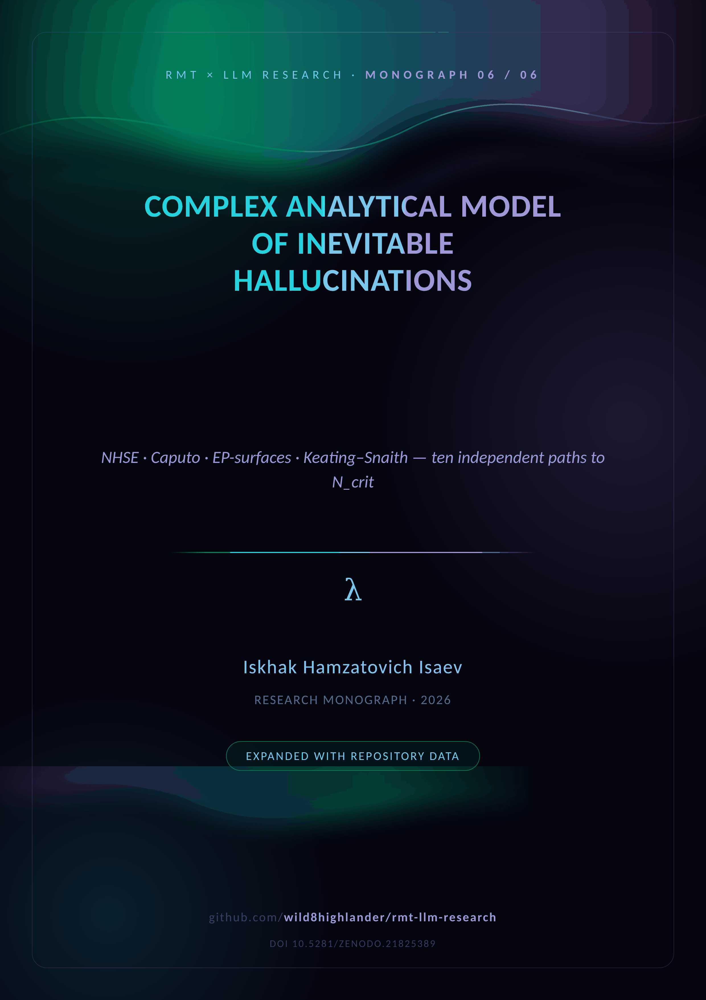
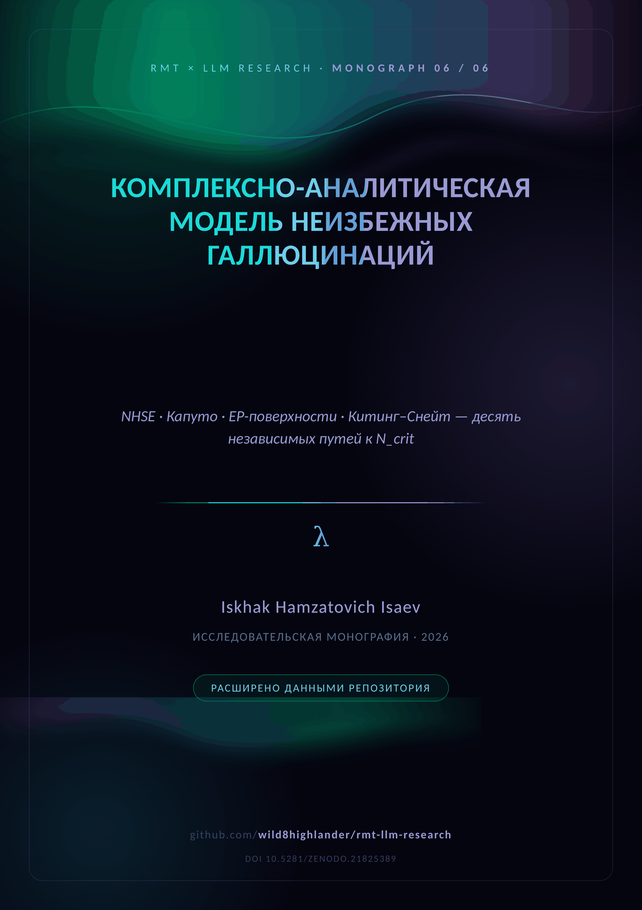

  

# 🌀 M06 · Inevitable Hallucinations

  <em>The complex analytical model — ten independent paths to N_crit</em>  
    
  
  

  
  &nbsp;&nbsp;&nbsp;
  

**The closing theory.** Ten independent paths to `N_crit` — phase, operator,
spectral, thermodynamic, fractional-stochastic, EP-surfaces, Tracy–Widom,
quantum channels, NHSE and Caputo — all converge on the same collapse, and each
is implemented as an independent module that can be falsified without touching
the others.

| Path to N_crit | Module | Executable core |
|---|---|---|
| NHSE winding collapse (§4) | `nhse.py` | `nhse_winding_number`, `nhse_imag_collapse` |
| Caputo Fokker–Planck (§5) | `caputo_fractional.py` | `caputo_mean_collapse_time`, `caputo_n_crit` |
| EP-surfaces (§6) | `ep_surfaces.py` | `ep_sensitivity`, `ep_order_from_separation` |
| Keating–Snaith γ₁(N) (§7) | `keating_snaith.py` | `ks_correction_series`, `ks_zeta_zero_statistics` |
| Tracy–Widom GUE (§8) | `tracy_widom.py` | `tracy_widom_cdf/pdf` |

**Framework constants.** `γ₁ = 14.134725` (first zeta zero), `β = 0.5`
(Caputo memory), `θ_B = 7.07°` — all centralised in
[`src/rmt_llm/constants.py`](../../src/rmt_llm/constants.py), with the full
20-zero census reproduced in the supplement.

**Aurora supplement (Appendices A–G).** The mechanism → module map for all
paths, the exact-constants table, the tabulated zero census, a figure atlas
(circle law, Tracy–Widom, BBP), the exit-code protocol and the reproduction
checklist.

---

## 📦 Inside the folder

| File | Content |
|---|---|
| `Complex_Analytical_Model_Inevitable_Hallucinations.docx` | the study + Aurora supplement (English) |
| `Complex_Analytical_Model_Inevitable_Hallucinations_RU.docx` | the same edition in Russian |
| `cover plates` | [`assets/branding/covers/cover_M06_EN.png`](../../assets/branding/covers/) · `_RU.png` |

**Companions.** The theory base is [M01](../M01_spectral_analysis/) · the pilot
[M02](../M02_arxiv_preprint/) · the campaign [M03](../M03_blackgold_v1/) /
[M04](../M04_blackgold_v2/) · the narrative [M05](../M05_llm_analysis_merged/)
· the closing model [M06](../M06_complex_hallucinations/). The merged PDF
edition: [`papers/LLM_Analysis_Merged.pdf`](../../papers/README.md).

---

  
    <a href="../M05_llm_analysis_merged/">← ← 🔮 The Merged Monograph</a> · <a href="README.md">top</a> · <a href="../README.md">↑ parent</a> · <a href="../../README.md">🏠 repository root</a> · <a href="../../papers/README.md">papers →</a>
  

