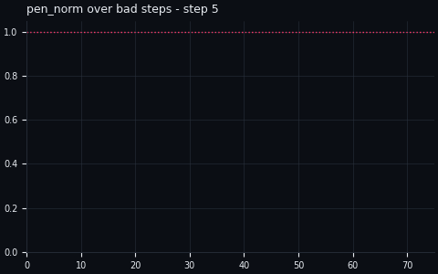
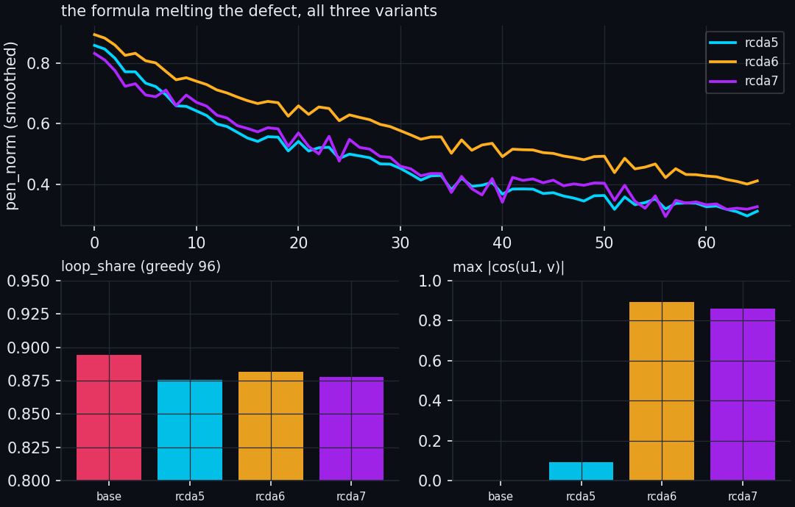

<p align="center">
  
</p>

# 🛠️ Code — the Gemma3 RCDA toolkit (validation layer)

<p align="center">
  
  
  
  <a href="https://github.com/hiyouga/LlamaFactory"></a>
  <a href="../README.md"></a>
</p>

One toolkit, one evaluator, three lever settings. The architecture adapter
in [`rcds_common.py`](rcds_common.py) auto-detects GPT-2 (the CPU
validation stand-in, `openai-community/gpt2`) vs Gemma3
(`google/gemma-3-1b-it` / the ungated mirror `unsloth/gemma-3-1b-it`) —
production runs change **only** the `--model` flag.

> **Where the real-model training lives.** The RCDA-8 round (the real
> Gemma, LlamaFactory 0.9.5, formula arm vs data arm) and the RCDA-9
> formula round (the monograph corpus + the pen re-run) are separate,
> self-contained pipelines:
> [`../LlamaFactory/`](../LlamaFactory/README.md) and
> [`../RCDA-9/`](../R%20-%20CDA%20%E2%80%94%209/README.md). This folder is the validated
> machinery they grew out of.

| Script | What it does |
|--------|--------------|
| [`gemma_probe.py`](gemma_probe.py) | RCDA-1-style probe: greedy continuations, per-layer Δh between looped and unlooped tokens of the same generations, z_diff, matrix scans (λ_v vs λ₊, θ_v vs θ_c), writer selection → `probe_report.json` + `rcds5_vectors.npz` |
| [`marchenko_pastur.py`](marchenko_pastur.py) | the RMT primitives: MP density/CDF, robust σ² fit, BBP spike scan, KS-based spectral-purity gate |
| [`gemma_rcds_train.py`](gemma_rcds_train.py) | **the formula as a loss.** `--variant rcda5\|rcda6\|rcda7`; `L = pen_norm + β·relu(mse − cap)` with `pen = (vᵀh/‖v‖)²` on the writer states (post-residual), per-prompt init normalisation, Adam, 150 steps, mini-bench at 0/75/150; options `--anchor_scope good` and `--refresh_every N` (online self-labelling); writes the training log, the trained state and the fp16 deltas |
| [`gemma_benchmark.py`](gemma_benchmark.py) | the one evaluator: ρ_bad / ρ_good / loop_share / loop_waste (greedy 96, 4-gram threshold 0.5), KL(base‖arm) + PPL on the control corpus, TW per edited tensor, cos(u₁ of ΔW, v) → `partN_eval_{base,trained}.json` |
| [`rcda6_channel_decomposition.py`](rcda6_channel_decomposition.py) | the RCDA-6 diagnostic: attention-write vs MLP-write vs carried v-energy |
| [`rcds_summarise.py`](rcds_summarise.py) | relative TW gate + `summary_all_variants.json` (the canonical summary every table and figure reads) |
| [`gemma_apply_deltas.py`](gemma_apply_deltas.py) | rebuild a trained model from untouched base weights + the shipped fp16 deltas |
| [`diag_prefix_vs_fresh.py`](diag_prefix_vs_fresh.py) | diagnostic: penalty on frozen training prefixes vs the model's own fresh trajectories (prefix-overfitting check) |

## 🎬 What the toolkit produces

| | |
|---|---|
|  |  |
| **the formula melting** — `gemma_rcds_train.py`, all three variants | **the one evaluator** — `gemma_benchmark.py` + `rcds_summarise.py` |

## The standard chain

```bash
python gemma_probe.py --model google/gemma-3-1b-it
python gemma_rcds_train.py --variant rcda5 --model google/gemma-3-1b-it \
    --steps 150 --lr 1e-4 --anchor_scope good --refresh_every 32
python gemma_rcds_train.py --variant rcda6 ... --lr 2e-5   # drift-matched
python gemma_rcds_train.py --variant rcda7 ... --lr 2e-5   # + tight anchor
python gemma_benchmark.py --round 5 --tag base
python gemma_benchmark.py --round 5 --tag trained --state ".../rcda5_trained_state.pt"
python rcds_summarise.py
```

## Prompt sets (`prompts/`)

Bilingual by design (inherited from the sibling kit): the loop defect was
provoked and measured on both languages.

| Set | n | Purpose |
|-----|---|---------|
| `bad.jsonl` | 16 | loop-inducing prefixes (echoes, counting, chains) — the penalty data |
| `good.jsonl` | 16 | natural prompts — the anchor / ability data |
| `control.jsonl` | 6 | prose paragraphs — KL and PPL measurement |

The **real-Gemma protocol sets** (20 bad sentinel-selected `bad_g01…g20`,
20 good, 5 control) live in [`../JSON-Results/`](../JSON%20Results/README.md)
and are frozen into the RCDA-8 round at
[`../LlamaFactory/data/`](../LlamaFactory/README.md) and the RCDA-9 round at
[`../RCDA-9/data/`](../R%20-%20CDA%20%E2%80%94%209/README.md).

## Provenance

The committed artifacts of this folder were produced on the GPT-2 stand-in
(the validation layer, archived in the
[main README](../README.md#-archive--the-gpt-2-stand-in-validation-layer));
`--model google/gemma-3-1b-it` reruns the identical protocol at Gemma
scale. The real-model rounds have their own folders:
[`../Reports-MD/`](../Reports%20MD/README.md) (scientific record),
[`../Scripts/`](../Script%27s/README.md) (working scripts),
[`../LlamaFactory/`](../LlamaFactory/README.md) (the RCDA-8 round),
[`../RCDA-9/`](../R%20-%20CDA%20%E2%80%94%209/README.md) (the formula round).

---

<p align="center">
  <sub><a href="../README.md">← kit root</a> ·
  <a href="../RCDA-5/README.md">RCDA-5 →</a> ·
  <a href="../RCDA-9/README.md">the formula round →</a></sub>
</p>
