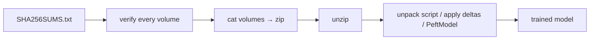

  

# 📦 Docs — unpacking and archives

  
  
  
  

Everything about turning the shipped archives back into a working model.

| Document | Contents |
|----------|----------|
| [`UNPACK_MODEL.md`](UNPACK_MODEL.md) | the intervention archive (`Model-ZIP/gemma3-rcds-interventions.zip`): verify → unpack → apply the deltas; plus the split-volume procedure for a full-model archive under the GitHub 100 MB rule |

## The four ways this kit ships a trained model

| Artifact | Folder | What it is | How to apply |
|----------|--------|------------|--------------|
| fp16 deltas (validation layer) | [`../Model-ZIP/`](../Model%20ZIP/README.md) | `W′ − W` of the three RCDA variants + the v-directions, 35.6 MB | `Code/gemma_apply_deltas.py` |
| full fine-tuned model | [`../Model-Z/`](../Model%20%E2%80%94%20Z/README.md) | the RCDA-5 SGD arm, base + trained o_proj L10–12, 1.59 GB in 17 self-assembling volumes | `cat` + `unzip` + the unpack script |
| LoRA adapters (RCDA-8) | [`../LlamaFactory/adapters/`](../LlamaFactory/adapters/) | peft adapters of the RCDA-8 formula arm and the SFT data arm | `PeftModel.from_pretrained(base, path)` |
| LoRA adapters (RCDA-9) | [`../RCDA-9/results/`](../R%20-%20CDA%20%E2%80%94%208/results) | the formula-corpus arm (10/12 repaired) + the pen re-run | `PeftModel.from_pretrained(base, path)` |

---

  <a href="../README.md">← kit root</a> ·
  <a href="UNPACK_MODEL.md">the unpack guide →</a> ·
  <a href="../Model-Z/README.md">the model archive →</a>

