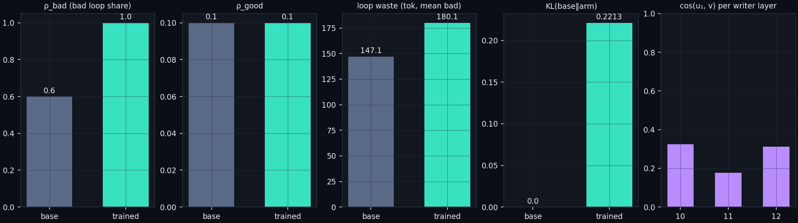
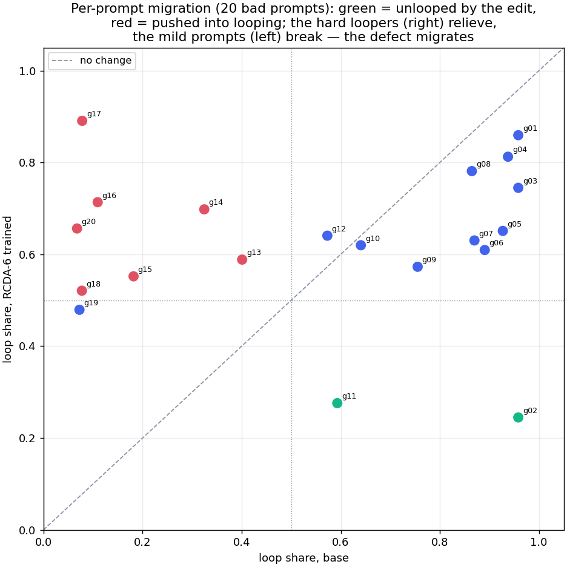
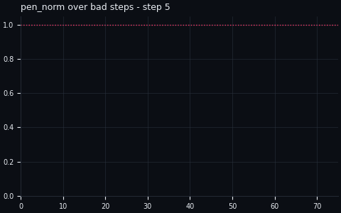
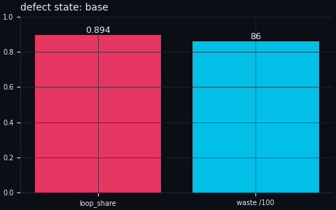

<p align="center">
  
</p>

# 📊 Graphics — the real-Gemma round figures

<p align="center">
  
  
  
  <a href="../LlamaFactory/figures/"></a>
  <a href="../README.md"></a>
</p>

The rendered record of the real-model rounds — every figure is drawn from
the committed JSONs of [`../JSON-Results/`](../JSON-Results/README.md)
by the `rcda*_figures.py` renderers of [`../Scripts/`](../Scripts/README.md).
Project palette: near-black field, cyan MP bulk, amber BBP spike, violet
structure, crimson defect.

## 🎨 The two figures that tell the story

| | |
|---|---|
|  |  |
| **the honest negative** — RCDA-5 on the real model: the formula trains, the loops worsen | **the migration** — RCDA-6: hard-12 improves while mild-8 breaks |

## The catalogue

| File | What it shows |
|------|---------------|
| [`figG1_probe_layers.png`](figG1_probe_layers.png) | per-layer z_diff of the real-model probe — the writer band L10–12 (RCDA-5) |
| [`figG2_spectral_purity.png`](figG2_spectral_purity.png) | TW spectral control of the RCDA-5 edit — violation ×3, structured bulk |
| [`figG3_gemma_eval.png`](figG3_gemma_eval.png) | the RCDA-5 arms vs base: ρ_bad, loop_share, waste — the honest negative |
| [`fig15_gemma_training.png`](fig15_gemma_training.png) | training dynamics: pen_norm and anchor MSE over 150 steps |
| [`figC1_probe_phase.png`](figC1_probe_phase.png) | the phase probe: early vs deep separability per layer |
| [`figC2_band.png`](figC2_band.png) | the RCDA-6 writer band (o_proj + down_proj, L8–L15) |
| [`figC3_training.png`](figC3_training.png) | RCDA-6 phase-matched penalty descent |
| [`figC4_eval_arms.png`](figC4_eval_arms.png) | RCDA-6 arm vs base vs RCDA-5 — the first partial repair |
| [`figC5_migration.png`](figC5_migration.png) | **the migration figure**: hard-12 improves while mild-8 breaks |
| `*_v5.png` / `*_v6.png` | the per-round generations of the same figures (RCDA-5 / RCDA-6 captures) |

The successor galleries — the RCDA-8 LlamaFactory round (formula arm vs
data arm, 9 figures + 6 animations from the real model) and the RCDA-9
formula round (10 figures + 6 animations, including the formula-QA axis) —
live at [`../LlamaFactory/figures/`](../LlamaFactory/README.md) and
[`../RCDA-9/figures/`](../RCDA-9/README.md).

---

<p align="center">
  <sub><a href="../Graphic/README.md">← the validation gallery</a> ·
  <a href="../README.md">kit root</a> ·
  <a href="../LlamaFactory/figures/">the RCDA-8 gallery →</a> ·
  <a href="../RCDA-9/figures/">the RCDA-9 gallery →</a></sub>
</p>


<p align="center">
  
</p>

# 🎨 Graphic — the validation-layer gallery

<p align="center">
  
  
  
  
  <a href="../README.md"></a>
</p>

Every image in this folder is rendered from the committed result JSONs by
[`make_graphic.py`](make_graphic.py) — the same rule as the rest of the
repository: **nothing is hand-typed**. These are the **validation-layer**
figures (GPT-2 stand-in): they prove the mechanics of the pipeline. The
real-model figures live in [`../Graphics/`](../Graphics/README.md),
[`../LlamaFactory/figures/`](../LlamaFactory/README.md) and
[`../RCDA-9/figures/`](../RCDA-9/README.md).

## 🎬 The animations

| | |
|---|---|
|  |  |
| **the penalty melting** — all three variants under their anchors | **the defect melting** — loop_share and waste across the arms |

## The figures

| File | What it shows |
|------|---------------|
| [`fig05_probe_zdiff_profile.png`](fig05_probe_zdiff_profile.png) | per-layer z_diff; writers L6/7/8 (stand-in) in crimson; θ_v vs θ_c overlay |
| [`fig06_matrix_scan.png`](fig06_matrix_scan.png) | λ_v/λ₊ per o_proj — the distributed-defect verdict |
| [`fig07_channel_decomposition.png`](fig07_channel_decomposition.png) | carried vs MLP-write vs attention-write v-energy (log scale) |
| [`fig08_training_pen_descent.png`](fig08_training_pen_descent.png) | pen_norm over 150 steps, all variants, smoothed + raw |
| [`fig09_rho_mini_melt.png`](fig09_rho_mini_melt.png) | mini-benchmark loop_share trajectories |
| [`fig10_headline_defect.png`](fig10_headline_defect.png) | loop_share / waste / ρ_bad across the four arms |
| [`fig11_abilities_preserved.png`](fig11_abilities_preserved.png) | KL, PPL and penalty-descent bars |
| [`fig12_cosine_alignment.png`](fig12_cosine_alignment.png) | cos(u₁ of the edit, v) per variant per tensor |
| [`fig13_spectral_purity.png`](fig13_spectral_purity.png) | relative spectral gate: bulk KS of edited vs base matrices |
| [`fig14_leverage_chart.png`](fig14_leverage_chart.png) | descent % vs KL — the efficiency frontier of the three levers |
| [`fig15_ppl_parity.png`](fig15_ppl_parity.png) | PPL parity, per control text and mean |
| [`fig16_overview_dashboard.png`](fig16_overview_dashboard.png) | the one-glance dashboard |

Regenerate everything:

```bash
python Graphic/make_graphic.py     # reads only the committed JSONs
```

---

<p align="center">
  <sub><a href="../README.md">← kit root</a> ·
  <a href="../Graphics/README.md">the real-Gemma gallery →</a> ·
  <a href="../RCDA-9/figures/gif03_loop_melt.gif">the RCDA-9 loop melt →</a></sub>
</p>
