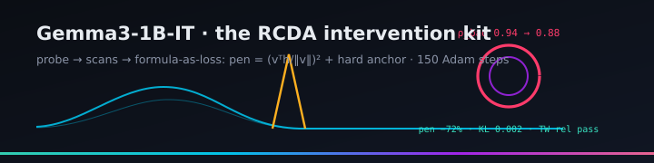
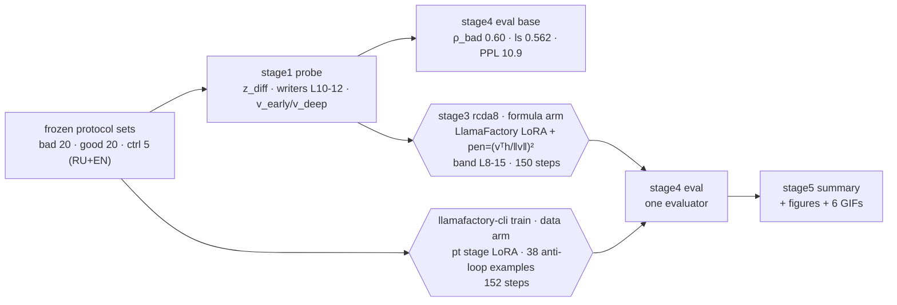

<p align="center">
  
</p>

# 🤖 LlamaFactory — the RCDA-8 round: formula vs data, on the real model

<p align="center">
  <a href="https://github.com/hiyouga/LlamaFactory"></a>
  
  
  
  
  
  
  <a href="../RCDA-9/README.md"></a>
  <a href="../README.md"></a>
</p>

> **The round that finally trained the real thing.** No GPT-2 stand-in, no
> pre-registered expectations: [`unsloth/gemma-3-1b-it`](https://huggingface.co/unsloth/gemma-3-1b-it)
> (the public mirror of the kit's patient, snapshot-pinned to the same
> weights as the RCDA-5/6 real-Gemma runs), trained end-to-end through
> [LlamaFactory](https://github.com/hiyouga/LlamaFactory) on a CPU-only
> box — the repository's formula `pen = (vᵀh/‖v‖)²` as a LoRA-fine-tuned
> **formula arm**, versus a stock-LlamaFactory **data arm** on curated
> anti-loop targets. One frozen evaluator decides. Its successor — the
> RCDA-9 formula round that teaches the monograph corpus and re-runs the
> pen arm, plus the 72-check audit of this round — lives in
> [`../RCDA-9/`](../RCDA-9/README.md) and [`../audit/`](../audit/README.md).

---

## ⌛ The round in 60 seconds

1. **The probe replicates.** Stage 1 reproduces the real-Gemma probe
   **exactly**: writers **L10/L11/L12**, z_diff **212.6 / 219.8 / 205.1**,
   ρ_bad(base) **0.60**, mean loop_share **0.562** — the same numbers as
   the RCDA-5 report, from the same snapshot. The pipeline is a faithful
   port, and the historical numbers are genuine.
2. **The formula arm finally repairs hard loopers.** RCDA-8 = the RCDA-6
   recipe (phase-matched `(v̂ᵀh)²` over the o_proj+down_proj band L8–L15,
   hard abilities anchor) re-implemented as a **band-masked LoRA**
   (r=16, 1.31 M params — 56× fewer than RCDA-6) on LlamaFactory's
   `CustomSeq2SeqTrainer`. Penalty melts **−97.9 %**; mini-bench
   loop_share **0.921 → 0.529**; **3 of 12** hard loopers fully repaired —
   the first formula-arm repairs on this model.
3. **…but the defect migrates again.** ρ_bad 0.60 → 0.70, mild-8
   0.164 → 0.691 — the same migration signature as RCDA-6, now through a
   low-rank edit. Three geometries, one invariant: the loop is a property
   of the computation, not of a direction.
4. **The data arm wins every axis.** Stock `llamafactory-cli train`
   (pt stage, LoRA r=8, 38 examples, 152 steps): ρ_bad **0.40**,
   **5/12 repaired**, no migration (mild-8 **0.097**), KL **0.12**, and
   PPL **10.9 → 8.6 (−21 %)** — self-distilled clean data even improves
   the control corpus. Teaching beats projecting.

| Symbol | Value | Meaning | Source |
|--------|-------|---------|--------|
| probe replication | z_diff **212.6 / 219.8 / 205.1** | writers L10/11/12, identical to RCDA-5 report | [`probe_report.json`](results/probe/probe_report.json) |
| ρ_bad (base → formula) | 0.60 → 0.70 | hard subset improves, mild subset migrates | [`part8_eval_rcda8.json`](results/part8_eval_rcda8.json) |
| ρ_bad (base → data) | 0.60 → **0.40** | the defect shrinks outright | [`part8_eval_sft.json`](results/part8_eval_sft.json) |
| pen descent (formula) | **−97.9 %** | the formula as a loss, 150 LoRA steps | [`training_log.json`](results/rcda8_arm/training_log.json) |
| mini-bench melt | 0.921 → **0.529** | hardest 8 prompts, greedy 192 | same |
| hard-12 loop share | 0.827 → 0.632 / **0.590** | formula / data | part8 evals |
| fully repaired | 3/12 / **5/12** | first formula-arm repairs on real Gemma | part8 evals |
| KL(base‖arm) | 0.512 / **0.120** | the price each arm pays | part8 evals |
| PPL control | 10.9 → 12.0 / **8.6** | data arm gains −21 % (self-distill) | part8 evals |
| trainable params | 1.31 M (0.13 %) / 6.9 M | band-masked LoRA / all-linear LoRA | training logs |

---

## 🧬 The pipeline



---

## 🎨 The gallery

| Figure / animation | What it shows |
|--------------------|---------------|
| [`fig01`](figures/fig01_probe_zdiff.png) | the behavioral probe on the real model — writers L10/11/12, band L8–L15 |
| [`fig02`](figures/fig02_phase_probe.png) | phase-conditioned directions: early vs deep separability, cos(v_e, v_d) |
| [`fig03`](figures/fig03_arms_defect.png) | ρ_bad / loop_share / waste across the three arms |
| [`fig04`](figures/fig04_abilities.png) | KL and PPL — drift vs the self-distill gain |
| [`fig05`](figures/fig05_pen_descent.png) | the formula melting (−97.9 %) and the anchor riding under the cap |
| [`fig06`](figures/fig06_forensics.png) | the LoRA edit per tensor: rel-Frobenius, cos(u₁, v_deep) |
| [`fig07`](figures/fig07_repair_matrix.png) | per-prompt loop_share heatmap — repaired rows go dark |
| [`fig08`](figures/fig08_dashboard.png) | the one-glance dashboard of the round |
| [`fig09`](figures/fig09_sft_loss.png) | the data arm's training loss (LlamaFactory) |
| [`gif01`](figures/gif01_pen_descent.gif) | animated penalty descent + anchor MSE |
| [`gif02`](figures/gif02_bench_melt.gif) | mini-bench bars melting step 0 → 150 |
| [`gif03`](figures/gif03_loop_melt.gif) | per-prompt loop_share: base → formula → data |
| [`gif04`](figures/gif04_zdiff_reveal.gif) | the z_diff profile revealing the writers |
| [`gif05`](figures/gif05_arms_dashboard.gif) | the arms dashboard, panel by panel |
| [`gif06`](figures/gif06_waste_melt.gif) | wasted tokens per prompt, melting across arms |

Everything is rebuilt from the committed JSONs by
[`scripts/make_figures.py`](scripts/make_figures.py) — nothing hand-typed.

---

## 🗂️ Folder map

| Folder | What lives there |
|--------|------------------|
| [`data/`](data) | the frozen protocol sets + the anti-loop SFT dataset + `dataset_info.json` |
| [`configs/`](configs) | LlamaFactory YAMLs: the CPU validation run and the full GPU recipe |
| [`scripts/`](scripts) | the resumable pipeline: probe → arms → evaluator → summary → figures |
| [`results/`](results) | every JSON this round's tables read + per-prompt generations |
| [`adapters/`](adapters) | the two trained LoRA adapters (formula / data), peft-loadable |
| [`RCDA8_REPORT.md`](RCDA8_REPORT.md) | **the full scientific report** of the round |

---

## ⚡ Reproduce

```bash
# 0) the stack (CPU is enough — 2 cores / 4 GB ran this round)
pip install torch --index-url https://download.pytorch.org/whl/cpu
pip install "llamafactory==0.9.5" transformers peft accelerate datasets

# 1) the whole round, one resumable command (~75 min on 2 cores)
python3 LlamaFactory/scripts/pipeline.py

# 2) or arm by arm — see RCDA8_REPORT.md §6 for the full command list

# 3) full-scale GPU replication (>= 16 GB VRAM)
llamafactory-cli train LlamaFactory/configs/sft_antiloop_gpu.yaml
python3 LlamaFactory/scripts/stage3_rcda8_train.py --steps 600 --lr 3e-4
```

The adapters apply directly to any copy of the base checkpoint:

```python
from peft import PeftModel
model = PeftModel.from_pretrained(base_model, "LlamaFactory/adapters/rcda8_formula")
```

---

## 🔐 Provenance & integrity

- **What ran.** Every number in this folder was produced on the real
  `unsloth/gemma-3-1b-it` @ snapshot `5b11413a…` (the same weights as the
  RCDA-5/6 real-Gemma rounds — their `probe_report.json` pins the same
  hash), on a **CPU-only validation box: 2 cores, 4 GB RAM, no GPU**.
  LlamaFactory 0.9.5 is the training framework of both arms; the RCDA-8
  loss rides on its `CustomSeq2SeqTrainer` via a documented subclass.
- **Budget honesty.** 150/152 training steps, 20-prompt suite, LoRA
  ranks 16/8. This is a budget run, sized to the box — the GPU configs
  for the full-scale replication ship next to it. Effect sizes may grow;
  the *sign* of each finding (replication, migration, data>formula,
  TW-dirty edits, cos ≤ 0.44) is the round's claim.
- **Every number is a field of a committed JSON** under `results/` — no
  figure or table is hand-typed.
- **The user-facing note about LlamaFactory**: the framework is
  self-hosted; its demo site only builds configs. Training ran here, on
  this box, through the framework's CLI and trainer classes.

<p align="center">
  
</p>

<p align="center">
  <br>
  <sub><a href="../README.md">← Gemma3-1B-IT kit</a> ·
  <a href="RCDA8_REPORT.md">the full RCDA-8 report →</a> ·
  <a href="../RCDA-9/README.md">the RCDA-9 formula round →</a> ·
  <a href="../audit/README.md">the RCDA-8 audit →</a> ·
  <a href="../../README.md">🏠 repository root</a></sub>
</p>
