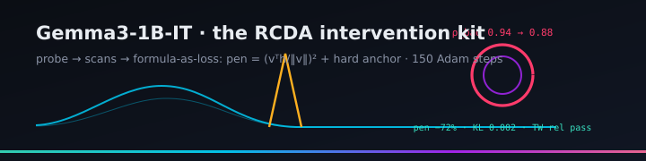
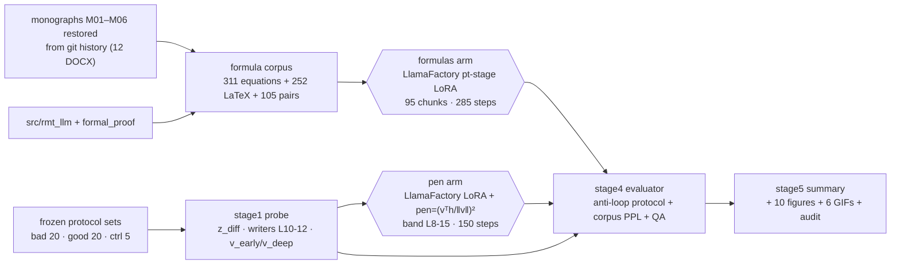

<p align="center">
  
</p>

# 🧪 RCDA-9 — the formula round: every monograph formula, taught to the real model

<p align="center">
  <a href="https://github.com/hiyouga/LlamaFactory"></a>
  
  
  
  
  
  
  <a href="../README.md"></a>
</p>

> **The round that taught the model its own theory.** The twelve monograph
> DOCX editions (M01–M06, EN+RU) were **restored from the git history**
> (they were deleted when `monographs/` moved to `docs/monographs/`), every
> formula was extracted in the rhythm it is written — 311 numbered equations
> and formula lines, 252 LaTeX theorems of the formal proof, the 12 executable
> modules of `src/rmt_llm` with 105 computational pairs from the library
> itself — and the real
> [`unsloth/gemma-3-1b-it`](https://huggingface.co/unsloth/gemma-3-1b-it)
> @ snapshot `5b11413a…` was trained on the corpus through
> [LlamaFactory](https://github.com/hiyouga/LlamaFactory), while the
> repository's spectral formula `pen = (vᵀh/‖v‖)²` was re-trained as a loss.
> One frozen evaluator, plus two new formula-knowledge axes. Everything real,
> everything committed, one honest audit of the predecessor round included.

---

## ⌛ The round in 60 seconds

1. **The probe replicates exactly.** Stage 1 re-run on the same pinned
   snapshot lands on the same numbers as the committed RCDA-8 probe —
   writers **L10/L11/L12**, z_diff **212.595 / 219.827 / 205.125**, ρ_bad
   **0.60**, mean loop_share **0.562**, band **L6–L16**. The historical
   numbers are genuine.
2. **The formula corpus is the strongest anti-loop intervention measured on
   this model so far.** LoRA SFT (r=8, all-linear, 285 steps) on the 95-chunk
   monograph formula corpus: ρ_bad **0.60 → 0.10**, **10 of 12** hard loopers
   fully repaired, no migration (mild-8 **0.164 → 0.096**, cleaner than
   base), waste 103 → **37 tok** — at the smallest abilities price ever
   measured on this protocol (KL **0.079**, PPL 10.9 → **10.6**).
3. **The corpus teaches the form, not the arithmetic.** Held-out corpus PPL
   (monograph M06 + formal proof ch.11–12, never trained on) melts
   **369.2 → 99.7 (−73 %)**, but exact numeric QA on a third parameter grid
   **drops** (9/57 → 4/57): the model learns to speak the formula language,
   not to compute the formulas.
4. **The pen arm replicates qualitatively, not quantitatively.** The formula
   as a loss melts **−97.2 %** (RCDA-8: −97.9 %), the edit is TW-dirty
   **16/16** with cos(u₁, v_deep) ≤ **0.431**, and the defect **migrates**
   (mild-8 0.164 → 0.725) — but the repair count (1/12 vs 3/12), ρ_bad
   (0.80 vs 0.70) and the mini-bench endpoint (0.794 vs 0.529) all differ:
   budget-run effect sizes are not stable across runs. The *signs* are the
   claim, not the digits.

| Symbol | Value | Meaning | Source |
|--------|-------|---------|--------|
| probe replication | z_diff **212.6 / 219.8 / 205.1** | writers L10/11/12, identical to RCDA-8 | [`probe_report.json`](../JSON%20Results/probe_report.json) |
| ρ_bad (base → formulas) | 0.60 → **0.10** | the defect collapses outright | [`part9_eval_formulas.json`](../R%20-%20CDA%20%E2%80%94%208/results/part9_eval_formulas.json) |
| ρ_bad (base → pen) | 0.60 → 0.80 | the defect migrates again | [`part9_eval_pen.json`](../R%20-%20CDA%20%E2%80%94%208/results/part9_eval_pen.json) |
| fully repaired | **10/12** / 1/12 | formulas / pen | part9 evals |
| mild-8 loop share | 0.164 → **0.096** / 0.725 | no migration / migration | part9 evals |
| KL(base‖arm) | **0.079** / 0.421 | the price each arm pays | part9 evals |
| PPL control | 10.9 → **10.6** / 11.4 | abilities preserved / drifted | part9 evals |
| corpus val PPL | 369.2 → **99.7** / 447.1 | held-out formula blocks | part9 evals |
| QA exact (held-out grid) | 9 → **4** / 0 of 57 | form learned, arithmetic not | part9 evals |
| pen descent | **−97.2 %** | the formula as a loss, 150 steps | [`training_log.json`](../JSON%20Results/training_log.json) |
| trainable params | 6.52 M / 1.31 M | all-linear LoRA / band-masked LoRA | training logs |
| RCDA-8 audit | **70/72 PASS · 1 FAIL** | rel-Frobenius claim understated ~3× | [`../audit/`](../audit/README.md) |

---

## 🧬 The pipeline



---

## 🎬 The animation wall

| | |
|---|---|
|  |  |
| **the formula melting** — pen_norm −97.2 %, anchor under the cap | **the budget honestly shown** — the mini-bench is non-monotonic this run |
|  |  |
| **per-prompt melt** — base → formulas → pen, ten rows go dark | **the waste melting** — loop tokens of 192, per prompt |
|  |  |
| **the writers lighting up** — L10/11/12 in crimson | **the arms dashboard** — the round at one glance |

---

## 🎨 The gallery

| Figure | What it shows |
|--------|---------------|
| [`fig01`](../R%20-%20CDA%20%E2%80%94%208/figures/fig01_probe_zdiff.png) | the behavioral probe re-run — writers L10/11/12, band L6–L16 |
| [`fig02`](../R%20-%20CDA%20%E2%80%94%208/figures/fig02_phase_probe.png) | phase directions: cos(v_e, v_d) per layer, band highlighted |
| [`fig03`](../R%20-%20CDA%20%E2%80%94%208/figures/fig03_arms_defect.png) | ρ_bad / loop_share / waste across the three arms |
| [`fig04`](../R%20-%20CDA%20%E2%80%94%208/figures/fig04_abilities.png) | KL, PPL and the formula-knowledge axes |
| [`fig05`](../R%20-%20CDA%20%E2%80%94%208/figures/fig05_pen_descent.png) | the formula melting (−97.2 %) and the anchor under its cap |
| [`fig06`](../R%20-%20CDA%20%E2%80%94%208/figures/fig06_forensics.png) | the pen-arm edit per band tensor: rel-Frobenius, cos(u₁, v_deep) |
| [`fig07`](../R%20-%20CDA%20%E2%80%94%208/figures/fig07_repair_matrix.png) | per-prompt loop_share heatmap — 10 repaired rows go dark |
| [`fig08`](../R%20-%20CDA%20%E2%80%94%208/figures/fig08_dashboard.png) | the one-glance dashboard of the round |
| [`fig09`](../R%20-%20CDA%20%E2%80%94%208/figures/fig09_sft_loss.png) | the formulas arm's LlamaFactory training loss |
| [`fig10`](../R%20-%20CDA%20%E2%80%94%208/figures/fig10_formula_qa.png) | formula QA: exact vs partial matches per arm |

Everything is rebuilt from the committed JSONs by
[`scripts/make_figures.py`](../R%20-%20CDA%20%E2%80%94%208/scripts/make_figures.py) — nothing hand-typed.

---

## 🗂️ Folder map

| Path | What lives there |
|------|------------------|
| [`RCDA9_REPORT.md`](RCDA9_REPORT.md) | **the full scientific report** of the round |
| [`MONOGRAPH_RESTORE_NOTES.md`](MONOGRAPH_RESTORE_NOTES.md) | how the twelve DOCX editions were recovered from git history (blob SHAs) |
| [`data/`](../R%20-%20CDA%20%E2%80%94%208/data) | the frozen protocol sets, the formula corpus (train/val/QA), `dataset_info.json`, the corpus manifest |
| [`configs/`](../R%20-%20CDA%20%E2%80%94%208/configs) | LlamaFactory YAMLs: the CPU validation run and the full GPU recipe |
| [`scripts/`](../R%20-%20CDA%20%E2%80%94%208/scripts) | the resumable pipeline: probe → corpus → arms → evaluator → summary → figures |
| [`results/`](../R%20-%20CDA%20%E2%80%94%208/results) | every JSON this round's tables read + per-prompt generations + both LoRA adapters |
| [`figures/`](../R%20-%20CDA%20%E2%80%94%208/figures) | 10 static figures + 6 animations, all rebuilt from the JSONs |
| [`../audit/`](../audit/README.md) | the static audit of the RCDA-8 round (70/72 PASS, 1 FAIL documented) |

---

## ⚡ Reproduce

```bash
# 0) the stack (CPU is enough — 2 cores / 4 GB ran this round)
pip install torch --index-url https://download.pytorch.org/whl/cpu
pip install "llamafactory==0.9.5" transformers peft accelerate datasets
#    (torchvision/torchaudio from the same CPU index if ABI conflicts arise)

# 1) the whole round, resumable (the orchestrator survives killed processes)
python3 scripts/pipeline.py

# 2) or stage by stage — see RCDA9_REPORT.md §9 for the full command list

# 3) full-scale GPU replication (>= 16 GB VRAM)
llamafactory-cli train configs/sft_formula_gpu.yaml
python3 scripts/stage3_pen_train.py --steps 600 --lr 3e-4
```

The adapters apply directly to any copy of the base checkpoint:

```python
from peft import PeftModel

model = PeftModel.from_pretrained(base_model, "results/formulas_arm/gemma3_formula_lora")
```

---

## 🔐 Provenance & integrity

- **What ran.** Every number in this folder was produced on the real
  `unsloth/gemma-3-1b-it` @ snapshot `5b11413a…` (the same weights as the
  RCDA-5/6/8 rounds), on a **CPU-only validation box: 2 cores, 4 GB RAM,
  no GPU**, torch 2.15.0+cpu, transformers 5.6.0, LlamaFactory 0.9.5,
  peft 0.18.1.
- **The corpus is real.** The 12 monograph DOCX files were recovered from
  the repository's own git history (they were dropped from the tree when
  `monographs/` was reorganized into `docs/monographs/`; only the READMEs
  were moved). Formulas were extracted verbatim — numbered equations with
  one line of context, LaTeX theorems, module docstrings and the library's
  own computed pairs. Two honest notes live in
  [`data/corpus_manifest.json`](../R%20-%20CDA%20%E2%80%94%208/data/corpus_manifest.json): the tinygpt
  RULES table mislabeled E[F1] as E[F2] (fixed here against the code), and
  the RU editions of M03/M04 carry machine-translation damage (formulas
  taken from the EN editions for those two).
- **Budget honesty.** 285/150 training steps, 20-prompt suite, LoRA ranks
  8/16. Effect sizes at CPU budget are not run-stable — the pen arm of this
  round differs from RCDA-8's committed run in magnitude (1/12 vs 3/12
  repairs) while replicating every qualitative signature. The *sign* of
  each finding is the claim.
- **Every number is a field of a committed JSON** under `results/` — no
  figure or table is hand-typed. The one discrepancy found in the
  predecessor round (RCDA-8 §4.3 claims rel-Frobenius 0.4–1.5 %, its own
  JSON says 1.35–4.14 %) is documented in the audit, not repeated here.

---

<p align="center">
  
</p>

<p align="center">
  <br>
  <sub><a href="../README.md">← kit root</a> ·
  <a href="RCDA9_REPORT.md">the RCDA-9 report →</a> ·
  <a href="../LlamaFactory/README.md">the RCDA-8 round →</a> ·
  <a href="../audit/README.md">the RCDA-8 audit →</a></sub>
</p>
