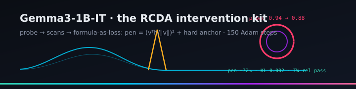
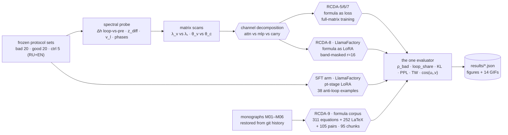
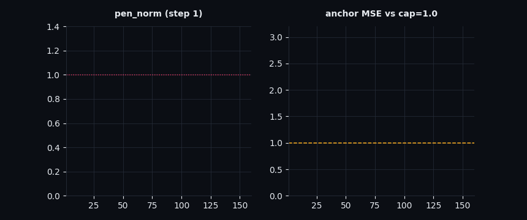
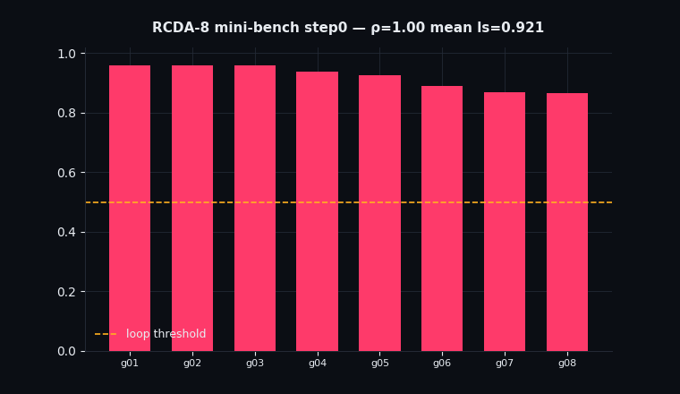
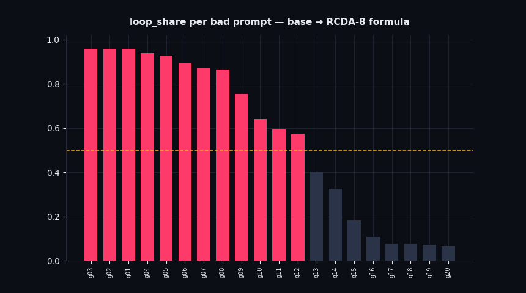
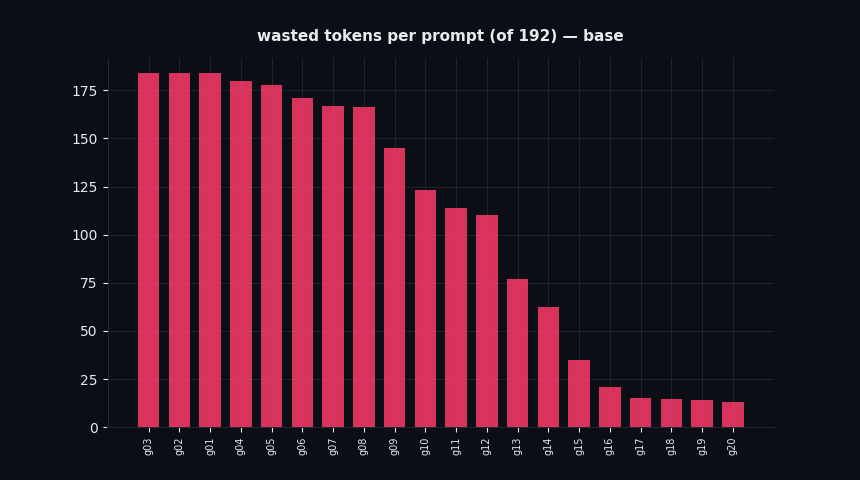
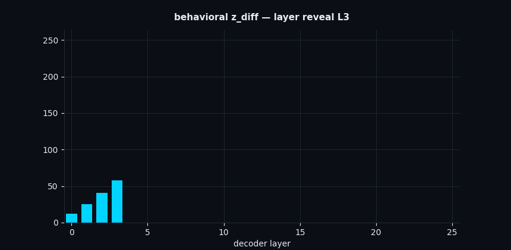
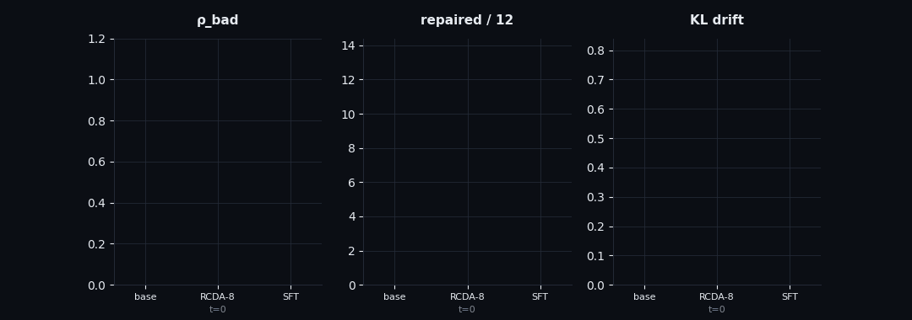
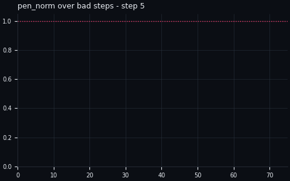
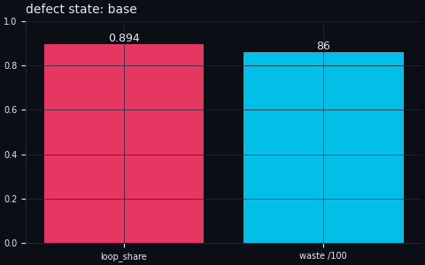

<p align="center">
  
</p>

# 🧪 Gemma3-1B-IT — the RCDA intervention kit

<p align="center">
  <a href="https://huggingface.co/litert-community/Gemma3-1B-IT"></a>
  
  
  
  
  
  
  
  
  <a href="https://github.com/hiyouga/LlamaFactory"></a>
  
  <a href="../MNN-Pocket-0.3B/README.md"></a>
</p>

> **One defect (greedy repetition loops), one evaluator
> (ρ_bad / loop_share / KL / PPL / TW), one formula
> `pen = (vᵀh/‖v‖)²` — now tested against a data-trained control *and*
> against the repository's own mathematics.** The RCDA-8 round
> ([`LlamaFactory/`](LlamaFactory/README.md)) trains the real
> `unsloth/gemma-3-1b-it` end-to-end through
> [LlamaFactory](https://github.com/hiyouga/LlamaFactory): the formula as
> a band-masked LoRA versus stock SFT/LoRA on curated anti-loop targets.
> The RCDA-9 round ([`RCDA-9/`](RCDA-9/README.md)) goes one level deeper:
> every formula of the twelve restored monographs, taught to the model as a
> 95-chunk corpus — the strongest anti-loop intervention measured on this
> model (**10/12 repaired, ρ_bad 0.10, no migration**), with a from-scratch
> pen-arm replication and a 72-check audit of the predecessor included.
> The defect migrates under every edit geometry — five rounds, one law.

---

## ⌛ The kit in 60 seconds

The patient — **[`litert-community/Gemma3-1B-IT`](https://huggingface.co/litert-community/Gemma3-1B-IT)**,
the LiteRT distillation of `google/gemma-3-1b-it` (per the repository
owner's context, an uncensored distill — restraint filters removed,
which is exactly why its raw autoregressive behaviour is worth studying).
Public training mirror: `unsloth/gemma-3-1b-it` @ snapshot `5b1141…`
(the exact weights of the real-Gemma rounds; hash-pinned in
[`probe_report.json`](LlamaFactory/results/probe/probe_report.json)).
26 blocks, d = 1152, 1.00 B params, 262 k vocabulary. On long greedy
generations in raw completion mode it **falls into repetition loops** —
and the kit treats the defect the way the whole repository does: as a
spectral object.

1. **Probe** — the model labels its own defect: hidden-state deltas
   between looped and pre-loop tokens of the *same* greedy trajectories
   give a behavioural direction `v` per layer. On the real model the
   contrast peaks at **blocks L10/L11/L12** (z_diff **212.6 / 219.8 /
   205.1**, diagonal-Mahalanobis units) — a clean unimodal band, the
   analog of the MNN kit's writers (o_proj L15/16/18 of 28). The wider
   **band L8–L15** (z_diff > 130) carries the phase structure:
   `v_early` and `v_deep` (cos 0.72–0.97 — aligned but not identical).
2. **Matrix scans + channel decomposition** — λ_v/λ₊ < 1 with θ_v >
   θ_c at the writers: the loop direction is not a single-matrix spike
   but is **carried** by the residual stream (~500–700 units of v-energy
   vs 2–7 per single write), with the **MLP down_proj channel writing
   68.6 %** of it — the RCDA-6 justification for the extended band.
3. **Formula as a loss** — `L = pen_norm + β·relu(mse − cap)`,
   `pen_norm = (v̂ᵀh)²` phase-matched over the band, per-prompt
   init-normalised, plus a hard abilities anchor on the trailing-32
   logits. RCDA-5/6/7 validated the machinery (on a GPT-2 stand-in and
   on the real model with full-matrix training); **RCDA-8 re-implements
   it as a LoRA on LlamaFactory rails and, for the first time on the
   real Gemma, repairs hard loopers** — while an identically-budgeted
   stock SFT arm beats it outright.
4. **Formula as a corpus (RCDA-9)** — the twelve monograph DOCX editions
   restored from git history, 311 numbered equations + 252 LaTeX
   theorems + 105 computed pairs distilled into 95 semantic chunks, and
   fed to the same LoRA geometry as the data arm: ρ_bad **0.60 → 0.10**,
   **10/12** hard loopers repaired, mild-8 *cleaner than base* — the
   first intervention that repairs both subsets at once, at the smallest
   abilities price of the series (KL 0.079, PPL 10.6). The model learns
   the **form** of its own theory (held-out corpus PPL −73 %), not the
   arithmetic (exact QA 9/57 → 4/57).
5. **The law of migration** — every formula geometry so far
   (full-matrix o_proj × RCDA-5; full-matrix band × RCDA-6; low-rank
   band × RCDA-8; low-rank band re-run × RCDA-9) suppresses the
   penalized spectral signature and moves the hard loopers, **and lets
   the defect re-emerge in the mild prompts** (mild-8: 0.16 → 0.92 /
   0.64 / 0.69 / 0.73). The data arm (5/12) and the formula corpus
   (10/12) are the only edits that shrink both subsets at once.

| Symbol | Value | Meaning | Source |
|--------|-------|---------|--------|
| writers (real model) | **L10 / L11 / L12** | z_diff 212.6 / 219.8 / 205.1 — replicated byte-exact in RCDA-8 and RCDA-9 | [`probe_report.json`](LlamaFactory/results/probe/probe_report.json) |
| band (z_diff > 130) | L8–L15 (pre-registered) | o_proj + down_proj trainable set of RCDA-6/8/9 | [`probe_phase_report.json`](LlamaFactory/results/probe/probe_phase_report.json) |
| ρ_bad (base, greedy 192) | **0.60** | 20 bad prompts, 4-gram, threshold 0.5 | [`part8_eval_base.json`](LlamaFactory/results/part8_eval_base.json) |
| pen descent (RCDA-8 LoRA) | **−97.9 %** | the formula as a loss, 150 steps, 1.31 M params | [`training_log.json`](LlamaFactory/results/rcda8_arm/training_log.json) |
| pen descent (RCDA-9 re-run) | −97.2 % | same recipe re-trained — magnitudes are not run-stable, signatures are | [`training_log.json`](RCDA-9/results/pen_arm/training_log.json) |
| hard-12 loop share | 0.827 → 0.632 / 0.590 / **0.259** | RCDA-8 formula / data / RCDA-9 corpus | [`summary_round9.json`](RCDA-9/results/summary_round9.json) |
| fully repaired (of 12) | 3 / 5 / **10** | RCDA-8 formula / data / RCDA-9 corpus | part8 + part9 evals |
| corpus val PPL (RCDA-9) | 369.2 → **99.7** | held-out monograph M06 + proof ch.11–12, −73 % | part9 evals |
| KL(base‖arm) | 0.512 / 0.120 / **0.079** | RCDA-8 formula / data / RCDA-9 corpus | part8 + part9 evals |
| PPL control | 10.9 → 12.0 / 8.6 / **10.6** | formula drifts; data gains −21 %; corpus holds | part8 + part9 evals |
| TW gate (all arms) | violation ×3/×16/×16/×52 | no spectrally clean edit on this architecture | round reports |
| cos(u₁ of edit, v) | ≤ 0.44 (RCDA-8) | the edit need not align with v to be penalty-compliant | part8 evals |

---

## 🏆 Headline results — every round, one evaluator

| Round | Question | Result | Where |
|-------|----------|--------|-------|
| **RCDA-5** (real Gemma) | Does the MNN-Pocket transfer hold on Gemma3? | **No.** Penalty collapses (−99 %) while every hard looper gets *worse* (ρ_bad 0.60 → 1.00 SGD / 0.95 Adam); the penalized direction is a correlate, not the cause. Abilities hold (PPL parity) | [`RCDA-5/`](RCDA-5/README.md) · [`RCDA5_REPORT.md`](Reports-MD/RCDA5_REPORT.md) |
| **RCDA-6** (real Gemma) | Does the wider band + phase-matched directions pay off? | **Partially.** First behavioral gains of the formula line: hard-12 0.827 → 0.620, 2/12 repaired — but the defect migrates (mild-8 0.16 → 0.64) and abilities drift (PPL +29 %, KL 0.31) | [`RCDA-6/`](RCDA-6/README.md) · [`RCDA6_REPORT.md`](Reports-MD/RCDA6_REPORT.md) |
| **RCDA-5/6/7** (validation layer) | Does the machinery run end-to-end, architecture-adaptively? | Yes — validated on a GPT-2 stand-in (the archived numbers: pen −72/−63/−80 %, KL ≤ 0.011, TW pass ×3) — *mechanics proven, effect sizes not claimed* | [`RCDA-7/`](RCDA-7/README.md) · [archive below](#-archive--the-gpt-2-stand-in-validation-layer) |
| **RCDA-8** (real Gemma, LlamaFactory) | Formula-as-LoRA vs data-as-LoRA, equal budget? | **The formula repairs 3/12 hard loopers (first on this model) at 1.31 M params and −97.9 % penalty — and migrates the defect again; the data arm wins every axis: 5/12, ρ_bad 0.40, mild-8 0.097, KL 0.12, PPL −21 %** | [`LlamaFactory/`](LlamaFactory/README.md) · [`RCDA8_REPORT.md`](LlamaFactory/RCDA8_REPORT.md) |
| **RCDA-9** (real Gemma, the formula round) | What if the model is *taught* the monograph formulas — as a corpus and as a loss? | **The corpus is the strongest anti-loop intervention measured on this model: 10/12 repaired, ρ_bad 0.10, no migration, KL 0.079 — and it teaches form, not arithmetic (held-out corpus PPL −73 %, exact QA 9→4/57). The pen arm re-run replicates every qualitative signature but not the magnitudes — budget-run honesty. Plus a 72-check audit of RCDA-8 (70 PASS / 1 FAIL documented)** | [`RCDA-9/`](RCDA-9/README.md) · [`RCDA9_REPORT.md`](RCDA-9/RCDA9_REPORT.md) · [`audit/`](audit/README.md) |

---

## 🧬 The pipeline



Every path ends in the same evaluator as the sibling kit — one defect
metric, one abilities metric, one spectral gate. That is what makes the
rounds comparable: to each other, and to MNN-Pocket-0.3B.

---

## 🎬 The animation wall

| | |
|---|---|
|  |  |
| **the corpus round** — base → formulas → pen, 10 rows go dark | **the RCDA-9 dashboard** — the round at one glance |
|  |  |
| **the waste melting** — loop tokens of 192, per prompt | **budget honesty** — the pen mini-bench is non-monotonic |
|  |  |
| **the formula melting** — pen_norm −97.9 %, anchor under the cap | **the defect bending** — mini-bench loop_share 0.921 → 0.529 |
|  |  |
| **per-prompt melt** — base → RCDA-8 → SFT, sorted by severity | **the waste melting** — loop tokens of 192, per prompt |
|  |  |
| **the writers lighting up** — L10/11/12 in crimson | **the arms dashboard** — the round at one glance |
|  |  |
| **validation layer** — RCDA-5/6/7 penalty descent | **validation layer** — defect state across the arms |

<p align="center"><sub><em>Every frame is a measured trajectory from a
committed JSON — rebuilt by
<a href="RCDA-9/scripts/make_figures.py">RCDA-9/scripts/make_figures.py</a>,
<a href="LlamaFactory/scripts/make_figures.py">LlamaFactory/scripts/make_figures.py</a>
and <a href="Graphic/make_graphic.py">Graphic/make_graphic.py</a>, never
an artist's impression.</em></sub></p>

---

## 🗂️ Kit map

| Folder | What lives there |
|--------|------------------|
| [`RCDA-9/`](RCDA-9/README.md) | **the formula round**: the monograph corpus arm (10/12 repaired) + the pen-arm re-run + the RCDA-8 audit — report, notes, corpus, configs, scripts, results, adapters, figures |
| [`LlamaFactory/`](LlamaFactory/README.md) | **the RCDA-8 round**: the real-model formula arm + data arm, trained through LlamaFactory 0.9.5 — report, logs, adapters, figures, GPU configs |
| [`audit/`](audit/README.md) | the static RCDA-8 verification: 72 checks, 70 PASS / 1 FAIL documented |
| [`Code/`](Code/README.md) | the toolkit: `gemma_probe.py`, `gemma_benchmark.py`, `gemma_rcds_train.py` (rcda5\|6\|7), `marchenko_pastur.py`, `rcda6_channel_decomposition.py`, `gemma_apply_deltas.py`, bilingual `prompts/` |
| [`Docs/`](Docs/README.md) | unpacking the model archives and the split-volume procedure |
| [`Graphic/`](Graphic/README.md) | validation-layer fig05–fig16 + two animations, rebuilt from `results/` |
| [`Graphics/`](Graphics/README.md) | the real-Gemma figures of rounds 5–6 (probe, band, training, eval arms, migration) |
| [`JSON-Results/`](JSON-Results/README.md) | the raw real-Gemma records: probe reports, training logs ×2, part5/part6 evals, rows, PPL checks, sentinel selection |
| [`Model-ZIP/`](Model-ZIP/README.md) | `gemma3-rcds-interventions.zip` — fp16 deltas of the three validation variants + the v-directions, SHA-256 pinned |
| [`Model-Z/`](Model-Z/README.md) | the fine-tuned full model (RCDA-5 SGD arm) as a self-assembling 17-volume split archive |
| [`RCDA-5/`](RCDA-5/README.md) | the canonical validation snapshot: reports, results, vectors, figures |
| [`RCDA-6/`](RCDA-6/README.md) | the extended-tensor validation round (down_proj channel) |
| [`RCDA-7/`](RCDA-7/README.md) | the deep-phase + tightened-anchor validation round |
| [`Reports-MD/`](Reports-MD/README.md) | the real-Gemma scientific record: plans, reports, runbooks, results summary |
| [`Scripts/`](Scripts/README.md) | the real-Gemma working scripts (probe, phase probe, trainers, benchmark, analysis) |
| [`assets/`](assets/README.md) | the kit identity: banner, avatar, divider |

---

## 🎨 The gallery

| Figure | What it shows |
|--------|---------------|
| [`r9-fig01`](RCDA-9/figures/fig01_probe_zdiff.png) … [`r9-fig10`](RCDA-9/figures/fig10_formula_qa.png) | **the RCDA-9 round**: probe re-run, arms defect, formula-knowledge axes, pen descent, forensics, the 10/12 repair matrix, dashboard, corpus loss, formula QA |
| [`r-fig01`](LlamaFactory/figures/fig01_probe_zdiff.png) | **the real-model probe** — writers L10/11/12, band L8–L15 |
| [`r-fig02`](LlamaFactory/figures/fig02_phase_probe.png) | phase directions: z_early vs z_deep, cos(v_e, v_d) per layer |
| [`r-fig03`](LlamaFactory/figures/fig03_arms_defect.png) | ρ_bad / loop_share / waste across base · formula · data |
| [`r-fig04`](LlamaFactory/figures/fig04_abilities.png) | KL and PPL — drift vs the −21 % self-distill gain |
| [`r-fig05`](LlamaFactory/figures/fig05_pen_descent.png) | the formula melting over 150 LoRA steps |
| [`r-fig06`](LlamaFactory/figures/fig06_forensics.png) | the LoRA edit per tensor — rel-Frobenius, cos(u₁, v_deep) |
| [`r-fig07`](LlamaFactory/figures/fig07_repair_matrix.png) | per-prompt repair heatmap, three arms |
| [`r-fig08`](LlamaFactory/figures/fig08_dashboard.png) | the RCDA-8 one-glance dashboard |
| [`r-fig09`](LlamaFactory/figures/fig09_sft_loss.png) | the data arm's training loss |
| [`fig05`](Graphic/fig05_probe_zdiff_profile.png) … [`fig16`](Graphic/fig16_overview_dashboard.png) | the validation layer (GPT-2 stand-in): probe profile, matrix scan, channel decomposition, pen descent, defect/abilities bars, cosine alignment, spectral purity, leverage chart, PPL parity, dashboard |
| [`figG1–G3`](Graphics/) · [`figC1–C5`](Graphics/) | the real-Gemma rounds 5–6: probe layers, spectral purity, eval arms, phase probe, band, migration |

Regenerate the validation layer with `python Graphic/make_graphic.py`,
the RCDA-8 round with `python LlamaFactory/scripts/make_figures.py`,
the RCDA-9 round with `python RCDA-9/scripts/make_figures.py`
(all three read only committed JSONs).

---

## 🧭 Reading paths

| I want to… | Time | Go to |
|------------|------|-------|
| 🕐 **get the story** | 10 min | [The kit in 60 seconds](#-the-kit-in-60-seconds) → [Headline results](#-headline-results--every-round-one-evaluator) → [the animation wall](#-the-animation-wall) |
| 🔬 **read the real-model science** | one evening | [`RCDA9_REPORT.md`](RCDA-9/RCDA9_REPORT.md) → [`RCDA8_REPORT.md`](LlamaFactory/RCDA8_REPORT.md) → [`RCDA5_REPORT.md`](Reports-MD/RCDA5_REPORT.md) → [`RCDA6_REPORT.md`](Reports-MD/RCDA6_REPORT.md) |
| ⚙️ **compare the levers** | 30 min | [`fig14`](Graphic/fig14_leverage_chart.png) (validation) → [`r-fig08`](LlamaFactory/figures/fig08_dashboard.png) (RCDA-8) → [`r9-fig08`](RCDA-9/figures/fig08_dashboard.png) (RCDA-9) → [`summary_round9.json`](RCDA-9/results/summary_round9.json) |
| 🧪 **train it yourself** | 75–100 min CPU / 1 h GPU | [`RCDA-9/README.md`](RCDA-9/README.md#-reproduce) → [`LlamaFactory/README.md`](LlamaFactory/README.md#-reproduce) → `pipeline.py` (resumable) → GPU configs |
| 📦 **apply the trained artifacts** | 10 min | [`Model-ZIP/`](Model-ZIP/README.md) (validation deltas) · [`LlamaFactory/adapters/`](LlamaFactory/adapters/) (RCDA-8 LoRA) · [`RCDA-9/results/`](RCDA-9/results) (corpus + pen LoRA) |
| 🔍 **verify the claims** | 5 min | [`audit/`](audit/README.md) — the 72-check static audit of RCDA-8, re-runnable with one command |

---

## ⚡ Reproduce

```bash
# ── A. the RCDA-9 formula round on the REAL model (CPU box is enough) ────
pip install torch --index-url https://download.pytorch.org/whl/cpu
pip install "llamafactory==0.9.5" transformers peft accelerate datasets

python3 neural_lab/Gemma3-1B-IT/RCDA-9/scripts/pipeline.py      # ~100 min, resumable
python3 neural_lab/Gemma3-1B-IT/RCDA-9/scripts/make_figures.py

# ── B. the RCDA-8 round on the REAL model (CPU box is enough) ────────────
python3 neural_lab/Gemma3-1B-IT/LlamaFactory/scripts/pipeline.py   # ~75 min, resumable
python3 neural_lab/Gemma3-1B-IT/LlamaFactory/scripts/make_figures.py

# ── C. the validation layer (GPT-2 stand-in, runs anywhere) ──────────────
pip install torch transformers scipy numpy matplotlib pillow
python neural_lab/Gemma3-1B-IT/Code/gemma_probe.py                 # GPT-2 default
python neural_lab/Gemma3-1B-IT/Code/gemma_rcds_train.py --variant rcda5 --steps 150
python neural_lab/Gemma3-1B-IT/Code/gemma_rcds_train.py --variant rcda6 --steps 150 --lr 2e-5
python neural_lab/Gemma3-1B-IT/Code/gemma_rcds_train.py --variant rcda7 --steps 150 --lr 2e-5
python neural_lab/Gemma3-1B-IT/Code/gemma_benchmark.py --round 5 --tag base
python neural_lab/Gemma3-1B-IT/Code/rcds_summarise.py
python neural_lab/Gemma3-1B-IT/Graphic/make_graphic.py

# ── D. the validation layer at Gemma scale (same commands) ───────────────
#    add  --model google/gemma-3-1b-it  (gated; or unsloth/gemma-3-1b-it)
```

Requirements: Python ≥ 3.10, `torch`, `transformers`, `scipy`; the
validation stack runs on CPU (2 cores, ~4.5 min per round on GPT-2);
the RCDA-8 round ran on CPU (2 cores, 4 GB RAM, ~75 min end-to-end),
the RCDA-9 round on the same box (~100 min end-to-end).

---

## 🔐 Provenance & integrity — four layers, stated plainly

| Layer | Model | Where | What it proves |
|-------|-------|-------|----------------|
| **validation** | `openai-community/gpt2` (124 M stand-in) | [`RCDA-5/`](RCDA-5/README.md), [`RCDA-6/`](RCDA-6/README.md), [`RCDA-7/`](RCDA-7/README.md), [`Graphic/`](Graphic/README.md), [`Model-ZIP/`](Model-ZIP/README.md) | the *mechanics*: the formula trains, the penalty melts, edits stay rank-structured, abilities anchor holds — architecture-adaptive code |
| **real-Gemma rounds** | `unsloth/gemma-3-1b-it` @ `5b1141…` | [`Reports-MD/`](Reports-MD/README.md), [`JSON-Results/`](JSON-Results/README.md), [`Scripts/`](Scripts/README.md), [`Graphics/`](Graphics/README.md), [`Model-Z/`](Model-Z/README.md) | the transfer test and its honest negatives: RCDA-5 inverts (ρ_bad 0.60 → 1.00), RCDA-6 buys the first partial repair and migrates the defect |
| **RCDA-8** (LlamaFactory) | same snapshot, via **LlamaFactory 0.9.5** | [`LlamaFactory/`](LlamaFactory/README.md) | the formula as a LoRA (first hard-loop repairs on the real model, 3/12) vs stock SFT (5/12, wins every axis) — one evaluator, equal budget |
| **RCDA-9** (the formula round) | same snapshot, same framework | [`RCDA-9/`](RCDA-9/README.md), [`audit/`](audit/README.md) | the monograph corpus as the strongest anti-loop intervention (10/12, ρ_bad 0.10, no migration) + the pen re-run + the 72-check audit of the predecessor |

- **Every number is a field of a committed JSON** — `RCDA-N/…/results/`,
  `JSON-Results/`, `LlamaFactory/results/`, `RCDA-9/results/`. No figure or
  table is hand-typed; every GIF frame is a measured trajectory.
- The RCDA-8 round ran on a **CPU-only box (2 cores, 4 GB RAM, no GPU)**;
  its budget (150 steps, LoRA r16/r8, 20-prompt suite) is part of the
  record, and the full-scale GPU configs ship in
  [`LlamaFactory/configs/`](LlamaFactory/configs) and
  [`RCDA-9/configs/`](RCDA-9/configs).
- **LlamaFactory note**: the framework is self-hosted — its demo site
  builds configs; the training itself ran here, through its CLI and
  trainer classes. No results were fabricated, projected, or borrowed.
- Intervention weights ship four ways: fp16 deltas
  ([`Model-ZIP/`](Model-ZIP/README.md), validation layer), the
  self-assembling full-model archive
  ([`Model-Z/`](Model-Z/README.md), RCDA-5 SGD arm), peft LoRA adapters
  ([`LlamaFactory/adapters/`](LlamaFactory/adapters/), RCDA-8 round) and
  the corpus + pen adapters of the RCDA-9 round
  ([`RCDA-9/results/`](RCDA-9/results)).
- **Language note** (inherited): experiment *inputs* are bilingual
  (Russian + English); everything a human reads is English. The one
  exception is the audit protocol ([`audit/`](audit/README.md)), kept in
  Russian exactly as produced.

---

## 🗄️ Archive — the GPT-2 stand-in validation layer

The numbers below were measured on `openai-community/gpt2` (124 M, 12
layers, d = 768) — the CPU standing substitute used while the Gemma
mirror was gated and no GPU was available. They prove the **mechanics**
of the pipeline, not Gemma-scale effect sizes; they are archived here
because every table above them now reads from the real-model rounds.

| | RCDA-5 | RCDA-6 | RCDA-7 |
|---|---|---|---|
| trainable tensors | o_proj L10–12 (3) | + down_proj (16) | same as 6 |
| pen_norm descent | **−71.5 %** | −63 % | **−80 %** |
| ρ_bad (full, 96 tok) | 0.94 → 0.88 | (mini −7.4 %) | between 5 and 6 |
| KL control | **0.002** | ≤ 0.011 | 0.011 |
| PPL parity | ±1.8 % | ±1.8 % | ±1.8 % |
| TW relative gate | pass ×3 | pass ×3 | pass ×3 |
| cos(u₁, v) | 0.32 / 0.18 / 0.31 | **0.74–0.89** | aligned |

Writers on the stand-in: **L6/L7/L8** (z_diff 2.20–2.23). The
architecture-adaptive loader (`Code/rcds_common.py`) reruns the same
protocol at Gemma scale with `--model google/gemma-3-1b-it`.

---

<p align="center">
  
</p>

<p align="center">
  <br>
  <sub><a href="../README.md">← neural_lab</a> ·
  <a href="RCDA-9/RCDA9_REPORT.md">the RCDA-9 report →</a> ·
  <a href="LlamaFactory/RCDA8_REPORT.md">the RCDA-8 report →</a> ·
  <a href="Reports-MD/RCDA5_REPORT.md">the RCDA-5 real-Gemma report →</a> ·
  <a href="../../README.md">🏠 repository root</a></sub>
</p>
