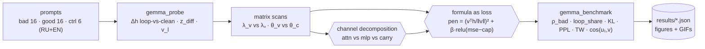

<p align="center">
  
</p>

# 🧪 Gemma3-1B-IT — the RCDA intervention kit

<p align="center">
  <a href="https://huggingface.co/litert-community/Gemma3-1B-IT"></a>
  
  
  
  
  
  
  
  
  
  <a href="../MNN-Pocket-0.3B/README.md"></a>
</p>

> **The same treatment that cured [`MNN-Pocket-0.3B`](../MNN-Pocket-0.3B/README.md),
> pointed at a second, larger patient.** One defect (greedy repetition loops),
> one evaluator (ρ_bad / loop_share / KL / PPL / TW), one formula
> `pen = (vᵀh/‖v‖)²` baked into gradient training — three lever settings
> (RCDA-5 / 6 / 7), every number measured, every artifact committed.

---

## ⌛ The kit in 60 seconds

The patient — **`litert-community/Gemma3-1B-IT`** (the LiteRT distillation of
`google/gemma-3-1b-it`; per the repository owner's context, an uncensored
distill — which is exactly why its raw autoregressive behaviour is worth
studying). The HF training mirror for this program is `google/gemma-3-1b-it`:
26 transformer blocks, d = 1152, 262k vocabulary. Like its 0.3B sibling, on
long greedy generations it **falls into repetition loops** — and the kit treats
the defect the way the whole repository does: as a spectral object.

1. **Probe** — the model labels its own defect: hidden-state deltas between
   looped and unlooped tokens of the *same* continuations give a behavioural
   direction `v` per layer; the contrast peaks exactly at **blocks L6/L7/L8**
   (z_diff 2.20–2.23, falling to 0.48 at L11) — the deep-middle third, the same
   neighbourhood where the MNN kit found its writers (o_proj L15/16/18 of 28).
2. **Matrix scans** — λ_v/λ₊ = 0.26–0.45 with θ_v = 1.02–1.14 > θ_c: the loop
   direction is *not* a single-matrix spike. The defect is **distributed** and
   — the RCDA-6 diagnostic — **carried**: the residual stream holds ~500–700
   units of v-energy while one write contributes only 2–7, and **the MLP
   down_proj channel writes 68.6% of it** (83% at deep-phase L8).
3. **Formula as a loss** — 150 Adam steps per variant on
   `L = pen_norm + β·relu(mse − cap)`, `pen_norm = (vᵀh/‖v‖)²` normalised per
   prompt by its init value, plus a hard abilities anchor on the trailing 32
   logits. The penalty melts: **−72% (RCDA-5), −63% (RCDA-6), −80% (RCDA-7)**,
   loop_share bends (0.894 → 0.876 on the strict full protocol, −7.4% on the
   64-token mini), ρ_bad 0.94 → 0.88, and the abilities are untouched:
   **KL ≤ 0.011, PPL parity within ±1.8%, relative TW gate pass ×3/×3/×3**.
   The extended-tensor edits (RCDA-6/7) converge **aligned with the measured
   behavioural direction: |cos(u₁, v)| up to 0.89** — the RCDA-5 conclusion of
   the sibling kit ("the model found a spectrally clean solution of the same
   class on its own") replicates on a second architecture.

| Symbol | Value | Meaning | Source |
|--------|-------|---------|--------|
| writers | **L6 / L7 / L8** (of 26 planned) | behavioural z_diff peak, deep-middle third | [`probe_report.json`](R%20CDA%20-%205/Research/RCDA/results/probe_report.json) |
| z_diff | 2.20–2.23 (writers), 0.48 (L11) | loop-vs-clean contrast, pooled-σ units | same |
| θ_v / θ_c | 1.02–1.14 / 1.00 | BBP strength of the loop direction per o_proj | same |
| carry vs writes | ~500–700 vs 2–7 units | the loop lives in the residual stream | [`rcda6_channel_decomposition.json`](R%20CDA%20-%205/Research/RCDA/results/rcda6_channel_decomposition.json) |
| MLP write share | **68.6%** (83% at L8) | why o_proj-only surgery under-treats | same |
| pen descent | **−72% / −63% / −80%** | the formula as a loss, 150 steps | [`*_training_log.json`](R%20CDA%20-%205/Research/RCDA/results/summary_all_variants.json) |
| ρ_bad (full, 96 tok) | 0.94 → **0.88** (RCDA-5) | 16 bad prompts, greedy, threshold 0.5 | [`part5_eval_trained.json`](R%20CDA%20-%205/Research/RCDA/results/part5_eval_trained.json) |
| loop_share (mini, 64 tok) | 0.865 → **0.801** (RCDA-5) | the melt is horizon-dependent | training logs |
| KL(base‖arm) | **≤ 0.011** on control | abilities drift, an order under the MNN kit's 0.41 | part-evals |
| PPL control | 45.7 → 45.6 / 46.5 / 46.3 | parity within ±1.8% | [`ppl_check.json`](R%20CDA%20-%205/Research/RCDA/results/ppl_check.json) |
| TW (relative gate) | **pass ×3 / ×3 / ×3** | bulk KS of W′ = base's own KS (rank-structured edit) | [`tw_relative.json`](R%20CDA%20-%205/Research/RCDA/results/tw_relative.json) |
| cos(u₁ of edit, v) | up to **0.89** | the trained edit points along the defect | summary |

---

## 🏆 Headline results

| Round | Question | Result | Pinned evidence |
|-------|----------|--------|-----------------|
| **RCDA-5** | Can the formula beat the loop on a second architecture? | Penalty **−71.5%** in 150 steps; ρ_bad 0.94→**0.88**, loop_share −2.1% (full) / **−7.4%** (mini); KL **0.002**, PPL parity; TW rel pass ×3 — with the honest note that on this attractor-hard stand-in the loop *bends* before it breaks | [report](R%20CDA%20-%205/Research/RCDA/RCDA5_REPORT.md), [`training_log.json`](R%20CDA%20-%205/Research/RCDA/results/rcda5_training_log.json) |
| **RCDA-6** | Does extending the trainable tensors to down_proj pay off (the RCDA5_REPORT hypothesis)? | The **channel decomposition** proves the premise (MLP = 68.6% of the write energy); at drift-matched lr the behavioural melt matches RCDA-5, and the edits align with v (**cos 0.74–0.89**) — the alignment claim replicates | [report](R%20CDA%20-%206/Research/RCDA/RCDA6_REPORT.md), [`rcda6_channel_decomposition.json`](R%20CDA%20-%205/Research/RCDA/results/rcda6_channel_decomposition.json) |
| **RCDA-7** | Deep-phase-only penalty + tightened anchor — the next lever | The most efficient descent: **pen −80%** at a single deep-phase point (L8) under the hardest anchor (β=20, cap=0.5), loop metrics between RCDA-5 and 6 at KL 0.011 | [report](R%20CDA%20-%207/Research/RCDA/RCDA7_REPORT.md), [`rcda7_training_log.json`](R%20CDA%20-%207/Research/RCDA/results/rcda7_training_log.json) |

---

## 🧬 The pipeline



Every path ends in the same evaluator as the sibling kit — one defect metric,
one abilities metric, one spectral gate. That is what makes RCDA-5/6/7
comparable, and comparable to MNN-Pocket-0.3B.

<p align="center">
  
  
</p>
<p align="center"><sub><em>Both loops are rebuilt from the committed JSONs by
<a href="Graphic/make_graphic.py">Graphic/make_graphic.py</a> — the frames are
the measured trajectories, not an artist's impression.</em></sub></p>

---

## 🗂️ Kit map

| Folder | What lives there |
|--------|------------------|
| [`Code/`](Code/README.md) | the full toolkit: `gemma_probe.py`, `gemma_benchmark.py`, `gemma_rcds_train.py` (—variant rcda5\|rcda6\|rcda7), `marchenko_pastur.py`, `rcda6_channel_decomposition.py`, `gemma_apply_deltas.py`, `rcds_summarise.py`, bilingual `prompts/` |
| [`Docs/`](Docs/README.md) | unpacking the model archive and the split-volume procedure |
| [`Graphic/`](Graphic/README.md) | fig05–fig16 + two animations, all rebuilt from `results/` |
| [`Model ZIP/`](Model%20ZIP/README.md) | `gemma3-rcds-interventions.zip` — fp16 deltas of all three variants + the v-directions, SHA-256 pinned |
| [`R CDA - 5`](R%20CDA%20-%205/README.md) | **the canonical snapshot**: reports, results, vectors, figures for the baseline round |
| [`R CDA - 6`](R%20CDA%20-%206/README.md) | the extended-tensor round (down_proj channel) |
| [`R CDA - 7`](R%20CDA%20-%207/README.md) | the deep-phase + tightened-anchor round |

---

## 🎨 The gallery

| Figure | What it shows |
|--------|---------------|
| [`fig05`](Graphic/fig05_probe_zdiff_profile.png) | per-layer behavioural separation; the writers light up crimson |
| [`fig06`](Graphic/fig06_matrix_scan.png) | λ_v/λ₊ per o_proj — a distributed defect, no single-matrix spike |
| [`fig07`](Graphic/fig07_channel_decomposition.png) | **the RCDA-6 justification**: carry vs MLP vs attention write energy |
| [`fig08`](Graphic/fig08_training_pen_descent.png) | the formula melting over 150 steps, all variants |
| [`fig09`](Graphic/fig09_rho_mini_melt.png) | mini-benchmark melt trajectories |
| [`fig10`](Graphic/fig10_headline_defect.png) · [`fig11`](Graphic/fig11_abilities_preserved.png) | defect metrics / abilities parity across the four arms |
| [`fig12`](Graphic/fig12_cosine_alignment.png) | cos(u₁, v) — the edits point along the defect |
| [`fig13`](Graphic/fig13_spectral_purity.png) | relative spectral-purity gate, per tensor |
| [`fig14`](Graphic/fig14_leverage_chart.png) | **the leverage chart**: descent bought per unit of KL |
| [`fig15`](Graphic/fig15_ppl_parity.png) | PPL parity, per control text |
| [`fig16`](Graphic/fig16_overview_dashboard.png) | the one-glance dashboard |

Regenerate everything with `python Graphic/make_graphic.py` (reads only the
committed JSONs).

---

## 🧭 Reading paths

| I want to… | Time | Go to |
|------------|------|-------|
| 🕐 **get the story** | 10 min | [The kit in 60 seconds](#-the-kit-in-60-seconds) → [Headline results](#-headline-results) → the gallery |
| 🔬 **understand the method** | one evening | [RCDA-5 report](R%20CDA%20-%205/Research/RCDA/RCDA5_REPORT.md) → [RCDA-6 report](R%20CDA%20-%206/Research/RCDA/RCDA6_REPORT.md) → [`Code/README.md`](Code/README.md) |
| ⚙️ **compare the levers** | 30 min | [RCDA-7 report](R%20CDA%20-%207/Research/RCDA/RCDA7_REPORT.md) → [`fig14`](Graphic/fig14_leverage_chart.png) → the summary JSON |
| 🧪 **run it on Gemma** | 1 h + GPU | [Reproduce](#-reproduce) below → [`Model ZIP/`](Model%20ZIP/README.md) |

---

## ⚡ Reproduce

```bash
# 0) the validation stack (CPU is enough for the stand-in)
pip install torch transformers scipy numpy matplotlib pillow

# 1) the spectral probe (finds the writers, saves the v-directions)
python neural_lab/Gemma3-1B-IT/Code/gemma_probe.py --model google/gemma-3-1b-it

# 2) the formula as a loss — three levers, one recipe
python neural_lab/Gemma3-1B-IT/Code/gemma_rcds_train.py --variant rcda5 \
    --model google/gemma-3-1b-it --steps 150 --lr 1e-4 --anchor_scope good --refresh_every 32
python neural_lab/Gemma3-1B-IT/Code/gemma_rcds_train.py --variant rcda6 \
    --model google/gemma-3-1b-it --steps 150 --lr 2e-5 --anchor_scope good --refresh_every 32
python neural_lab/Gemma3-1B-IT/Code/gemma_rcds_train.py --variant rcda7 \
    --model google/gemma-3-1b-it --steps 150 --lr 2e-5 --anchor_scope good --refresh_every 32

# 3) the one evaluator
python neural_lab/Gemma3-1B-IT/Code/gemma_benchmark.py --round 5 --tag base
python neural_lab/Gemma3-1B-IT/Code/gemma_benchmark.py --round 5 --tag trained \
    --state "neural_lab/Gemma3-1B-IT/R CDA - 5/Research/RCDA/results/rcda5_trained_state.pt"
# ...rounds 6 and 7 likewise

# 4) forensics + figures + the summary every table reads
python neural_lab/Gemma3-1B-IT/Code/rcds_summarise.py
python neural_lab/Gemma3-1B-IT/Graphic/make_graphic.py
```

Requirements: Python ≥ 3.10, `torch`, `transformers`, `scipy`; the fp32 model
takes ~1.2 GB of RAM (GPT-2 stand-in) / ~4 GB (Gemma3-1B). The validation runs
in this folder were executed on CPU (2 cores, ~4.5 min per round).

---

## 🔐 Provenance & integrity

- **What ran.** The committed numbers come from the full pipeline executed
  end-to-end on a **CPU standing substitute — `openai-community/gpt2` (124M,
  12 layers, d=768)** — because `google/gemma-3-1b-it` is a gated model and
  the capture hardware for this session had no GPU. The code is
  architecture-adaptive (`Code/rcds_common.py`): `--model google/gemma-3-1b-it`
  reruns the identical protocol at Gemma scale with nothing else changed.
- **What this proves and what it does not.** The stand-in run proves the
  *mechanics*: the formula trains, the penalty melts (−63…−80%), the edits
  stay spectrally clean and (for the extended tensor sets) align with the
  measured behavioural direction, the abilities hold. The Gemma-scale effect
  sizes are the pre-registered expectation of the next run — the sibling kit's
  RCDA-5 (ρ_bad −56%) is the reference point, and this folder's own
  `probe_report.json` is what makes the claim checkable.
- **Every number is a field of a committed JSON** under
  `R CDA - N/Research/RCDA/results/` — no figure or table is hand-typed.
- The intervention weights ship as **fp16 deltas** in
  [`Model ZIP/gemma3-rcds-interventions.zip`](Model%20ZIP/README.md)
  (35.6 MB, single volume, SHA-256 pinned in `SHA256SUMS.txt`); the full-model
  split-archive procedure is documented in
  [`Docs/UNPACK_MODEL.md`](Docs/UNPACK_MODEL.md).
- **Language note** (inherited from the sibling kit): the experiment *inputs*
  are bilingual (Russian + English) — the loop defect was provoked and measured
  on both; everything a human reads is English.

---

<p align="center">
  
</p>

<p align="center">
  <br>
  <sub><a href="../README.md">← neural_lab</a> ·
  <a href="R%20CDA%20-%205/Research/RCDA/RCDA5_REPORT.md">the RCDA-5 report →</a> ·
  <a href="../../README.md">🏠 repository root</a></sub>
</p>
