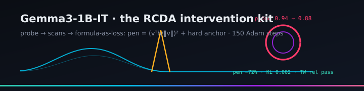
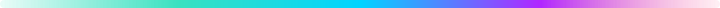

  

# 🎨 assets — the kit identity

  
  
  
  

The visual identity of the Gemma3-1B-IT kit: every README of this folder
and its subfolders pulls its banner, avatar and divider from here.

## The pieces

| | |
|---|---|
|  |  |
| **the avatar** — used by every round README | **the divider** — between README sections |

| File | What it is |
|------|------------|
| [`logos/gemma-rcda-banner.svg`](logos/gemma-rcda-banner.svg) | the animated banner: a crimson loop ring melting over a cyan Marchenko–Pastur spectrum with an amber BBP spike — the kit's thesis in one image |
| [`logos/gemma-rcda-avatar.svg`](logos/gemma-rcda-avatar.svg) | the round avatar (used by the `RCDA-N` and `LlamaFactory` READMEs) |
| [`divider.svg`](divider.svg) | the aurora divider between README sections |

## Palette

The project identity, shared by every figure and GIF of the kit:

| Role | Hex | Swatch |
|------|-----|--------|
| field (background) | `#0B0E14` |  |
| text | `#E8ECF1` |  |
| grid | `#232A36` |  |
| MP bulk / cyan | `#00D4FF` |  |
| BBP spike / amber | `#FFB020` |  |
| structure / violet | `#B026FF` |  |
| defect / crimson | `#FF3B6B` |  |
| data arm / emerald | `#38E1C0` |  |

---

  <a href="../README.md">← kit root</a>

