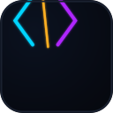

<p align="center">
  
</p>

# <sub>🧰</sub> Code — probe, benchmark, intervene

<p align="center">
  
  
  
  <a href="../README.md"></a>
</p>

Everything that *touches the model* lives here: the spectral probe, the
weight-space editor with its Tracy–Widom gate, the before/after benchmark and
the MP-law math they all share. Run from this directory; the theory behind the
formulas is documented in `docs/monographs/` and implemented in `src/rmt_llm/`.

## The scripts, in the order a round uses them

| # | script | purpose | talks to |
|---|--------|---------|----------|
| 0 | [`reassemble_model.py`](reassemble_model.py) | rebuild `model/model.safetensors` from the split archive, verify SHA-256; `--eval_dir/--overlay_state` overlays edited tensors onto the base | [`../Model ZIP/`](../Model%20ZIP/README.md) |
| 1 | [`pocket_rmt_probe.py`](pocket_rmt_probe.py) | per-layer spectra of activations and weights: Δh, z_RMT, β/β_floor, Hotelling z_diff, matrix scans; `--rcds-probe` adds the token-labeled behavioral contrast, precursor PR curves, token attribution, and saves fig5/fig6 | [`../R CDA - 5/Research/RCDA/results/rcda_probe_report.json`](../R%20CDA%20-%205/Research/RCDA/results/rcda_probe_report.json) |
| 2 | [`rmt_intervention.py`](rmt_intervention.py) | the RCDA weight editor: `matrix_scan`, `select_columns` (auto_tw / auto_chi2 / topk), `rcda_edit` (W′ = W − α·v·pᵀ), `spectral_tw_control`, self-contained edit-packs (`--apply_pack`), plus the §9 bulk shrinkage (`rcda_shrink`) and runtime hooks (`clip`/`dampen`/`project`) | edit packs in `../R CDA - 5/Research/RCDA/results/` |
| 3 | [`benchmark_rmt.py`](benchmark_rmt.py) | the one evaluator every round trusts: ρ (defect rate) on bad prompts, FPR on good, PPL + KL on control texts, Wilcoxon, spectral TW control of the edited matrices | `results/rcda_benchmark.json` |
| — | [`marchenko_pastur.py`](marchenko_pastur.py) | the shared math: `mp_upper_edge`, `tw_scale`, `rmt_z_score`, `bbp_threshold`, `rayleigh_spike_strength`, `alpha_from_bbp` | — |
| — | [`probe_real_gpt2.py`](probe_real_gpt2.py) | the same spectral probe for a reference GPT-2 checkpoint (sanity baseline) | — |
| — | [`plot_benchmark.py`](plot_benchmark.py) | renders `results.json` of a benchmark run into `../Graphic/` | `../Graphic/` |

## A round, end to end

```bash
python pocket_rmt_probe.py --rcds-probe --model_dir model \
    --bad_set prompts/bad.jsonl --good_set prompts/good.jsonl --out_dir rcda_results
python rmt_intervention.py --rcda --model_dir model \
    --layer 15 --matrix o_proj --vector rcda_results/vectors/L15_delta_h_behav.pt \
    --alpha auto --columns auto_chi2 --out_dir edited_model
python benchmark_rmt.py --baseline_dir model --edited_dir edited_model \
    --bad_set prompts/bad.jsonl --good_set prompts/good.jsonl \
    --control_set prompts/control.jsonl --out_dir bench --max_new 96
```

The `--columns auto_tw` gate is the strict one — it may legitimately refuse an
edit (0 columns) when no single column carries mass above the MP edge; that
refusal is a result, not a failure.

## Conventions worth knowing

- For `W ∈ R^{m×n}`, columns are the sample: `C = WWᵀ/n`, aspect `q = m/n`,
  bulk `σ_W² = median(eig(C))`, edge `λ₊ = σ_W²(1+√q)²`, TW-scale
  `λ₊N^(−2/3)`.
- Signal strength follows the repository's BBP parameterization:
  `θ_v = √(q·max(λ_v/σ_W² − 1, 0))`, threshold `θ_c = √q`; the edit strength
  starts at `α₀ = min(1, κ·δ/(1−δ))`, κ = 0.5.
- TW control: healthy top singular values of the edited matrix must stay within
  ±2 TW-scale units; a violation above 3 is a hard fail.
- The in-code default control texts and the `prompts/` sets are intentionally
  bilingual (RU+EN) — they are experiment inputs, not documentation; see the
  language note in the [parent README](../README.md#-provenance--integrity).

---

<p align="center">
  <br>
  <sub><a href="../README.md">← kit root</a> · <a href="../../../../src/rmt_llm/README.md">the NumPy core →</a></sub>
</p>
