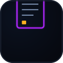

<p align="center">
  
</p>

# <sub>📄</sub> Docs — kit unpacking

<p align="center">
  
  <a href="../README.md"></a>
</p>

Two documents, one job: get the 0.69 GB kit from six archive volumes to a
working model directory without losing a byte.

| Document | What it gives you |
|----------|-------------------|
| [`HOW_TO_UNPACK.txt`](HOW_TO_UNPACK.txt) | the full path: download all volumes → join (`zip -s 0` or 7-Zip) → `python tools/reassemble_model.py` (joins the 8 safetensors parts, verifies SHA-256 `24e182ce…a6276`) → install deps → run the benchmark/probe; includes the optional push-to-your-GitHub recipe |
| [`RCDA_RUNBOOK.md`](../R%20CDA%20-%202/Docs/RCDA_RUNBOOK.md) *(in the `R CDA - 2` snapshot)* | the complete reproduction command set, round by round, from a clean clone to both research rounds — the canonical runbook for rounds 1–2 |

## The 30-second version

```bash
# all volumes in ONE directory, then either
zip -s 0 rmt-pocket-interventions.zip --out kit_full.zip && unzip kit_full.zip
# or let the script do everything (it also verifies the checksum)
python ../Code/reassemble_model.py
```

Every volume is required — a missing `.zNN` makes the whole archive unreadable.
Verified on 2026-11-08: the joined archive passes integrity checks and the
reassembled weights match the recorded SHA-256.

---

<p align="center">
  <br>
  <sub><a href="../README.md">← kit root</a> · <a href="HOW_TO_UNPACK.txt">HOW_TO_UNPACK.txt →</a></sub>
</p>
