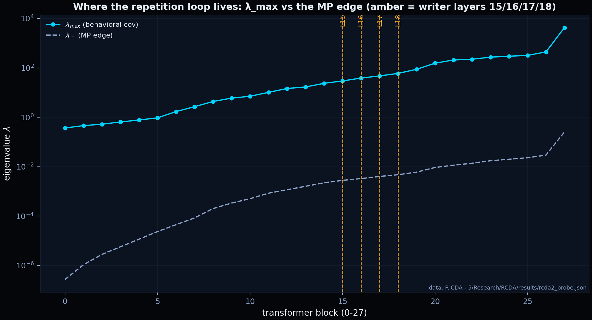
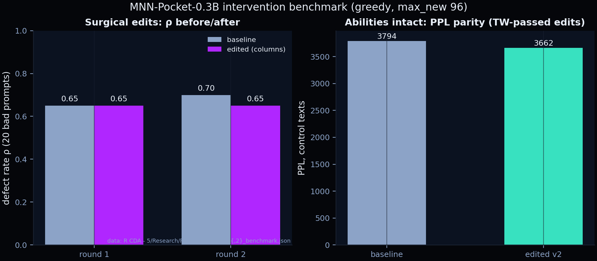
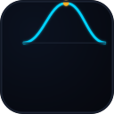

  

# 📊 Graphic — result figures

  
  
  

Two layers of figures live here.

## The aurora layer (current)

Re-rendered in the Black-Aurora project style from the committed result JSONs —
same data mappings as the original tools, English labels, deterministic seeds.
Regenerate with `python scripts/gen_mnn_figures.py` from the repository root.

| Figure | What it shows |
|--------|---------------|
| `aurora_layer_profile.png` | where the loop lives: λ_max per block vs the MP edge, writer layers 15/16/17/18 in amber |
| `aurora_benchmark_summary.png` | the surgical-edit benchmark: ρ before/after for rounds 1–2 and the PPL parity of abilities |

  

  

The full round figure set — fig5–fig15 with the same styling — lives next to
each round's report: [`R CDA - 5/Research/RCDA/figures/`](../R%20CDA%20-%205/Research/RCDA/figures/)
(and the subset produced by each earlier snapshot in `R CDA - 2/3/4`).

## The historical layer (pinned, do not regenerate)

The original kit renders produced by the first spectral probe of the raw model.
They are kept byte-for-byte as generated on 2026-11-08; `fig2`'s title records
the probe conditions (`T=1169, H=896, q=0.77`). Their data (raw eigenvalues) is
not committed, so they cannot be honestly re-rendered — they are the "before"
picture of this folder's own glow-up.

| Figure | What it shows |
|--------|---------------|
| `fig1_spectra_per_layer.png` | eigenvalue spectra of every layer |
| `fig2_mp_fit.png` | Marchenko–Pastur fit to the measured spectrum |
| `fig3_bbp_theta.png` | signal strength vs the BBP critical θ |
| `fig4_outliers.png` | spectral outliers (spiked eigenvalues) |
| `benchmark_summary.png` | before/after intervention benchmark |

---

   
  <a href="../README.md">← kit root</a> · <a href="../R%20CDA%20-%205/Research/RCDA/figures/">the round figures →</a>

