<p align="center">
  
</p>

# <sub>📦</sub> Model ZIP — the split archive of the intervention kit

<p align="center">
  
  
  
  <a href="../README.md"></a>
</p>

`rmt-pocket-interventions` — the complete offline kit (scripts, configs,
prompts, the fp32 model split into 8 safetensors parts) — stored as a
multi-volume archive to stay under the 100 MB per-file GitHub limit:

```text
rmt-pocket-interventions.z01 … rmt-pocket-interventions.z06
rmt-pocket-interventions.zip      ← last volume, keep it next to the others
```

## Unpack

Put **all** volumes in one directory (every `.zNN` is required — one missing
volume makes the archive unreadable), then:

```bash
zip -s 0 rmt-pocket-interventions.zip --out kit_full.zip
unzip kit_full.zip
# or simply
python ../Code/reassemble_model.py
```

Inside, `tools/reassemble_model.py` joins
`model/model.safetensors.part-00 … part-07` into the ~690 MB
`model/model.safetensors` and validates the checksum —
SHA-256 `24e182cebe433e9354dc35567d66c655888e7577ca7f6f71cea196a5b7da6276`
(verified 2026-11-08). After that the project is fully offline-ready.
Step-by-step text: [`../Docs/HOW_TO_UNPACK.txt`](../Docs/HOW_TO_UNPACK.txt).

## Why a split archive

GitHub caps any single file at 100 MB. Six 90 MB volumes + one 10 MB final
volume keep the kit pushable with plain git — no LFS, no external hosting —
and the reassembly is a one-command, checksum-verified step.

---

<p align="center">
  <br>
  <sub><a href="../README.md">← kit root</a> · <a href="../Docs/HOW_TO_UNPACK.txt">unpacking guide →</a></sub>
</p>
