  

# 🧪 R CDA — 2 · behavioral contrast, dose-response, precursors

  
  

A frozen snapshot of the working tree at the end of **RCDA round 2** — the
round that replaced the style contrast with the model's own behavioral labels,
measured the α dose-response, found the participation-ratio precursor, and
produced the first TW-passed surgical edit (190k weights, ρ 0.70 → 0.65).

## What is inside

| Path | Contents |
|------|----------|
| [`Code/`](Code) | the toolkit as of round 2 (probe, editor, benchmark) |
| [`config/`](config) | `rcda_experiment.yaml` (round 1 + stop criteria), `rcda2_behavioral.yaml` (round 2) |
| [`prompts/`](prompts) | `bad.jsonl` / `good.jsonl` / `control.jsonl` — the experiment inputs (bilingual by design) |
| [`Research/RCDA/`](Research/RCDA) | [`RCDA_ROUND1_SUMMARY.md`](Research/RCDA/RCDA_ROUND1_SUMMARY.md), [`RCDA2_REPORT.md`](Research/RCDA/RCDA2_REPORT.md), [`results/`](Research/RCDA) (probe, dose, benchmark, edit packs), `figures/` fig5–fig10, `vectors/` (Δh directions) |
| [`Docs/RCDA_RUNBOOK.md`](Docs/RCDA_RUNBOOK.md) | the canonical runbook for rounds 1–2 |
| `rmt-llm-research_rcda2.zip` | byte-exact archive of the whole repository at the end of round 2 — historical, never regenerated |

**Read next:** the round-2 report → [`Research/RCDA/RCDA2_REPORT.md`](Research/RCDA/RCDA2_REPORT.md);
the continuation of the story → [`../R CDA - 3/README.md`](../R%20CDA%20-%203/README.md).

> Later snapshots supersede this one's artifacts: the current canonical copies
> of all reports and results live in [`../R CDA - 5/`](../R%20CDA%20-%205/README.md).
> This folder is kept exactly as round 2 left it.

---

   
  <a href="../README.md">← kit root</a> · <a href="Research/RCDA/RCDA2_REPORT.md">the round-2 report →</a>

