  

# 🛡️ R CDA — 3 · the spectral sentinel

  
  

A frozen snapshot at the end of **RCDA round 3** — the round that turned the
PR precursor into a working online controller: calibration without threshold
tuning (q10 of a healthy teacher-forced pool), **TPR 96.7% with zero false
alarms**, the attractor experiment (timer arms restore themselves), therapy
arms ρ 0.70 / 0.65 / **0.50**, the persistent `ban_persist` policy at
**ρ 0.10 with zero edited weights**, and the placebo-controlled head-surgery
NO-GO.

## What is inside

| Path | Contents |
|------|----------|
| [`Code/`](Code) | the toolkit as of round 3 |
| [`config/`](config) | sentinel configuration (`rcda3_sentinel.yaml`) and earlier configs |
| [`prompts/`](prompts) | the experiment inputs (bilingual by design) |
| [`Research/RCDA/`](Research/RCDA) | [`RCDA3_REPORT.md`](Research/RCDA/RCDA3_REPORT.md) (+ earlier reports), `results/` (`rcda3_sentinel.json`, `rcda3_heads.json`, `rcda3_comparison.json`, `rcda3_digest.md`, generations with PR traces), `figures/` fig5–fig13 |
| `rmt-llm-research_rcda3.zip` | byte-exact archive of the repository at the end of round 3 |

**Read next:** [`Research/RCDA/RCDA3_REPORT.md`](Research/RCDA/RCDA3_REPORT.md);
the continuation → [`../R CDA - 4/README.md`](../R%20CDA%20-%204/README.md).

> The canonical copies of all reports and results live in
> [`../R CDA - 5/`](../R%20CDA%20-%205/README.md); this folder is kept exactly
> as round 3 left it.

---

   
  <a href="../README.md">← kit root</a> · <a href="Research/RCDA/RCDA3_REPORT.md">the round-3 report →</a>

