  

# 🤖 R CDA — 4 · weight-space programming

  
  

A frozen snapshot at the end of **RCDA round 4** — the independent response to
MIT CSAIL's "Sparks of Weight-Space Programming" (Takehi et al., Nov 2, 2026):
**Part C** — a non-frontier GLM reads the top concentration head from raw
896×896 matrices under blind labels (top-1 exact hit); **Part A** — the
published MIT edit fails our pre-registered gate on our benchmark (the effect
does not generalize beyond the authors' diagnostic set); **Part B** — the
agent, blind or aided, fails to write a working edit (TW violation,
cos 0.054, defect 0.85) — plus the collinearity side result
(v15·v16 = 0.944, v16·v18 = 0.883, v15·v18 = 0.833: one loop, three observers).

## What is inside

| Path | Contents |
|------|----------|
| [`Code/`](Code) | the toolkit as of round 4 |
| [`config/`](config) | experiment configs |
| [`prompts/`](prompts) | the experiment inputs (bilingual by design) |
| [`Research/RCDA/`](Research/RCDA) | [`RCDA4_PLAN.md`](Research/RCDA/RCDA4_PLAN.md), [`RCDA4_REPORT.md`](Research/RCDA/RCDA4_REPORT.md) (+ earlier reports), `results/` (partA base/edited summaries, partB blind/aided transcripts, partC secret + transcript, `rcda3_heads.json`), `figures/` fig5–fig14 |
| `rmt-llm-research_rcda4.zip` | byte-exact archive of the repository at the end of round 4 |

**Read next:** the [plan](Research/RCDA/RCDA4_PLAN.md) → the
[report](Research/RCDA/RCDA4_REPORT.md); the continuation →
[`../R CDA - 5/README.md`](../R%20CDA%20-%205/README.md).

> The canonical copies of all reports and results live in
> [`../R CDA - 5/`](../R%20CDA%20-%205/README.md); this folder is kept exactly
> as round 4 left it.

---

   
  <a href="../README.md">← kit root</a> · <a href="Research/RCDA/RCDA4_REPORT.md">the round-4 report →</a>

