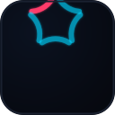

  

# 🔥 R CDA — 5 · the formula as a loss

  
  
  

The final and **canonical** snapshot: at the end of round 5 this folder holds
every report and result of the whole program. Round 5 asked the third way of
applying the formula — bake `(I − P_v)` into training as a gradient penalty on
the loop layers (o_proj L15/16/18, 0.8% of the parameters) with a hard
abilities anchor — and it won: **ρ_bad 0.80 → 0.35 (−56%)**, loop waste
73 → 31 tokens, TW **pass ×3**, cos(u₁, v) = 0.72/0.64/0.29, PPL parity.
SGD converged to a spectrally clean, distributed solution of the same class as
the surgery — the model found the repository's primitive on its own.

## What is inside

| Path | Contents |
|------|----------|
| [`Code/`](Code) | the full toolkit |
| [`config/`](config) | all round configs |
| [`prompts/`](prompts) | the experiment inputs (bilingual by design) |
| [`Research/RCDA/`](Research/RCDA) | **all five reports** ([ROUND1](Research/RCDA/RCDA_ROUND1_SUMMARY.md), [RCDA2](Research/RCDA/RCDA2_REPORT.md), [RCDA3](Research/RCDA/RCDA3_REPORT.md), [RCDA4](Research/RCDA/RCDA4_REPORT.md), [RCDA5](Research/RCDA/RCDA5_REPORT.md)), `results/` — the complete JSON record (probe, dose, benchmark, sentinel, heads, partA/B/C, training log, part5 evals, PPL check), `figures/` fig5–fig15 (aurora re-render), `tools/` (the round scripts incl. `rcda5_*.py`, `test_rcda_math.py`), `vectors/` |

**Start here:** [RCDA-5 report](Research/RCDA/RCDA5_REPORT.md) → then walk
backwards through the table above; or forward through the gallery in the
[parent README](../README.md#-the-gallery).

> Earlier snapshots (`R CDA - 2/3/4`) are frozen history; when they disagree
> with this folder, this folder is authoritative.

---

   
  <a href="../README.md">← kit root</a> · <a href="Research/RCDA/RCDA5_REPORT.md">the round-5 report →</a>

