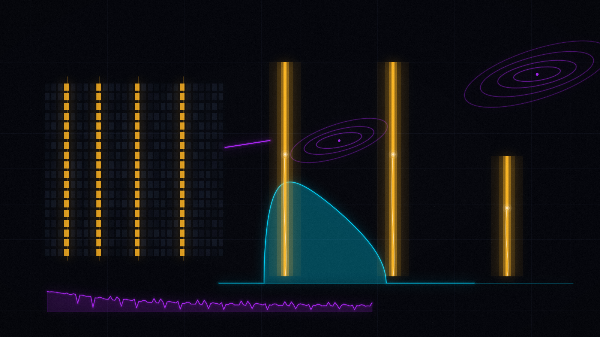
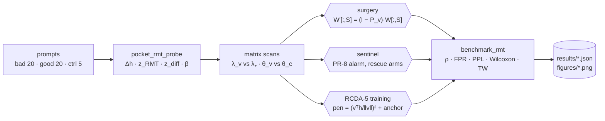
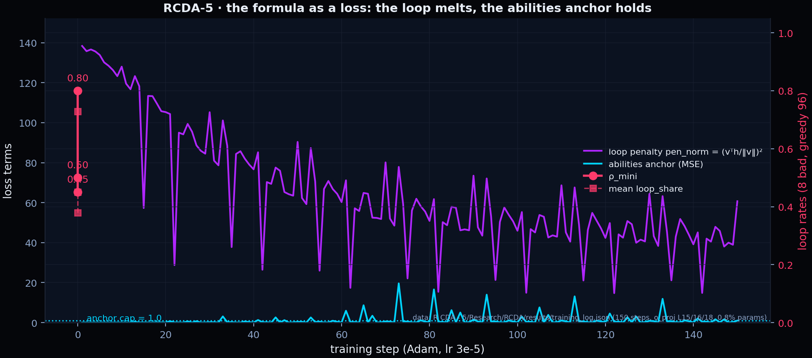
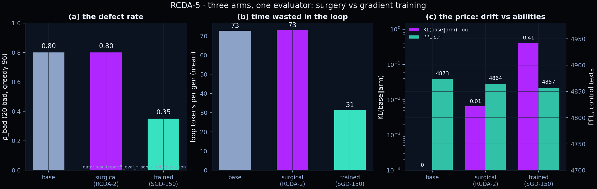
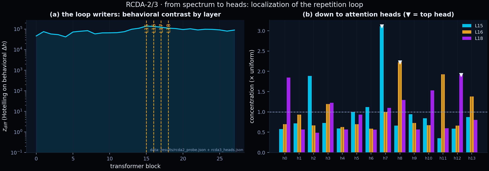
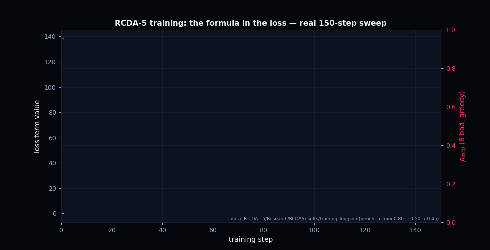
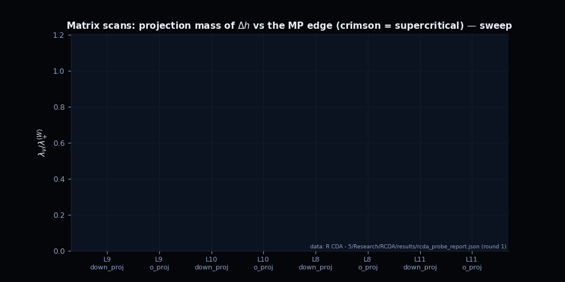
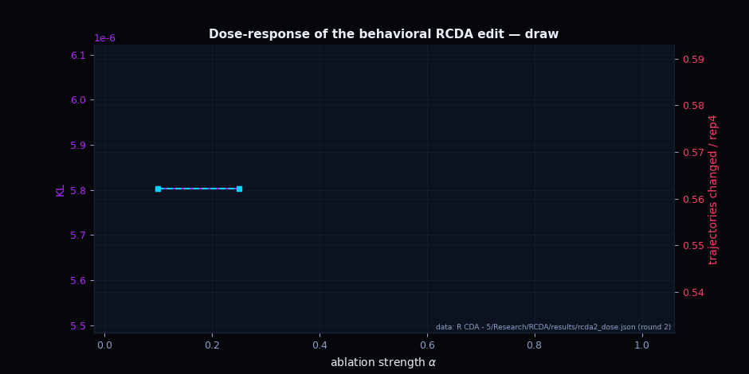
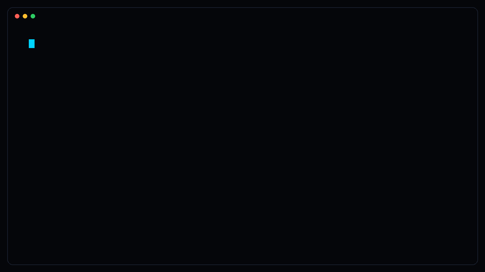
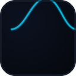

# <sub>🔬</sub> MNN-Pocket-0.3B — the RMT intervention kit

<p align="center">
  <picture>
    <source srcset="assets/visuals/hero-2x.avif" type="image/avif">
    <source srcset="assets/visuals/hero-2x.webp" type="image/webp">
    
  </picture>
</p>

<p align="center">
  
</p>
<p align="center"><sub><em>
  The loop melts — literally. The three spike heights are the measured
  <code>ρ_bad</code> of the three RCDA-5 arms (0.80 / 0.80 / 0.35), the violet
  trace is the real 150-step <code>pen_norm</code> from
  <code>Research/RCDA/results/training_log.json</code>. Regenerate everything
  with <code>python scripts/gen_folder_visuals.py</code> +
  <code>python scripts/gen_folder_anims.py</code>.
</em></sub></p>

<p align="center">
  <a href="README.md"></a>
  
  
  
  <a href="../README.md"></a>
</p>

> **A real 0.3B transformer, a real behavioral defect, and every tool of the
> repository pointed at it:** spectral probing layer by layer, Marchenko–Pastur
> fits, BBP thresholds, Tracy–Widom-controlled weight surgery, an online
> spectral sentinel — and, finally, the RMT formula baked into gradient
> training. Five pre-registered rounds, every number measured, every artifact
> committed.

---

## ⌛ The kit in 60 seconds

The model — [`taobao-mnn/MNN-Pocket-0.3B`](https://huggingface.co/taobao-mnn/MNN-Pocket-0.3B)
(Qwen3ForCausalLM, 28 layers, d = 896, 14 heads, tied embeddings) — has a
reproducible defect: on long greedy generations it falls into **repetition
loops**. The kit treats this defect the way the rest of the repository treats
LLMs: as a spectral object.

1. **Probe** — hidden-state deltas Δh between looping and clean tokens (the
   model labels its own defect) give a *behavioral direction* `v` per layer;
   Hotelling z_diff localizes the writers at **o_proj L15/L16/L18** (the round-1
   style contrast was a confounder — the two directions are nearly orthogonal,
   |cos| ≈ 0.01–0.09).
2. **Matrix scans** — the loop direction is *supercritical* in exactly those
   three `o_proj` matrices (λ_v/λ₊ = 1.28–1.41 > 1, θ_v > θ_c = √q).
3. **Surgery** — the repository's primitive
   `W′[:, S] = (I − P_v)·W[:, S]` removes the projection mass from selected
   columns: 190k weights (0.062%), TW control **pass**, PPL improved (−3.5%) —
   but the defect only bends (ρ 0.70 → 0.65): it is *distributed*.
4. **Sentinel** — the participation ratio of a sliding window drops **before**
   the text collapses (−9%), so a threshold detector catches the loop online:
   **TPR 96.7%, zero false alarms**; alarm-triggered interventions cut the
   in-loop waste 4.3× without touching a weight.
5. **SGD** — the formula itself becomes a loss: `pen = (vᵀh/‖v‖)²` on the
   loop layers + a hard abilities anchor. 150 steps, 0.8% of the parameters,
   and the loop melts: **ρ_bad 0.80 → 0.35 (−56%)**, loop waste 73 → 31 tokens,
   TW **pass ×3**, cos(u₁, v) = 0.72/0.64/0.29 — the model found a
   spectrally clean solution of the same class *on its own*.

| Symbol | Value | Meaning | Source |
|--------|-------|---------|--------|
| defect | repetition loop | 4-gram token recurrence, loop_share ≥ 0.5 | [`benchmark_rmt.py`](Code/benchmark_rmt.py) |
| writers | o_proj **L15/L16/L18** | behavioral Δh, z_diff ≈ 1.1–1.4·10⁵ | [`rcda2_probe.json`](R%20CDA%20-%205/Research/RCDA/results/rcda2_probe.json) |
| top heads | L15→h7 (×3.11), L16→h8 (×2.22), L18→h12 (×1.91) | per-head concentration, placebo-controlled | [`rcda3_heads.json`](R%20CDA%20-%205/Research/RCDA/results/rcda3_heads.json) |
| surgery | 190,952 weights ≈ 0.062% | `auto_chi2` columns, TW pass | [`rcda2_edit_report.json`](R%20CDA%20-%205/Research/RCDA/results/rcda2_edit_report.json) |
| sentinel | TPR **96.7%**, 0 FP | PR-8 threshold θ = q10, alarm = 2 steps | [`rcda3_sentinel.json`](R%20CDA%20-%205/Research/RCDA/results/rcda3_sentinel.json) |
| ban_persist | ρ **0.10** (−60 pp), 0 weights | decoder 4-gram exhaustion | [`rcda3_digest.md`](R%20CDA%20-%205/Research/RCDA/results/rcda3_digest.md) |
| SGD-150 | ρ_bad **0.35**, TW pass ×3 | formula in the loss, 0.8% params | [`part5_eval_trained.json`](R%20CDA%20-%205/Research/RCDA/results/part5_eval_trained.json) |
| abilities | PPL 4873 → 4857 | parity on control texts | [`ppl_check.json`](R%20CDA%20-%205/Research/RCDA/results/ppl_check.json) |

---

## 🏆 Headline results

| Round | Question | Result | Pinned evidence |
|-------|----------|--------|-----------------|
| **RCDA-1** | Where does the defect live? | Super-critical Δh in L8–L12 by the *style* contrast — later shown to be a confounder | [`rcda_probe_report.json`](R%20CDA%20-%205/Research/RCDA/results/rcda_probe_report.json), [report](R%20CDA%20-%205/Research/RCDA/RCDA_ROUND1_SUMMARY.md) |
| **RCDA-2** | What *writes* the loop? | o_proj L15/L16/L18; dose-response shows the defect is distributed (α = 1 moves 2/8 trajectories); PR precursor −9% before collapse | [report](R%20CDA%20-%205/Research/RCDA/RCDA2_REPORT.md), [`rcda2_dose.json`](R%20CDA%20-%205/Research/RCDA/results/rcda2_dose.json) |
| **RCDA-3** | Detect or edit? | Sentinel TPR 96.7% / 0 FP; therapy arms ρ 0.70 / 0.65 / **0.50** / **0.10**(C′); head surgery NO-GO with placebo control | [report](R%20CDA%20-%205/Research/RCDA/RCDA3_REPORT.md), [`rcda3_sentinel.json`](R%20CDA%20-%205/Research/RCDA/results/rcda3_sentinel.json) |
| **RCDA-4** | Can an LLM do this alone? | Part C: reads the top head from raw weights (top-1 hit). Part A: MIT's published edit fails our gate. Part B: blind and aided agent edits both fail (TW violation, cos 0.054) | [report](R%20CDA%20-%205/Research/RCDA/RCDA4_REPORT.md), [plan](R%20CDA%20-%205/Research/RCDA/RCDA4_PLAN.md) |
| **RCDA-5** | Teach the model the formula | SGD beats surgery: ρ_bad 0.80 → **0.35**, spectrally clean (TW pass ×3, cos 0.72/0.64/0.29), abilities intact | [report](R%20CDA%20-%205/Research/RCDA/RCDA5_REPORT.md), [`training_log.json`](R%20CDA%20-%205/Research/RCDA/results/training_log.json) |

---

## 🧬 The pipeline



Every path ends in the same evaluator — one defect metric `ρ`, one abilities
metric (PPL + KL on control texts), one spectral gate (Tracy–Widom). That is
what makes the rounds comparable.

---

## 🗂️ Kit map

| Folder | What lives there |
|--------|------------------|
| [`Code/`](Code/README.md) | probe, benchmark and intervention scripts (`pocket_rmt_probe.py`, `benchmark_rmt.py`, `rmt_intervention.py`, `marchenko_pastur.py`, …) |
| [`Docs/`](Docs/README.md) | how to unpack the split model archive |
| [`Graphic/`](Graphic/README.md) | result figures — historical kit renders + the aurora re-renders |
| [`Model ZIP/`](Model%20ZIP/README.md) | the split archive `rmt-pocket-interventions.zip` (+ `.z01`–`.z06`), SHA-256 verified |
| [`R CDA - 2`](R%20CDA%20-%202/README.md) … [`R CDA - 5`](R%20CDA%20-%205/README.md) | frozen snapshots at the end of each round: reports, result JSONs, vectors, tools, RCDA zips |

Related programs: [`../research/`](../research/README.md) (TinyGPT Formula) and
[`../science/`](../science/README.md) (the H1 predictive core).

---

## 🎨 The gallery

The branded charts below are rebuilt from the committed result JSONs — the
full-round figure set (fig5–fig15, one copy per snapshot) was re-rendered in
the project style by [`scripts/gen_mnn_figures.py`](../../scripts/gen_mnn_figures.py)
with English labels.

<p align="center">
  
</p>
<p align="center">
  
</p>
<p align="center">
  
</p>

| Figure | Where | What it shows |
|--------|-------|---------------|
| `fig5`–`fig6` | [`R CDA - 5 …/figures/`](R%20CDA%20-%205/Research/RCDA/figures/) | per-layer spectra vs the MP edge; matrix scans (supercritical in crimson) |
| `fig7`–`fig10` | same | behavioral contrast, dose-response, PR precursor, token attribution |
| `fig11`–`fig13` | same | the sentinel (traces, ROC, rescue arms), head surgery, therapy arms |
| `fig14` | same | RCDA-4: reading (C), verifying (A), writing (B) |
| `fig15` | same | RCDA-5: three arms, training curves, spectral purity |
| `fig1`–`fig4` | [`Graphic/`](Graphic/README.md) | the original kit renders (historical, kept as produced) |
| `aurora_*` | [`Graphic/`](Graphic/README.md) | the layer profile and benchmark summary in the project style |

Three of the stories also run as **animated counterparts** — the same data
mappings, drawn frame by frame by
[`scripts/gen_mnn_anims.py`](../../scripts/gen_mnn_anims.py) from the canonical
snapshot's JSONs (`R CDA - 5/Research/RCDA/results/`):

<p align="center">
  
</p>
<p align="center">
  
</p>
<p align="center">
  
</p>

<p align="center"><sub><em>
  Every frame is deterministic and budget-checked like the static assets; the
  GIFs are re-generated by <code>python scripts/gen_mnn_anims.py</code> and
  pinned in <code>MANIFEST.json</code> like everything else.
</em></sub></p>

---

## 🧭 Reading paths

| I want to… | Time | Go to |
|------------|------|-------|
| 🕐 **get the story** | 10 min | [The kit in 60 seconds](#-the-kit-in-60-seconds) → [Headline results](#-headline-results) → the gallery above |
| 🔬 **understand the method** | one evening | [RCDA-2 report](R%20CDA%20-%205/Research/RCDA/RCDA2_REPORT.md) → [RCDA-3 report](R%20CDA%20-%205/Research/RCDA/RCDA3_REPORT.md) → [`Code/README.md`](Code/README.md) |
| 🤖 **see the agent experiment** | 45 min | [RCDA-4 plan](R%20CDA%20-%205/Research/RCDA/RCDA4_PLAN.md) → [RCDA-4 report](R%20CDA%20-%205/Research/RCDA/RCDA4_REPORT.md) → [RCDA-5 report](R%20CDA%20-%205/Research/RCDA/RCDA5_REPORT.md) |
| 🧪 **run it** | 1 h | [`Docs/HOW_TO_UNPACK.txt`](Docs/HOW_TO_UNPACK.txt) → [`Docs/RCDA_RUNBOOK.md`](R%20CDA%20-%202/Docs/RCDA_RUNBOOK.md) → reproduction below |

---

## ⚡ Reproduce

```bash
# 0) unpack the kit (assembles model.safetensors + verifies SHA-256, ~10 s)
unzip by any split-archive tool, then
python tools/reassemble_model.py          # inside the extracted folder

# 1) the full round-2 chain (CPU, ~40 min): probe → dose → edit → benchmark
python Research/RCDA/tools/rcda2_stage1_probe.py
python Research/RCDA/tools/rcda2_stage2_dose.py
python Code/benchmark_rmt.py --baseline_dir model --edited_dir edited_model_v2 \
    --bad_set prompts/bad.jsonl --good_set prompts/good.jsonl \
    --control_set prompts/control.jsonl --out_dir bench_v2 --max_new 96

# 2) the sentinel (online detection + rescue, ~18 min)
python Research/RCDA/tools/rcda3_sentinel.py

# 3) the formula as a loss (150 SGD steps, ~3 min after the states are prepared)
python Research/RCDA/tools/rcda5_prepare.py
python Research/RCDA/tools/rcda5_train.py --steps 150 --lr 3e-5 --bench-at 75 150
```

Requirements: Python ≥ 3.10, `torch` (CPU is enough), `transformers`,
`safetensors`, `scipy`, `matplotlib`; the fp32 model takes ~1.2 GB of RAM.
The complete command set, round by round:
[`Docs/RCDA_RUNBOOK.md`](R%20CDA%20-%202/Docs/RCDA_RUNBOOK.md).

<p align="center">
  
</p>
<p align="center"><sub><em>
  The numbers in the recording are the measured ones — the surgery benchmark
  (<code>rcda2_benchmark.json</code>) and the RCDA-5 run
  (<code>training_log.json</code>).
</em></sub></p>

---

## 🔐 Provenance & integrity

- The model reassembly matches the recorded SHA-256
  `24e182cebe433e9354dc35567d66c655888e7577ca7f6f71cea196a5b7da6276`
  (verified on 2026-11-08, see [`Docs/HOW_TO_UNPACK.txt`](Docs/HOW_TO_UNPACK.txt)).
- Every result number in this README is a field of a committed JSON under
  `R CDA - 5/Research/RCDA/results/` — no figure or table is hand-typed.
- The RCDA zips (`rmt-llm-research_rcda2.zip` … `rcda4.zip` in the snapshot
  folders) are byte-exact archives of the repository at the end of rounds 2–4:
  historical snapshots, never regenerated.
- **Language note.** The experiment *inputs* — the bad/good/control prompt
  sets and the in-code default control texts — are intentionally bilingual
  (Russian + English): the loop defect was provoked and measured on Russian
  prompts, and changing them would change the experiment. Everything a human
  reads (reports, runbooks, figure labels, READMEs) is English.

---

<p align="center">
  <br>
  <sub>
    <a href="../README.md">← neural_lab</a> · <a href="README.md">top</a> ·
    <a href="../../README.md">🏠 repository root</a> ·
    <a href="../science/README.md">the science core →</a>
  </sub>
</p>
