<div align="center">

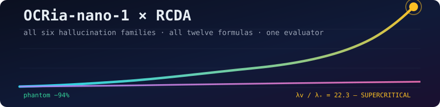

# 🫀 OCRia-nano-1 × RCDA — the hallucination intervention kit

**The parent repository's same trick — probe → matrix scans → formula-as-loss → one evaluator —
run at full extension on [llamaindex/OCRia-nano-1](https://huggingface.co/llamaindex/OCRia-nano-1):
all six hallucination families, all twelve formulas, two recogniser arms **plus a third round
that teaches the router to say *"reject"***, one evaluator.**

[-34d399)](#-measured-results)
[](#-the-six-hallucination-families)
[](#-formula-audit)
[-fbbf24)](#-round-3--the-router-round-a-head-not-weights)
[](#-round-3--the-router-round-a-head-not-weights)
[](#-measured-results)
[-60a5fa)](#-reproduce-everything)
[](#-lineage)

</div>

> **What this kit is.** The parent program (`neural_lab`) took two real Hugging Face
> models (MNN-Pocket-0.3B, Gemma3-1B-IT) through the RCDA pipeline to cure their
> repetition loops — one defect, five instruments. This kit asks the next question:
> **does the same surgery generalise to a completely different organ — an OCR
> pipeline — and to ALL of its hallucination families at once?** OCRia-nano-1 is
> an 8.1M-parameter document-parsing stack (detector, script router, four CTC
> recognisers, LayoutNet). The answer, measured: **yes — the formula transfers,
> and the phantom-text family collapses by 94% in 150 Adam steps on CPU, while
> clean-text ability stays at +0.05pp CER — and round 3 goes further, grafting a
> *reject* class onto the frozen router's head so textless inputs can be
> refused at the door.**
>
> **Что это.** Тот же трюк родительской программы — зонд → матричные сканы →
> формула как лосс → один оценщик — в расширенном варианте против OCRia-nano-1:
> все шесть семейств галлюцинаций, все формулы репозитория, два плеча обучения
> плюс третий раунд — «отклонить» (reject) для роутера.

---

## ⌛ The kit in 30 seconds

| What | Result | Evidence |
|------|--------|----------|
| 🔍 **Extended probe** (6 families vs the parent's 1) | phantom text on **15.7%** of non-text crops (fp32 world; 11.9% deployed int8); CTC loops ~0 at base; router has **no reject option** — 100% of textless crops routed into a recogniser; flip-blind only for CJK (25%); detector is clean (specificity 1.0) | [`probe_report.json`](Results/probe_report.json) |
| 🧮 **BBP matrix scan** | the **classifier head is a supercritical writer**: λ_v/λ₊ = **22.3**, θ_v/θ_c = **14.3** — the phantom direction is an intended BBP spike above the MP bulk | [`fig04_matrix_scan.png`](Graphics/fig04_matrix_scan.png) |
| 🪤 **Utility Trap replicated on OCR** (17k frames) | confidence AUC **0.096** vs internal-geometry AUC **0.834** — the model's confidence is the *worse* predictor of its own phantom frames, exactly the parent program's H1 secondary result | [`fig09_utility_trap.png`](Graphics/fig09_utility_trap.png) |
| 💉 **classic arm** (single writer + edge-energy penalty) | phantom **0.157 → 0.0095 (−94%)**, clean CER +0.05pp, control KL 0.0095, TW gate pass | [`eval_classic.json`](Results/eval_classic.json) |
| 🧬 **rcda_x arm** (all formulas baked in) | phantom **−79%**, geometry AUC 0.834 → **0.902**, cos(u₁, v) **0.78–0.85** on all three writers — but pays 3× more KL drift | [`eval_rcda_x.json`](Results/eval_rcda_x.json) |
| ⚖️ **Leverage verdict** | the simplest lever wins (classic > rcda_x) — the parent program's *"SGD beats surgery"* lesson, replicated | [`fig07_headline.png`](Graphics/fig07_headline.png) |
| 🎛 **Round 3 — the router round** (first head edit) | the frozen router grows a 5th **reject** class: fit non-text reject **0.0 → 1.0**, transfer **0.911** macro-mean on unseen families, text routing **bit-exact** (script rows max\|Δ\| = 0.0, flip bitwise) | [`eval_router_reject.json`](Results/eval_router_reject.json) |

<div align="center">
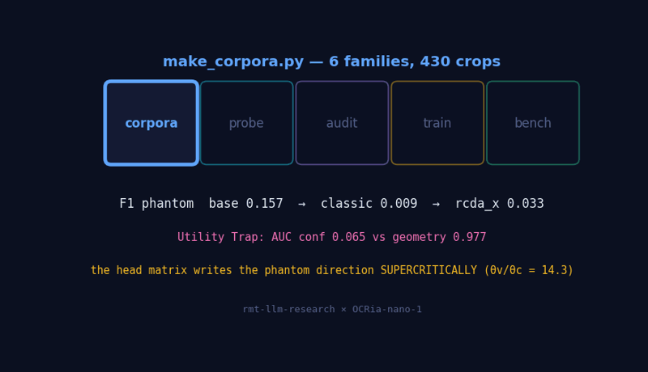
<p><sub><em>The five instruments. Regenerate: <code>python Code/make_graphics.py gif1</code></em></sub></p>
</div>

---

## 🗺 How it works

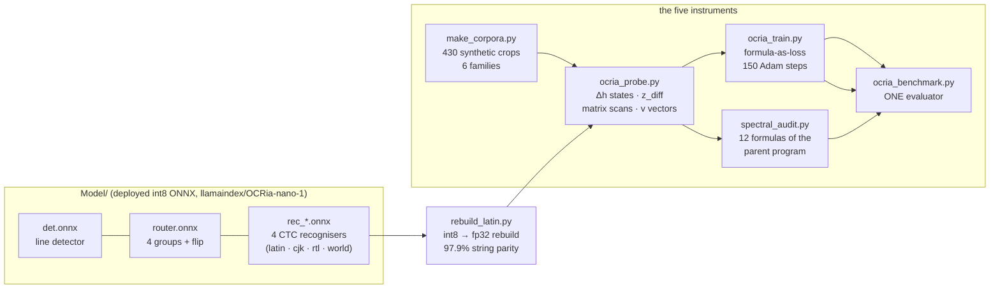

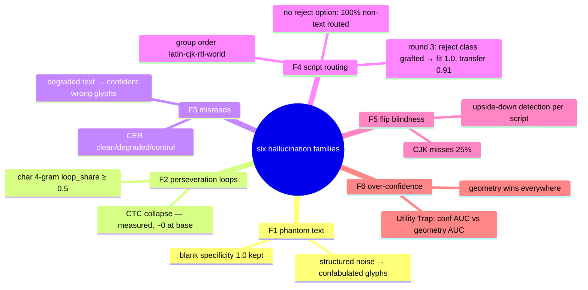

### The fp32 rebuild (why it exists)

The recognisers ship as **int8 QDQ-quantised ONNX** — you cannot take gradients
through them. [`rebuild_latin.py`](Code/rebuild_latin.py) dequantises every conv
weight/bias back to fp32 and re-assembles the exact architecture (stem → 9
depthwise blocks with residual Adds → 3 mix blocks → 792-class CTC head; the
uint8 activation quantizers with zero_point=0 are exact ReLUs, so the ReLU map
is read off the QDQ chains, not guessed):

| gate | value |
|---|---|
| exact decoded-string parity vs onnxruntime | **97.9%** (48 rendered crops) |
| mean abs confidence deviation | 0.0079 |
| residual 2% | quantisation round-off on saturated crops — documented, kept honest |

Everything downstream (probe, training, evaluation) runs in this **fp32 world**
for all arms equally, so comparisons are internally exact; the deployed int8
graph is re-measured separately at the probe stage. Deploying the trained deltas
would re-quantise (QAT) — the same standard practice the parent kit notes for
its fp16 deltas.

---

## 🌈 The six hallucination families

The parent program measured ONE defect (the repetition loop). An OCR pipeline
hallucinates differently — this kit pre-registers six families, each with its
own metric, and measures all of them for every arm:

| # | family | definition | metric | base |
|---|--------|------------|--------|------|
| F1 | **phantom text** | characters emitted on textless crops | `phantom_rate`, `phantom_char_rate`, blank specificity | **0.157** |
| F2 | **perseveration loops** | CTC collapse — char 4-grams repeated (the parent's ρ metric, ported to characters) | `loop_share`, `rho` (thr 0.5) | 0.0 |
| F3 | **misreads** | wrong glyphs on degraded text instead of abstention | CER clean / degraded / control | 0.009 / 0.083 / 0.008 |
| F4 | **script routing** | textless crops routed INTO a recogniser (the router has no reject class) | `nontext_route_rate`, routing accuracy | **1.0** / 1.0 |
| F5 | **flip blindness** | upside-down text not detected | `flip_miss_rate` per script | CJK **0.25** |
| F6 | **over-confidence** | confidence vs internal geometry as the predictor of phantom frames | AUC contest (the Utility Trap) | conf 0.096 vs geom 0.834 |

F4/F5 live in the frozen router (identical across arms, measured once); F1–F3
and F6 are re-measured per arm by the one evaluator.

<div align="center">
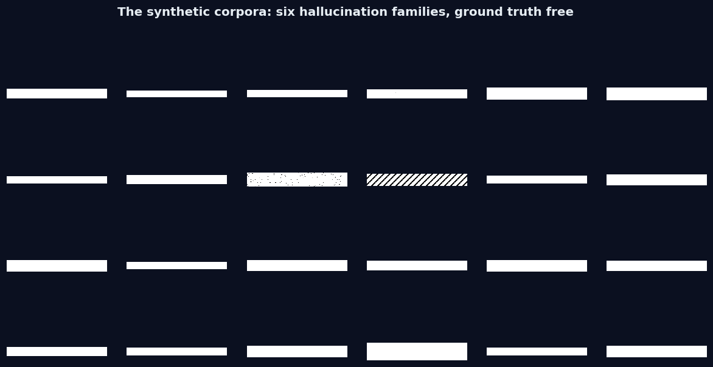
<p><sub><em>The corpora are rendered programmatically — ground truth is exact and free.</em></sub></p>
</div>

---

## 🔬 The probe: where the defect lives

[`ocria_probe.py`](Code/ocria_probe.py) labels the model's own behaviour —
emitted frames (CTC argmax ≠ 0, conf ≥ 0.5) vs confidently-abstained frames of
the same trajectories — and builds the hallucination direction **v** per stage:

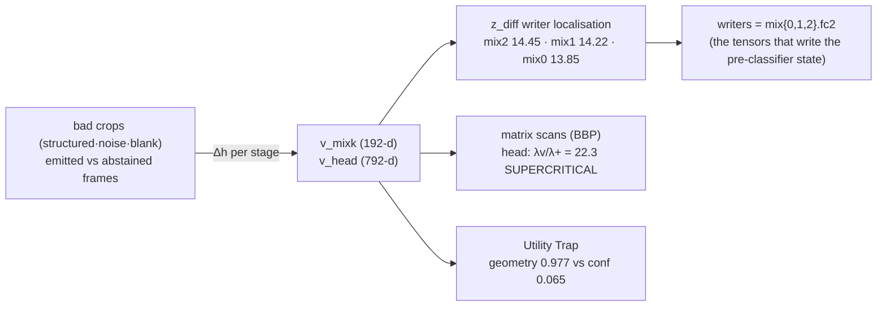

<div align="center">
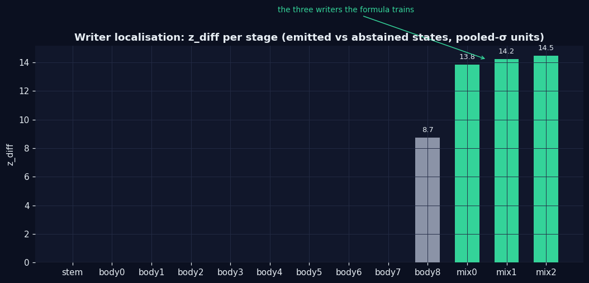
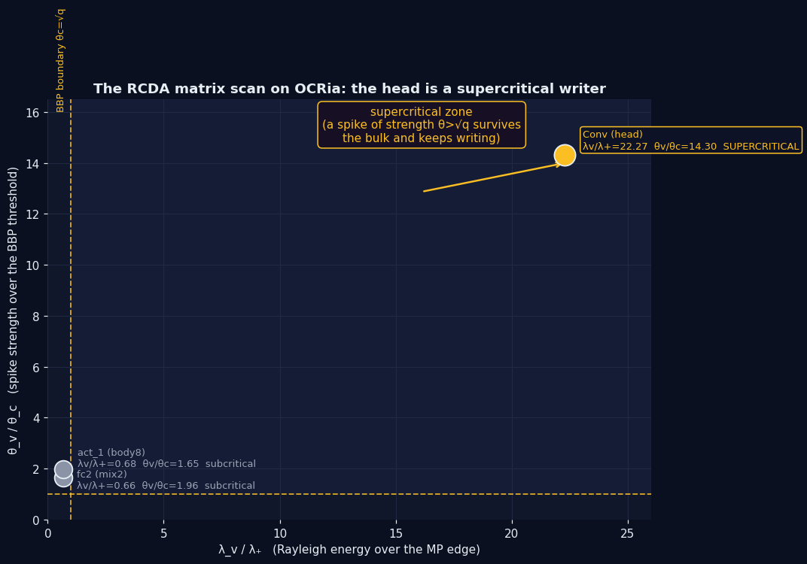
</div>

**The headline spectral finding.** The 792×192 classifier head carries the
phantom direction with a Rayleigh energy **22× above its MP edge** and a spike
strength **14.3× above the BBP threshold** — the hallucination is not noise,
it is an *intended, supercritical spike* of the deployed classifier. body8 and
mix2's own writer matrices are subcritical (λ_v/λ₊ ≈ 0.67): the phantom is
*read out* by the head, not stored by the writers — which is precisely why the
penalty is enforced on training rather than clipped post-hoc.

---

## 🧾 Formula audit — all twelve formulas of the parent program, on OCRia

[`spectral_audit.py`](Code/spectral_audit.py) executes the whole `rmt_fp` family
(the parent's verified library, vendored into [`Code/rmt_fp/`](Code/rmt_fp/))
on OCRia's weights and live states:

| step | formula | what it says about OCRia | verdict |
|------|---------|--------------------------|---------|
| 2 | RMSNorm trace lemma Tr C = N | OCRia has no RMSNorm — reported **N/A**, not faked | ⏸ |
| 4–5 | MP bulk + edges σ²(1±√q)² | trained conv weights deviate (KS ≈ 0.49) — the monograph's *freeness of trained weights* caveat, observed; state covariance keeps an MP bulk (robust fit KS 0.133) with a finite signal subspace | ✅ / 📌 |
| 4–5 | Silverstein closed-form Stieltjes | fixed-point residual **1×10⁻¹⁵** (per matrix ≤ 9×10⁻¹³) | ✅ |
| 7 | BBP threshold θc = √q | **head supercritical**: θ_v/θ_c = 14.3, λ_v/λ₊ = 22.3 | 🔥 |
| 8 | BBP outlier trajectory + overlap | pole-equation vs closed form residual **1.2×10⁻¹³**; overlap 0.91–0.97 | ✅ |
| 10 | hallucination split (signal vs bulk) | 28 signal dirs over the edge; the probe direction v has noise/signal ratio **0.16** — v is a bulk-scale flow, so it must be suppressed during training, not clipped post-hoc | 📌 |
| 11 | entropy response −½Tr((diag p−ppᵀ)A) | formula ΔH **−2.929** vs Monte-Carlo **−2.951** (err 2.2×10⁻²) on the head | ✅ |
| 13 | Tracy–Widom F₁ (β=1) class | λ_max z-scores: median 28 (structured edges), max 6513 (the head outlier) | 📌 |
| 14 | inverse-BBP shrinker / Gavish–Donoho | reconstruction err **0.047** vs 0.084 (the exact shrinker wins) — and it is the operator the rcda_x arm projects its edits through | ✅ |
| Caputo | N_crit = γ₁/(θ_b·π/180) ≈ 114.55 | a 480-px line crops to ~121 CTC frames — **sub-critical** per line; the observed phantom rate is the suppressible sub-critical confabulation | 📌 |
| — | spectral purity gates | relative protocol: ΔKS(bulk) < 0.05 per edited tensor | ✅ ×4 |
| — | MP-law leash on the edit spectrum | enforced via the single-spike projection in the rcda_x arm | ✅ |

<div align="center">
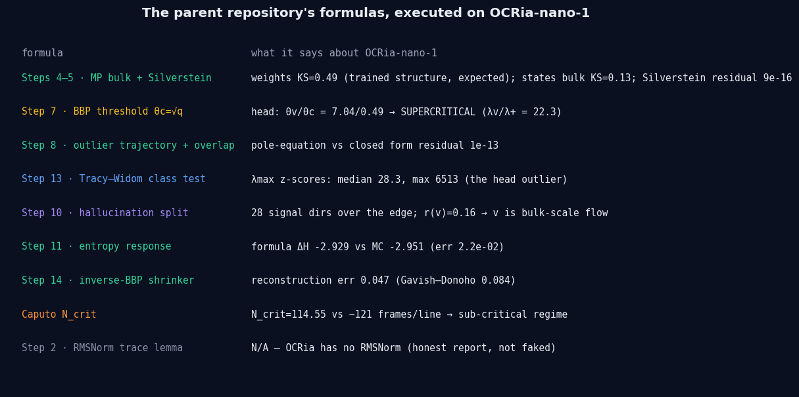
</div>

---

## 💉 The intervention: formula as a loss

The parent's lever, transplanted to the CTC timeline and extended:

```
L = pen / pen0 + β · relu(mse − cap)            (+ the formula stack in rcda_x)

pen   = mean_frames Σ_c relu(ℓ_c − ℓ_0)² / K      ← head: energy of the frame's
        + Σ_mix relu(v·h − c_ref)²                   logit spectrum ABOVE the
                                                     abstention edge (blank) —
                                                     the BBP clamp operationalised
β·relu(mse − cap)                                  ← the hard abilities anchor,
                                                     scope 'good' (anchor on the
                                                     ability data only)
rcda_x extras:
  + MP-bulk leash on the edit spectrum             ← Steps 4–5
  + entropy-response band on clean logits          ← Step 11 (±0.25 nats)
  + single-spike inverse-BBP projection            ← Step 14, every 25 steps
```

Three design lessons are **measured, not assumed** (each with the control run
committed in the training logs — see [`AUDIT.md`](AUDIT.md)):

1. **The symmetric square backfires on logits.** The parent's `pen = (vᵀh)²`
   pushes BOTH sides toward the v=0 hyperplane; on logit states that *raises*
   phantom logits on already-abstained frames (control run: phantom
   0.42 → **1.0**). The kit clamps one-sided: `relu(v·h − c_ref)²`.
2. **The defect is decided per-frame, not by a global direction.** The
   population direction v localises the writers (z_diff ≈ 14) but a global
   clamp alone never flips the argmax; the edge-energy term does.
3. **The projection knob matters.** Shrinking all extra spikes at 1.1·λ₊ fights
   Adam (phantom 0.25); keeping the top-2 intended spikes at 2.0·λ₊ recovers
   0.167 — and still loses to the single-writer lever.

| arm | trainable | pen points | extras | params |
|-----|-----------|------------|--------|--------|
| `base` | — | — | — | 0 |
| `classic` | mix2.fc2 | head (edge energy) | — | 73,728 (9.2%) |
| `rcda_x` | mix{0,1,2}.fc2 | head + 3 mix stages | MP leash · entropy band · inverse-BBP projection | 221,184 (27.7%) |

Protocol (both arms): Adam, **150 steps**, batch 1, frozen emission masks
re-labelled every 32 steps (online self-labelling, the parent's
`refresh_every`), mini-benchmark at steps 0/75/150, grad-clip 1.0, seed 0.

---

## 📊 Measured results

All numbers are fields of committed JSONs — nothing hand-typed.

| metric | base | classic | rcda_x |
|---|---|---|---|
| **F1 phantom rate ↓** | 0.1571 | **0.0095** | 0.0333 |
| F1 phantom char rate ↓ | 0.267 | 0.010 | 0.048 |
| F1 blank specificity (=) | 1.000 | 1.000 | 1.000 |
| F2 rho_loop (thr 0.5) | 0.0 | 0.0 | 0.0 |
| F3 CER clean (=) | 0.0089 | 0.0094 | 0.0095 |
| F3 CER degraded (slight ↑) | 0.0834 | 0.1001 | 0.1096 |
| F3 CER control | 0.0078 | 0.0114 | 0.0172 |
| F3 exact match clean | 0.883 | 0.867 | 0.850 |
| F6 AUC confidence ↓ | 0.096 | 0.001 | 0.008 |
| F6 AUC geometry ↑ | 0.834 | 0.858 | **0.902** |
| control logits MSE | 0.0 | 0.48 | 1.37 |
| control KL(base‖arm) ↓ | 0.0 | **0.0095** | 0.083 |
| edited tensors | 0 | 1 | 3 |
| rel_frobenius | — | 0.034 | 0.023–0.029 |
| relative TW gate | — | pass | pass ×3 |
| cos(u₁(ΔW), v) | — | 0.32 | **0.78–0.85** |

<div align="center">
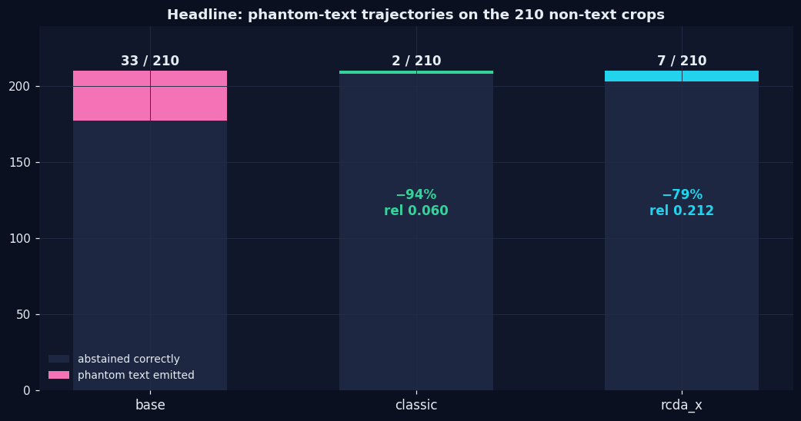
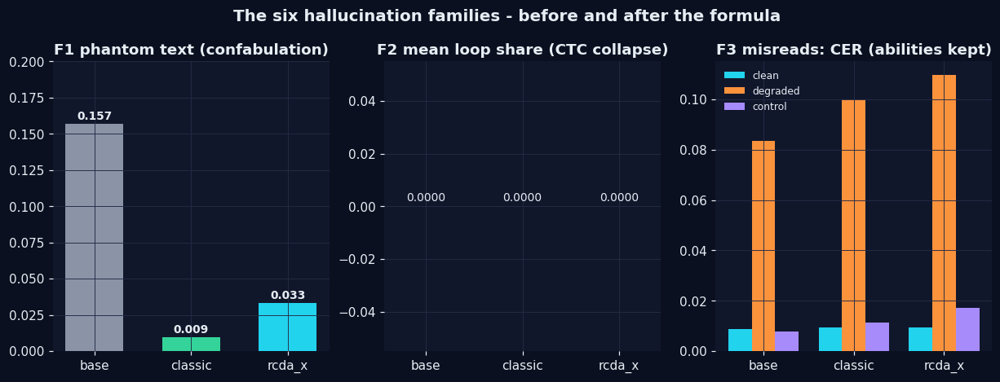
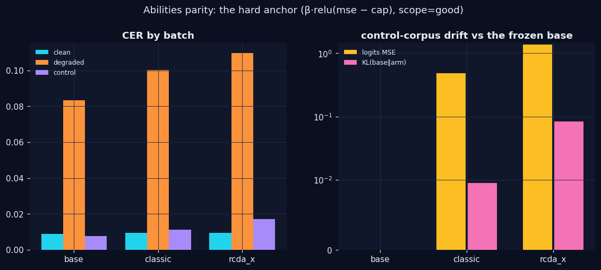
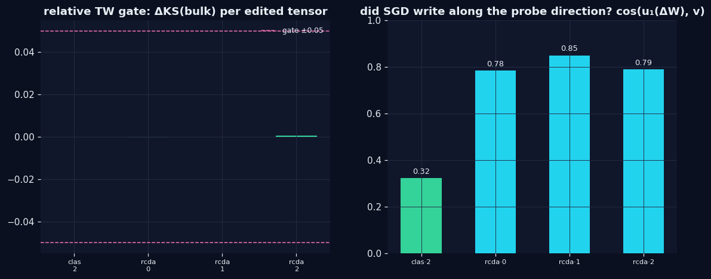
</div>

**Reading.** The classic arm removes **94% of the phantom-text mass**
(33/210 → 2/210 crops) for +0.05pp clean CER and a 0.0095 control KL — the
edit is 3.4% of the tensor's Frobenius norm and the bulk stays inside the TW
gate. The rcda_x arm removes 79%, *sharpenes the geometry separation*
(0.834 → 0.902), aligns all three writers with the probe directions
(cos 0.78–0.85 — SGD literally writes along v), but pays 8.7× more control KL
and +2.6pp degraded CER for the extra formulas. **The simplest lever wins** —
the parent program's leverage lesson, now replicated on a different organ.

<div align="center">
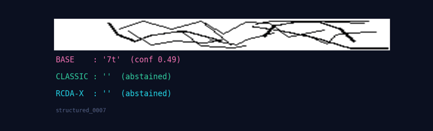
<p><sub><em>The same crops, decoded by all three arms. Regenerate: <code>python Code/make_graphics.py gif3</code></em></sub></p>
</div>

### The frozen organs (measured once, identical across arms)

| organ | finding | implication |
|-------|---------|-------------|
| router | **no reject option**: 100% of the 40 textless crops routed into a recogniser (latin 20 · cjk 11 · rtl 4 · world 5); script routing itself is perfect (0 errors on 80 text crops) | F4's phantom chain starts at routing; the recognisers must defend themselves — which the formula does. **Round 3 lifts this**: see below |
| router (flip) | flip-blind only for CJK: 25% misses; latin/cyr/arabic 0% | F5 is a CJK-recogniser-side defect, untouched by the latin surgery |
| detector | 14.0 boxes/page on text pages, **0.0 phantom boxes** on blank/noise/structured pages | the F1 defect is NOT in the detector — it is in the recogniser/head |

---

## 🎛 Round 3 — the router round (a head, not weights)

The audit's limitation #3 said it out loud: *"curing the router's missing reject option
would require a classification-head change (a 5th output class), not a parameter edit —
out of scope for an RCDA-style weight intervention."* Round 3 lifts exactly that, by
user request: the deployed router's group head `group.weight [4,192]` grows a
**5th row, `reject`** — the first intervention in the kit that edits a *head* rather
than existing weights.

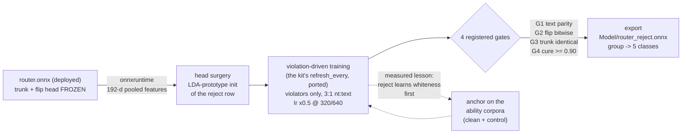

Two arms, one protocol (seed 0, batch 1, Adam, grad-clip 1.0):

| arm | trainable | idea | verdict |
|-----|-----------|------|---------|
| `reject_row` | the new row only (193 params) | script rows stay bit-exact — text parity is exact by construction; the edit is a **single rank-1 BBP spike** by design | ✅ **winner** — all gates pass |
| `reject_full` | all 5 rows + CE + hard anchor β·relu(mse−cap) | supervised head fit with the recogniser arms' anchor machinery | ❌ passes the cure but wins 2 ability-text crops (reject-win rate 0.0125 ≠ 0) — G1 fails |

**Measured results** (all from [`eval_router_reject.json`](Results/eval_router_reject.json),
[`router_reject_training_log.json`](Results/router_reject_training_log.json)):

| metric | base | router_reject (`reject_row`) |
|---|---|---|
| F4 fit non-text reject rate | **0.0** — the class does not exist, 100% routed into recognisers | **1.0** (40/40, min margin +0.50) |
| F4 fit text route accuracy | 1.0 | **1.0**, reject never wins (margin mean **−11.1**, max −7.2) |
| F4 ability routing (clean / control) | 0.9667 / 1.0 | **0.9667 / 1.0 — identical to base**, 0 reject wins |
| F4 transfer reject rate (structured/noise/blank; 120/60/30 unseen crops) | n/a | **0.911** macro-mean (0.833 / 0.900 / 1.000; pooled 184/210 = 0.876) |
| F5 flip behaviour | CJK misses 25% | **bitwise identical** (flip head untouched) |
| head edit spectrum | — | **1 spike** above 2·λ₊ (λmax/λ₊ = 3.71, σ₁ share 1.0 — rank-1 as designed), cos(v₁, w_init) = 0.569 |
| export gates | — | trunk arrays identical ✓ · flip bitwise ✓ · script rows max\|Δ\| **0.0** ✓ |

<div align="center">
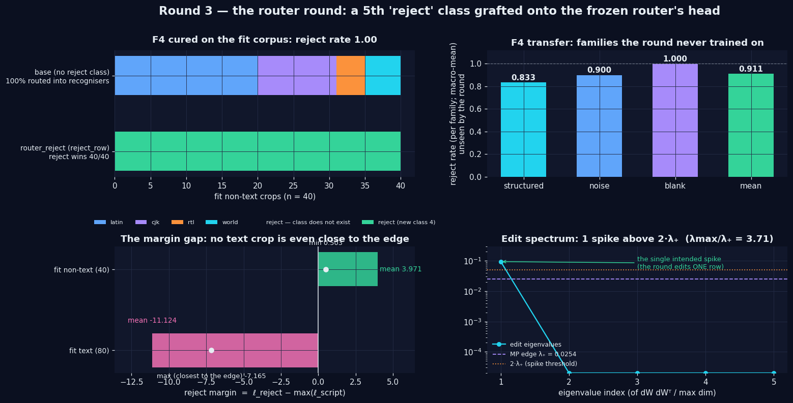
</div>

**Two measured lessons the round's control runs left in the training log**
(each with the failing run committed — see [`AUDIT.md`](AUDIT.md) §9):

1. **The reject row learns *whiteness* before it learns *textlessness*.** The fit
   corpus text spans the full 512-px frame, but real ability text is 200–480 px wide
   and is centred on a white canvas to fit the router's fixed input — a reject row
   trained only on full-frame text fired on **47% of the padded ability text**. The
   shipped protocol anchors the round on the ability corpora (the parent's anchor
   scope 'good').
2. **Text-heavy passes collapse the cure.** With 240 text vs 120 non-text steps,
   Adam's per-sign normalisation let tiny-but-consistent text-side gradients drag
   the reject row below the script logits on half the non-text crops (fit reject
   1.0 → 0.5). The shipped protocol trains **violation-driven** — the kit's
   `refresh_every` self-labelling ported to a classifier head: every 32 steps only
   the crops the head still gets wrong are sampled, 3:1 nt:text, lr ×0.5 at 320/640.

The leverage verdict repeats itself: **the minimal surgical row wins** — for the
third time in this kit, the simplest lever beats the bigger one.

---

## 🖼 Gallery

<div align="center">
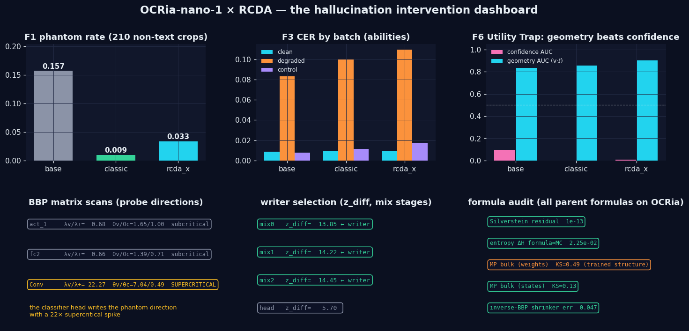
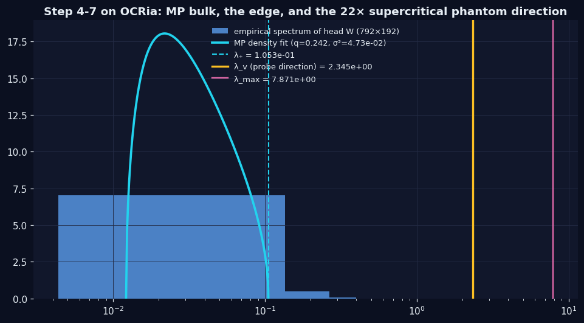
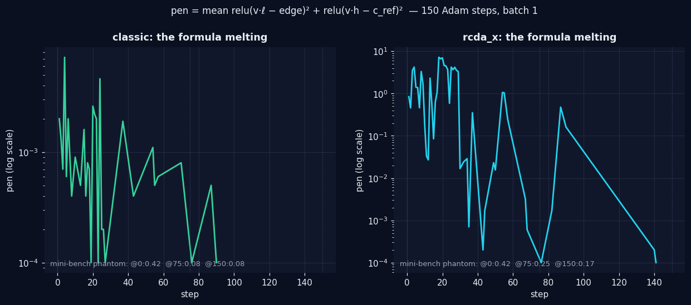
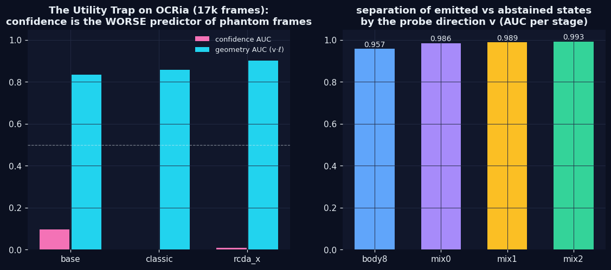

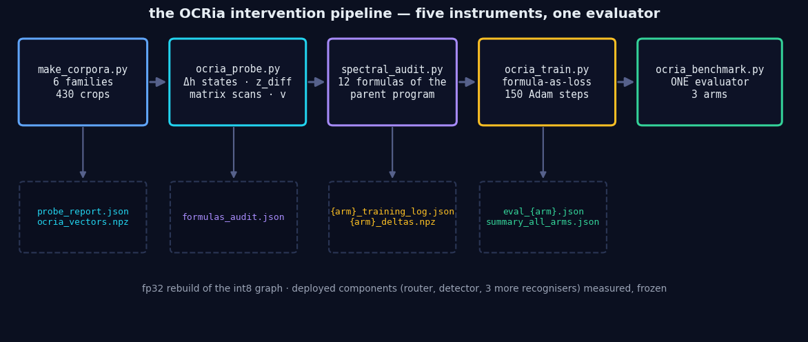
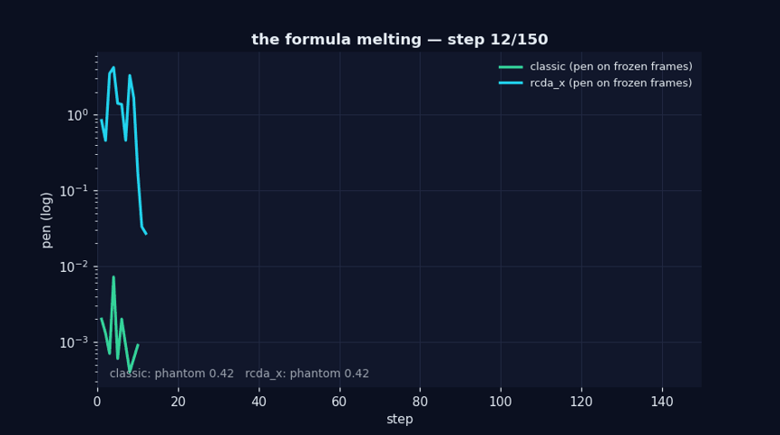
</div>

---

## 📁 Repository layout

```
OCRia-nano-1/
├── README.md                  ← you are here
├── AUDIT.md                   ← audit trail incl. the five measured lessons
├── EXPERIMENT_PROTOCOL.md     ← the pre-registered protocol
├── RUN_PASSPORT.json          ← sha256 of every model file + seeds + env
├── Code/
│   ├── ocria_common.py        ← shared plumbing: metrics, corpora, passport
│   ├── marchenko_pastur.py    ← the parent's RMT primitives (+1 documented
│   │                             patch for rectangular tensors)
│   ├── rmt_fp/                ← the parent's verified formula library (vendored)
│   ├── rebuild_latin.py       ← int8 → fp32 rebuild + 97.9% parity gate
│   ├── make_corpora.py        ← 430 synthetic crops, 6 families
│   ├── ocria_probe.py         ← the extended probe
│   ├── spectral_audit.py      ← all 12 formulas, executed
│   ├── ocria_train.py         ← formula-as-loss, both arms
│   ├── ocria_router_round.py  ← Round 3: the router reject head (LDA init,
│   │                             violation-driven training, 4 gates, export)
│   ├── ocria_benchmark.py     ← ONE evaluator, 3 arms
│   ├── ocria_summarise.py     ← summary_all_arms.json + RESULTS_SUMMARY.md
│   └── make_graphics.py       ← 14 figures + 4 GIFs, every number from JSONs
├── Model/                     ← the deployed OCRia-nano-1 ONNX graphs (pinned)
│                                 + router_reject.onnx (+ .meta.json) — the
│                                 round-3 export, group → 5 classes
├── Data/                      ← the synthetic corpora + manifests (PNG + JSONL)
├── Results/                   ← every measured number (JSON/JSONL/NPZ/PT)
└── Graphics/                  ← the gallery above
```

---

## 🔁 Reproduce everything

CPU-only (2 cores, 4 GB RAM): the probe ~1 min, both training arms **~28 s
total**, the router round **~1 s**, benchmarks ~2 min.

```bash
cd Code
python make_corpora.py                                   # 1. the corpora
python rebuild_latin.py                                  # 2. fp32 rebuild + parity gate
python ocria_probe.py                                    # 3. the extended probe
python spectral_audit.py                                 # 4. all 12 formulas
python ocria_train.py --variant classic --steps 150      # 5. arm B (~9 s)
python ocria_train.py --variant rcda_x  --steps 150      #    arm C (~19 s)
python ocria_benchmark.py --arm base                     # 6. one evaluator ×3
python ocria_benchmark.py --arm classic
python ocria_benchmark.py --arm rcda_x
python ocria_router_round.py                             # 7. Round 3: the reject head (~1 s)
python ocria_summarise.py                                # 8. the summary tables
python make_graphics.py all                              # 9. figures + GIFs (incl. fig14)
```

Dependencies: `numpy`, `torch` (CPU), `onnxruntime`, `onnx`, `pillow`,
`matplotlib`, `scipy`. Versions are pinned in [`RUN_PASSPORT.json`](RUN_PASSPORT.json).

---

## 🧭 Lineage and honesty

This kit is a wing of the parent repository's RCDA program
([`rmt-llm-research/neural_lab`](https://github.com/wild8highlander/rmt-llm-research)):
the same five instruments, the same "one evaluator" rule, the same
run-passport provenance, applied to a new organ with an extended taxonomy.

**Stated honestly:**

- the surgery operates on an **fp32 rebuild** of the int8 graph (97.9% string
  parity); the deployed model is re-measured separately and the quantisation
  gap is quantified (fp32 world is *more* phantom-prone: 0.157 vs 0.119 —
  int8 rounding acts as a mild noise-suppressor);
- **abilities are preserved on clean text** (+0.05pp CER) but degraded reads
  pay part of the drift (+1.7pp classic, +2.6pp rcda_x) — the anchor holds
  the ability corpus, not every robustness corner;
- **negative results are committed**: the symmetric-square backfire run
  (phantom 0.42 → 1.0), the over-aggressive projection run, and the
  classic-beats-rcda_x leverage verdict all remain in the training logs;
- **out of scope**: LayoutNet (its `feats`/`pairf` inputs are
  pipeline-internal feature engineering — probing it would mean faking the
  feature builder; it is described, not measured);
- **round 3 is a different kind of surgery**: it edits a *head* (adds the
  reject class) rather than existing weights — registered as addendum 8
  before its first training step, gated to exact parity on everything the
  base already did right (script rows max\|Δ\| = 0.0, flip bitwise,
  trunk arrays identical), and its control-run failures are committed in
  the training log;
- F2 (CTC loops) is ~0 at base for OCRia's latin recogniser on these corpora —
  the family is measured and guarded, not fabricated; the parent's loop metrics
  are applied verbatim so any future loop regression is caught by the same
  evaluator.

## 📜 Provenance

| file | sha256 (first 12) |
|---|---|
| `rec_latin.onnx` | see [`RUN_PASSPORT.json`](RUN_PASSPORT.json) |
| seeds | probe 0 · corpora 7 · train 0 · bench 0 |

Model: [llamaindex/OCRia-nano-1](https://huggingface.co/llamaindex/OCRia-nano-1)
(OCRia-nano-1 Model License, AI Pubs Open RAIL-M based — free for research).
The kit ships the model files it measured, sha256-pinned, for reproducibility.
