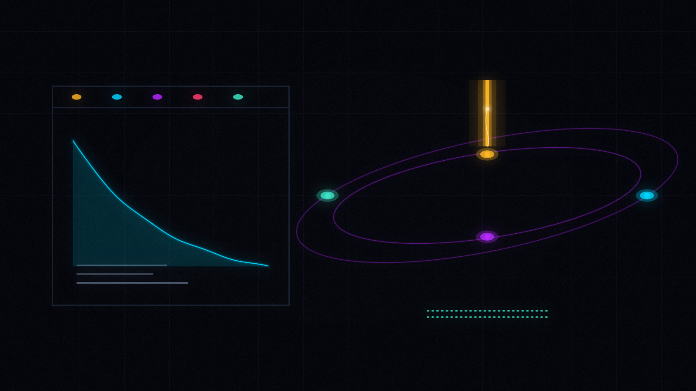
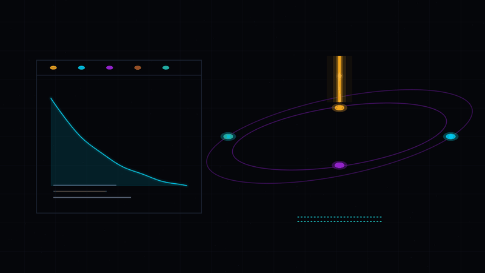
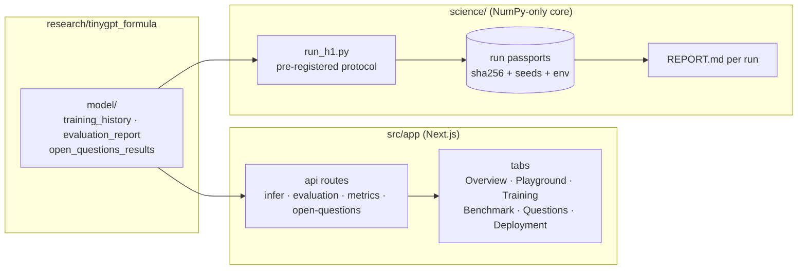

<p align="center">
  
</p>

# 🌐 neural_lab — the living lab

<p align="center">
  <picture>
    <source srcset="assets/visuals/hero-2x.avif" type="image/avif">
    <source srcset="assets/visuals/hero-2x.webp" type="image/webp">
    
  </picture>
</p>

<p align="center">
  
</p>
<p align="center"><sub><em>
  Left — the app: five tabs reading real artifacts, a training curve that is
  never hand-entered. Right — the science core: one pre-registered pipeline,
  the prediction node firing a BBP spike, and 52 tests holding it all together
  (the two rows of emerald dots). Regenerate:
  <code>python scripts/gen_folder_visuals.py</code> +
  <code>python scripts/gen_folder_anims.py</code>.
</em></sub></p>

<p align="center">
  <a href="../README.md"></a>
  
  
</p>

> **One folder, two organisms.** A Next.js playground where the trained
> formula model *lives* — and the predictive science core where the
> repository's hypotheses are pre-registered, measured, and falsified. The
> app is a read-only window over real artifacts; the science core is the
> working laboratory of the project.

---

## ⌛ The lab in 30 seconds

The model trained in [`research/tinygpt_formula/`](research/tinygpt_formula/README.md)
is served here: the Playground tab calls `scripts/infer.py` through the API,
the other tabs render the training artifacts — the same files stored in the
research folder's `model/`, so the UI is always a *view* of real artifacts and
never a hand-edited copy. Around the app grows the **science core**
([`science/`](science/README.md)): a NumPy-only
`hypothesis → measurement → prediction → validation → falsification`
pipeline whose every published number is generated by a run whose passport
(sha256 of weights, corpus, dataset; seeds; environment versions) is stored
next to the results.

| What | Count | Where |
|------|-------|-------|
| App tabs over real artifacts | **5** | `src/app/` |
| API routes (thin artifact wrappers) | **4** | `src/app/api/` |
| Science-core tests (offline, NumPy-only) | **52** | [`science/tests/`](science/tests/) |
| Pre-registered runs with passports | **2** (+1 queued) | [`science/results/`](science/results/) |
| Full H1 run, CPU | **~3 min** | `science/experiments/run_h1.py` |

## 🏆 What the science core has measured so far

Every number below is a field of a committed JSON under a run passport —
nothing is hand-typed.

| Endpoint | Result | Pinned evidence |
|----------|--------|-----------------|
| H1 v1 · primary (error prediction from internal features) | **underpowered**: ΔAUC +0.206 [+0.084, +0.319], permutation p = 0.097 — direction consistent, power not there yet | [`science/results/h1_v1/REPORT.md`](science/results/h1_v1/REPORT.md) |
| H1 v1 · secondary — **the Utility Trap** | internal spectral states AUC **0.871** vs confidence **0.794**, p = **0.0025** — the model's confidence is a *worse* predictor of its errors than its own internal geometry | [`science/results/h1_v1/REPORT.md`](science/results/h1_v1/REPORT.md) |
| H1 × scaling ladder (S/M/L, 113 tasks) | direction D > B replicated **3/3 cells**; L-cell ΔAUC **+0.116 [+0.012, +0.215]** — bootstrap CI excludes 0; confidence baseline is non-monotonic across scale; XL queued (GPU) | [`science/results/h1_scaling/REPORT.md`](science/results/h1_scaling/REPORT.md) |

---

<p align="center">
  
</p>

## 🗺️ How to read this folder

Four curated entry points — pick the one that matches your time budget.

| I want to… | Time | Go to |
|------------|------|-------|
| 🕐 **see the model talk** | 10 min | [Tabs](#-tabs) → run `npm run dev` → Playground |
| 🔬 **understand the science** | one evening | [`AUDIT.md`](AUDIT.md) → [`EXPERIMENT_PROTOCOL.md`](EXPERIMENT_PROTOCOL.md) → [the measured results](#-what-the-science-core-has-measured-so-far) |
| 📈 **follow the program** | 30 min | [`PREDICTION_ROADMAP.md`](PREDICTION_ROADMAP.md) (stages 01→06 with readiness criteria) |
| 🧪 **run everything** | 15 min | [Getting started](#-getting-started) below + the H1 quick start |

## 🧬 The dataflow



The app never writes to the artifacts; the science core never hand-enters a
number. Re-train the model and refresh the page — everything you see updates
itself.

## 📑 What's inside

```text
neural_lab/
├── README.md             — this document
├── src/                  — the Next.js app (pages, API routes, components)
│   └── app/api/          — infer / evaluation / metrics / open-questions routes
├── research/             — standalone research programs (TinyGPT Formula-Edition)
├── science/              — predictive research core (H1 pipeline, 52 tests)
├── assets/               — banners (logos/) and the folder's visual layer (visuals/, anim/)
├── AUDIT.md              — factual audit of what is really measured
├── EXPERIMENT_PROTOCOL.md— pre-registered H1 protocol
└── PREDICTION_ROADMAP.md — staged plan 01→06 with readiness criteria
```

## 🖥️ Tabs

| Tab | What it shows |
|-----|---------------|
| Overview | project summary: model, corpus, ROADMAP goal |
| Playground | live inference: 8 formula presets, temperature, seed, token count |
| Training | loss / perplexity / match_rate curves from the real training history |
| Benchmark | held-out scores (format / numeric / teacher-forced) + answer samples |
| Questions | the 4 ROADMAP open questions and their empirical answers |
| Deployment | models for fine-tuning, free compute servers, repository bugs found |

Each tab reads directly from the artifacts (or from the API route that wraps
the artifact generator), so re-training the model and refreshing the page is
enough to update everything you see — there is no manual data entry anywhere
in the app.

## 🔌 API routes

| Route | Wraps | Returns |
|-------|-------|---------|
| `/api/infer` | `research/tinygpt_formula/scripts/infer.py` | generated tokens for a prompt (temperature, seed, count) |
| `/api/evaluation` | `evaluation_report.json` | held-out benchmark scores and samples |
| `/api/metrics` | `training_history.json` | per-epoch loss / perplexity / match-rate series |
| `/api/open-questions` | `open_questions_results.json` | Q1–Q4 empirical answers |

## 🔬 Science core (`science/`)

The core does not produce demo numbers. Every figure it publishes is generated
by a run whose passport is stored next to the results, so any number can be
traced back to the exact inputs that produced it.

| Document | Content |
|----------|---------|
| [`AUDIT.md`](AUDIT.md) | factual audit: what is really measured, where the synthetic-looking objects are, what was fixed |
| [`EXPERIMENT_PROTOCOL.md`](EXPERIMENT_PROTOCOL.md) | pre-registered H1 protocol (error prediction from internal features) |
| [`PREDICTION_ROADMAP.md`](PREDICTION_ROADMAP.md) | staged plan 01→06 with readiness criteria |
| [`science/results/h1_v1/REPORT.md`](science/results/h1_v1/REPORT.md) | the fixed H1 run — see [the measured results](#-what-the-science-core-has-measured-so-far) |
| [`science/results/h1_scaling/REPORT.md`](science/results/h1_scaling/REPORT.md) | the scaling ladder — see [the measured results](#-what-the-science-core-has-measured-so-far) |

Quick start (after training the model):

```bash
python3 neural_lab/science/experiments/run_h1.py   # full run (~3 min CPU)
python3 -m pytest neural_lab/science/tests/ -q     # 52 tests
```

A smoke run (greedy generation, ~1 min) is available via
`SMOKE=1 python3 neural_lab/science/experiments/run_h1.py --out /tmp/h1_smoke` —
it walks the same pipeline end-to-end on a reduced budget and is the fastest
way to check that nothing broke after refactoring.

## 🚀 Getting started

```bash
cd neural_lab
npm install        # or bun install
npm run dev        # http://localhost:3000
```

Requirements: Node.js 20+ (LTS recommended). If the Playground tab says the
model is missing, train it first —
`python3 research/tinygpt_formula/scripts/train_formula_model.py`
(~20 min CPU, resumes on restart). If a port is already taken, start with
`npm run dev -- -p 3001`.

## ❓ FAQ

**Does the web app change the model or the results?**
No. The app is a read-only window over artifacts plus a thin wrapper around
`infer.py`. All science happens in `science/` under fixed seeds and
pre-registered protocols.

**Where do the numbers on the Questions tab come from?**
From `research/tinygpt_formula/model/open_questions_results.json` — the
output of `scripts/open_questions.py` (Q1–Q4, see the research README).

**Can I run only the science core without the web app?**
Yes — the science core is pure Python/NumPy and has no dependency on
Node.js; the app is optional UI on top.

**Where do the folder's visuals come from?**
From the same pipeline as the repository root: the hero, the loop, and the
divider are procedural, seeded renders driven by
[`assets/prompts.yaml`](../assets/prompts.yaml) (section `folders:`) —
`scripts/gen_folder_visuals.py` and `scripts/gen_folder_anims.py` regenerate
everything, and [`scripts/verify_repo.py`](../scripts/verify_repo.py) checks
their budgets.

---

<p align="center">
  <br>
  <sub>
    <a href="../README.md">← root</a> · <a href="README.md">top</a> ·
    <a href="MNN-Pocket-0.3B/README.md">the intervention kit →</a> ·
    <a href="science/README.md">the science core →</a>
  </sub>
</p>
