<p align="center">
  
</p>

# 🎨 neural_lab/assets — Lab Visual Identity

<p align="center">
  <em>Animated logos and avatars for the neural_lab README set</em><br><br>
  <a href="../../README.md"></a>
  
</p>

The visual identity of the `neural_lab` folder: one animated **banner**
(800×220) and one animated **avatar** (128×128) per README, generated
as pure-SMIL SVGs — no CSS, no JavaScript, no external resources — so
they animate on GitHub, in mkdocs, and in any standards-compliant
viewer. Every emblem is drawn from the repository's aurora color wheel,
with a distinct accent pair and motif per section.

## The set

| Emblem | Section | Motif |
|---|---|---|
| neural net | `neural_lab` | pulsing nodes, traveling signal |
| atom | `research` | three rotating orbits, electrons |
| Sigma | `tinygpt_formula` | attention arcs over token blocks |
| gears | `scripts` | counter-rotating gears |
| database | `data` | disks with falling packets |
| chip | `model` | live waveform on a pin grid |
| ladder | `scaling` | rising bars, flying trend arrow |
| cloud | `colab` | compute cloud, activity bolt |
| flask | `science` | clipped bubbling liquid, electron orbit |

The gallery with inline previews is [`logos/README.md`](logos/README.md).

## Usage rules

```markdown

```

- Banners go at the very top of a README (`width="760"`), avatars in the
  footer navigation block (`width="56"`).
- Keep animations SMIL-only: adding CSS or JS would break rendering on
  GitHub.
- Regenerate with the maintainer's `gen_neural_lab_logos.py` (single
  source of truth for all 18 files) rather than hand-editing.

---

<p align="center">
  <br>
  <sub>
    <a href="../../README.md">← neural_lab</a> · <a href="logos/README.md">🖼 logo gallery</a> · <a href="../../../assets/branding/README.md">🎨 repo branding →</a>
  </sub>
</p>
