# 🎨 logos — Animated SVG Set

  
  
  
  
  
  
  
  
  

Animated SVG logos for the `neural_lab/` README set: one **banner**
(800×220, header of each README) and one **avatar** (128×128, footer of
each README) per section. All animation is pure SMIL (`<animate>`,
`<animateTransform>`, `<animateMotion>`) — no CSS, no JavaScript, no
external resources — so the logos animate on GitHub, in mkdocs, and in
any standards-compliant viewer. Each section has its own accent pair
and emblem: neural net (neural_lab), atom (research), Sigma (tinygpt_formula),
gears (scripts), database (data), chip (model), ladder (scaling),
cloud (colab), flask (science), all cycling through the repository's
aurora color wheel.

Regenerate with `/scripts` of the maintainer environment
(`gen_neural_lab_logos.py`); the files are committed artifacts, edits
should go through the generator.

| Pattern | Usage |
|---|---|
| `<name>.banner.svg` | top header of the corresponding README, `width="760"` |
| `<name>.avatar.svg` | footer navigation block, `width="56"`, or standalone icon |

[← back to neural_lab](../../README.md)
