  

# 🗄️ scaling/runs — Per-Cell Artifacts

  <em>One folder per ladder cell: history, cell report, weights</em>  
  
  

Where the ladder lives, cell by cell. Each subfolder is one trained cell
of the parameter ladder (`S`/`M`/`L` × `formula`/`control` arms),
holding its training history, its cell report (budget overrides and
conditions), and — locally, not committed — the weights themselves.

## Cells

| Folder | Cell / arm | Committed contents |
|---|---|---|
| `S_formula/` | S × formula | `history.json` |
| `S_control/` | S × control | `history.json`, `cell_report.json` |
| `M_formula/` | M × formula | `history.json`, `cell_report.json` (+ local `model.npz`) |
| `L_formula/` | L × formula | `history.json`, `cell_report.json` (+ local `model.npz`) |

## What each file means

| File | Content |
|---|---|
| `history.json` | per-epoch loss / perplexity / match-rate for the cell |
| `cell_report.json` | the cell's provenance: epochs actually run, schedule overrides, feature counts, tokenizer notes |
| `model.npz` | the weights — **gitignored**: retraining with the fixed seed regenerates them byte-for-byte |

The cell reports are what make the ladder honest: M's full 60-epoch
budget and L's shortened-but-completed cosine schedule are *declared
there*, not remembered in someone's head, and the H1 protocol v1.1
derives its per-layer feature counts from the same records (37 for M,
45 for L).

## Reproducing a cell

Train via the ladder runner (see [`../README.md`](../README.md)) —
resume chunks make interruptions cheap — then run the H1 experiment
against the cell as described in
[`../../../../science/experiments/README.md`](../../../../science/experiments/README.md).

---

   
  
    <a href="../README.md">← scaling</a> · <a href="../../../README.md">↑ tinygpt_formula</a> · <a href="../../../../science/results/README.md">H1 results →</a>
  

