<p align="center">
  
</p>

# 💻 neural_lab/src — Application Source

<p align="center">
  <em>The Next.js app: pages, components, hooks, and API routes</em><br><br>
  <a href="../../README.md"></a>
  
</p>

Source tree of the Neural Lab web application (see the parent
[`README`](../../README.md) for the product view). The app is a
read-only window over the research artifacts plus one live-inference
route; there is no database, no hidden state, and no manual data entry —
every number rendered in the UI comes from a committed artifact or from
a Python script called through an API route at request time.

## Layout

| Path | Content |
|---|---|
| `app/` | pages and layouts: `page.tsx` (the single-page lab), `layout.tsx`, `globals.css` |
| `app/api/infer/` | live inference — wraps `research/tinygpt_formula/scripts/infer.py` |
| `app/api/evaluation/` | serves `evaluation_report.json` (held-out benchmark) |
| `app/api/metrics/` | serves `training_history.json` (loss / perplexity / match-rate series) |
| `app/api/open-questions/` | serves `open_questions_results.json` (Q1–Q4 answers) |
| `components/lab/` | the lab-specific UI: tab shell, playground, training charts, benchmark views |
| `components/ui/` | the generic component kit (shadcn/ui) the lab components are built from |
| `hooks/` | shared React hooks (artifact fetching, playground state) |
| `lib/` | client utilities (API helpers, formatting) |

## Conventions

- **Artifacts over copies**: tabs never hardcode numbers; they fetch via
  the API routes, so retraining the model updates the UI on reload.
- **One route per artifact family**: the four API routes map 1:1 to the
  four artifact kinds listed in
  [`../research/tinygpt_formula/model/README.md`](../research/tinygpt_formula/model/README.md).
- **Lab vs kit**: anything specific to this research app goes in
  `components/lab/`; anything reusable and research-agnostic goes in
  `components/ui/`.

## Development

```bash
cd neural_lab
npm install    # or bun install
npm run dev    # http://localhost:3000
```

---

<p align="center">
  <br>
  <sub>
    <a href="../../README.md">← neural_lab</a> · <a href="../../research/README.md">🔬 research →</a> · <a href="../../science/README.md">🧪 science →</a>
  </sub>
</p>
