<p align="center">
  
</p>

# 🧭 stages — Research Stages 2–5 on Real HF Models

Empirical program for the four research stages on **real transformer
checkpoints** (as opposed to the TinyGPT-based `science/` core). The
package reuses `science/`'s ground rules: run passports, labels
established independently of scores, honest out-of-fold evaluation,
and reports generated from data. A negative result is a result.

| Stage | Question | Module | Entry point |
|---|---|---|---|
| **2** | Do spectral features detect hallucinations beyond token entropy, semantic entropy and linear probes? | [`stage2_detector/`](stage2_detector/) | `run_stage2.py` |
| **3** | Does the error rate follow the predicted N_crit law — `T_crit = c·μ_eff^(−1/β)`, β ≈ 0.5? | [`stage3_ncrit/`](stage3_ncrit/) | `run_stage3.py` |
| **4** | Does the BBP spike coincide with a MECHANISM (lens commit, patching, SAE features)? | [`stage4_interpretability/`](stage4_interpretability/) | `run_stage4.py` |
| **5** | Does instruction tuning (SFT/RLHF/DPO) shift spectra and N_crit of the same family? | [`stage5_rlhf/`](stage5_rlhf/) | `run_stage5.py` |

Protocols (frozen before runs): [`EXPERIMENT_PROTOCOLS.md`](EXPERIMENT_PROTOCOLS.md).
Hypotheses H2–H5 live in the shared registry
[`../science/hypotheses/registry.yaml`](../science/hypotheses/registry.yaml).

---

## Layer map (mirrors science/)

```
common/                     instrumentation for real HF models
  hf_model.py               pinned loading, weight sha256, arch resolvers
  generation.py             hand-rolled AR loop: per-step logprobs/entropy,
                            block-output capture via hooks (version-proof)
  passports.py / reporting  run passports, report.json + REPORT.md

stage2_detector/            the AUROC race
  benchmarks.py             TruthfulQA / HaluEval QA / SelfCheckGPT wiki_bio
  token_entropy.py          5 confidence baselines (higher = more hallucinated)
  semantic_entropy.py       Farquhar et al. 2024 discrete SE (Jaccard / NLI)
  probes.py                 linear probes, leave-one-benchmark-out + grouped folds
  spectral_features.py      science spectral features on HF hidden states
  detectors.py              unit/eval: AUROC + item-clustered bootstrap, ΔAUC
  run_stage2.py             the race: report + AUROC table + deltas

stage3_ncrit/               token-level collapse dynamics
  numeric_tasks.py          verifiable tasks (truth recomputed independently)
  error_labels.py           first-error position with right-censoring
  survival_fit.py           Weibull MLE (c, [β], γ), binned curve, changepoint
  scaling_test.py           log τ ~ log μ regression vs slope 2, β consistency
  run_stage3.py             per-model N_crit + cross-model scaling

stage4_interpretability/    bridge to mechanisms
  logit_lens.py             per-layer P(answer) + spike alignment
  activation_patching.py    clean→corrupted restoration vs gap profile
  heavy_tail.py             Martin–Mahoney α (Clauset MLE) per weight matrix
  sae_bridge.py             Gemma Scope audit of the spike window + Neuronpedia
  run_stage4.py             A–D (+E with --sae)

stage5_rlhf/                the RLHF thesis
  model_pairs.yaml          registry of base↔tuned pairs (open + gated)
  compare_pairs.py          paired spectra, Δτ, KL-based μ_eff proxy
  run_stage5.py             per-pair records + verdicts
```

## Quick start

```bash
pip install torch transformers datasets pyyaml scipy   # CPU is enough to start

# Stage 2 — AUROC race on one model (~10 min CPU for a 0.1–0.5B model)
python3 neural_lab/stages/stage2_detector/run_stage2.py \
    --model EleutherAI/pythia-70m --n-items 25 --out results/stage2/pythia70m

# Stage 3 — first-error survival + N_crit
python3 neural_lab/stages/stage3_ncrit/run_stage3.py \
    --model EleutherAI/pythia-70m --n-tasks 60 --out results/stage3/pythia70m \
    --mu-eff 0.42          # optional external mu_eff (e.g. stage-5 KL)

# Stage 4 — lens / patching / heavy-tail
python3 neural_lab/stages/stage4_interpretability/run_stage4.py \
    --model EleutherAI/pythia-70m --out results/stage4/pythia70m

# Stage 5 — pair comparison (see the registry: run_stage5.py --list)
python3 neural_lab/stages/stage5_rlhf/run_stage5.py \
    --pair qwen2.5-0.5b --out results/stage5

# Cross-model scaling (>= 3 stage-3 runs with --mu-eff):
python3 neural_lab/stages/stage3_ncrit/run_stage3.py \
    --scaling-in "results/stage3/*" --out results/stage3/scaling

# tests (offline, no downloads)
python3 -m pytest neural_lab/stages/tests/ -q
```

For instruct models add `--use-chat` (stage 2) — the chat template is then
applied before scoring.

## Honest-interpretation clause (from the plan)

Stage 2's protocol pre-registers BOTH outcomes: spectral features **not**
beating the probes is a publishable negative result; a gain **on top of**
probe + entropy (`ΔAUROC` with item-clustered CI excluding 0) is the
strong result. The same clause governs Stage 3 (slope CI vs the β = 0.5
prediction of 2) and Stage 5 (Δτ and Δgap not significant → "not
resolved, report as is"). The runners print/write these verdicts; none of
them can silently turn a negative into a positive.

## Compute notes

- CPU: anything ≤ 1B runs comfortably (a stage-2 pass over 25 items × 3
  benchmarks with K=5 samples takes minutes on pythia-70m/0.5B).
- 7B pairs: use `--dtype float16 --device cuda` where available.
- SAE audit (stage 4 `--sae`) needs `sae_lens` + a Gemma checkpoint and
  is intentionally the only optional-heavy path; everything else runs on
  CPU.

## Data flow between the stages

```
                 ┌───────────────────────────────────────────────┐
                 │  common: HF loading, passports, schemas, CLI   │
                 └───────────────────────────────────────────────┘
 S4 (autonomous)      S2 (detector race)          S3 (N_crit) ◄─── --mu-eff-from
 ┌─────────────┐      ┌──────────────────┐        ┌──────────────┐
 │ logit lens  │      │ TruthfulQA /     │        │ arithmetic   │
 │ patching    │      │ HaluEval /       │        │ tasks, first │
 │ heavy-tail  │      │ SelfCheckGPT     │        │ errors +     │
 │ SAE (opt.)  │      │ → units.jsonl    │        │ censoring    │
 └─────────────┘      └──────────────────┘        └──────────────┘
        │                     │                        │ fit.json (tau, tau_ci)
        │ every stage ends with the PRE-REGISTERED    ▼
        │ criterion section (science/hypotheses/check.py)
                              │                  S5 (base vs tuned)
                              │                  ┌──────────────────┐
                              └─────────────────►│ paired spectra,  │
                              shared registry &  │ Δtau (paired CI),│
                              schema validation  │ KL mu_eff proxy  │
                                                 └──────────────────┘
                                                          │ fit.json sidecar
                                                          ▼
                              S3 --scaling-in ◄── (stage3 fits + stage5 pairs)
                              scaling.json: slope ~ -1/beta, verdict
```

Artifacts (`report.json`, `fit.json`, `record.json`, `scaling.json`) are
validated against `results_schema/v1/` at write time and indexed by
`common/index.py` (`make index-results`); `compare_reports.py` diffs two
runs of the same stage. StageRunner CLI (all stages): `--config *.yaml`,
`--resume`, `--only` (stage4: lens|patching|heavy-tail|sae), `--dry-run`,
`--log-json`.
