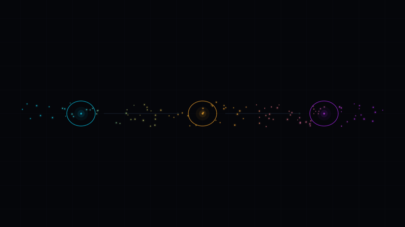

<p align="center">
  <a href="../README.md"></a><br>
  
</p>

# 🧰 scripts — the maintenance & reproducibility toolbelt

<p align="center">
  <em>Every visual, every pinned hash, every link, every release number
  in this repository is one command away — from this folder.</em>
</p>

[](../.github/workflows/ci.yml)
[](../.github/workflows/repo-janitor.yml)
[](../.github/workflows/cli-doctor.yml)
[](../.github/workflows/verify-repo.yml)
[](../.github/workflows/markdown-lint.yml)
[](../.github/workflows/pre-commit.yml)
[](https://www.python.org/)
[](https://docs.astral.sh/ruff/)
[](#4-files--roles)
[](repo_janitor.py)
[](../LICENSE)

<p align="center">
  
</p>
<p align="center"><sub><em>
  The toolbelt's own mascot: the dataflow loop from
  <code>gen_anims.py</code> — deterministic, seeded, reproducible with
  <code>make anims-dataflow</code>.
</em></sub></p>

> **15 scripts, three jobs.** Render the repository's visuals
> deterministically, prove its claims machine-checkably, and keep its
> health — links, paths, formatting, release metadata — repaired
> automatically.

---

## Contents

- [1. The toolbelt in 60 seconds](#1-the-toolbelt-in-60-seconds)
- [2. 🎨 The render layer](#2--the-render-layer)
- [3. 🛡 Evidence & self-healing](#3--evidence--self-healing)
- [4. 🩺 Diagnostics & release hygiene](#4--diagnostics--release-hygiene)
- [5. Quick start](#5-quick-start)
- [6. How everything is verified](#6-how-everything-is-verified)
- [7. Reading paths](#7-reading-paths)
- [8. Related](#8-related)

## 1. The toolbelt in 60 seconds

| Script | One-line role | Group |
|---|---|---|
| [`gen_images.py`](gen_images.py) | renders the 9 static slots (hero, thread cards, OG base, favicon, dividers) | 🎨 render |
| [`gen_anims.py`](gen_anims.py) | renders the 5 seamless loops → WebM/MP4/GIF + posters + the terminal GIF | 🎨 render |
| [`gen_folder_visuals.py`](gen_folder_visuals.py) | folder-level statics for `neural_lab/` + MNN kit (spike heights = measured ρ_bad) | 🎨 render |
| [`gen_folder_anims.py`](gen_folder_anims.py) | folder-level loops for the MNN kit (melt driver = the 150-step training log) | 🎨 render |
| [`gen_mnn_figures.py`](gen_mnn_figures.py) | re-renders the RCDA figure set (fig5–fig15) from committed result JSONs | 🎨 render |
| [`gen_mnn_banners.py`](gen_mnn_banners.py) | animated SVG banners + avatars for the MNN kit folders | 🎨 render |
| [`gen_banner_gif.py`](gen_banner_gif.py) | the original live BBP banner (matplotlib + Pillow) | 🎨 render |
| [`compose_og.py`](compose_og.py) | composites the 1200×630 OG text lockup | 🎨 render |
| [`verify_repo.py`](verify_repo.py) | the evidence gate: MANIFEST sha256 + budgets + alt text + CLI smoke | 🛡 evidence |
| [`check_links.py`](check_links.py) | relative-link **and anchor** checker (GitHub-style slugs) | 🛡 evidence |
| [`repo_janitor.py`](repo_janitor.py) | the self-healing bot: fixes moved links, stale paths, dead redirects | 🛡 evidence |
| [`repo_stats.py`](repo_stats.py) | live repo numbers + README badge wall sync (`tests 480+`) | 🩺 hygiene |
| [`env_doctor.py`](env_doctor.py) | "why doesn't X run here?" — Python, deps, tooling, labs | 🩺 hygiene |
| [`bump_version.py`](bump_version.py) | bumps the version in pyproject + CITATION.cff + .zenodo.json atomically | 🩺 hygiene |
| [`release_check.py`](release_check.py) | pre-flight gate: version consistency, CHANGELOG, citability | 🩺 hygiene |

Everything render-side is seeded and offline: no API keys, no gen-AI calls —
the same tree always renders the same pixels. Everything hygiene-side is
stdlib-only and safe to run anywhere: the janitor never guesses (ambiguous
relocations are reported, not rewritten).

## 2. 🎨 The render layer

The visuals are *the package running*. The hero banner, the three thread
loops and the OG image are computed from the actual `src/rmt_llm`
formulas — MP density ρ(λ) = √((λ₊−λ)(λ−λ₋))/(2πσ²λq), the BBP outlier at
λ_max(θ) = σ²(1 + θ²/q) — driven by
[`assets/prompts.yaml`](../assets/prompts.yaml), the single source of
truth for palette, seeds and budgets.

- **`gen_images.py`** — draws every static slot with matplotlib onto the
  Black-Aurora palette (#05060A background, cyan bulk #00D4FF, amber spike
  #FFB020, violet edge #B026FF), then post-processes with Pillow: bloom,
  vignette, seeded film grain, and AVIF/WebP export with an adaptive
  quality loop that keeps each file inside its 400 KB budget.
  Run: `make images` (or one slot: `make images-hero`).
- **`gen_anims.py`** — renders each loop as seeded frames whose motion
  drivers are *periodic functions of the loop phase*, so frame 0 equals
  frame N and the loops are seamless by construction. ffmpeg encodes VP9
  WebM (primary), H.264 MP4 (fallback) and an 800 px GIF twin (GitHub
  sanitizes `<video>`). Run: `make anims` / `make anims-hero`.
- **`gen_folder_visuals.py` / `gen_folder_anims.py`** — the same Aurora
  language one level deeper: folder-level heroes, dividers and OG images
  for `neural_lab/` and the MNN-Pocket-0.3B kit. The science stays real —
  the MNN hero's spike heights are the *measured* ρ_bad of the three
  RCDA-5 arms, and the melting spike is driven by the committed 150-step
  training log. Run: `python scripts/gen_folder_visuals.py --all`.
- **`gen_mnn_figures.py`** — rebuilds the RCDA figure set (fig5–fig15)
  from the *committed* result JSONs; no model, no torch, no re-running of
  experiments. A figure is produced only when its inputs are present.
- **`gen_mnn_banners.py`** — animated SVG banners and avatars for the MNN
  kit folders; stdlib-only, deterministic.
- **`gen_banner_gif.py`** — the live BBP transition banner in the root
  README; the spike position is `bbp_lambda_max` from the package.
- **`compose_og.py`** — composites the 1200×630 social-preview lockup;
  the only place in the visual layer where typography is allowed.
  Run: `make og-image`.

## 3. 🛡 Evidence & self-healing

- **`verify_repo.py`** — the one-second evidence gate behind
  `make verify-repo` (and CI's `verify-repo.yml`): re-checks every sha256
  pinned in [`MANIFEST.json`](../MANIFEST.json), the presence of every
  promised slot and poster, per-file size budgets (AVIF/WebP 400 KB,
  GIF 2 MB, WebM 3 MB, MP4 4 MB, 5 MB `assets/visuals` total), alt text
  on every ``/`<video>` in the Markdown tree, and a
  `rmt-llm-verify verify` smoke run. `--repin` re-pins the manifest.
- **`check_links.py`** — walks all `.md` files and exits 1 on any broken
  relative link. Since v2 it also validates `#anchor` fragments against
  the headings of the target document using GitHub-style slugs
  (`## Real Section` → `#real-section`); mkdocstrings API anchors
  (`#rmt_llm.module.item`) are skipped — they are generated at
  docs-build time and verified by `mkdocs build --strict` instead.
  Run: `python scripts/check_links.py` (daily via `cli-doctor.yml`).
- **[`repo_janitor.py`](repo_janitor.py)** — the self-healing bot. Where
  the doctor only *reports*, the janitor *repairs*: rewrites internal
  markdown links whose target file moved or was renamed (resolved by
  basename + trailing-path scoring; anchors preserved; fenced code left
  untouched; ambiguous candidates reported, never guessed), repairs stale
  `directory:` entries in `.github/dependabot.yml`, repairs broken
  `nav:` paths in `mkdocs.yml`, rewrites external links that moved
  permanently (HTTP 301/308) and files the dead ones as issues. Weekly
  sweep + on-demand + **automatic self-heal whenever CI fails on main**
  (`.github/workflows/repo-janitor.yml`); fixable findings land in one
  PR, unfixable ones in a `janitor`-labelled issue.
  Run locally: `make janitor` (offline) or
  `python scripts/repo_janitor.py --fix --online`.

## 4. 🩺 Diagnostics & release hygiene

- **[`env_doctor.py`](env_doctor.py)** — answers "why doesn't X run on
  my machine": Python version against `requires-python`, the core
  dependency set, the dev tooling, and the optional lab tools
  (ffmpeg, Julia, Go, Cargo, g++, Node, Docker) with per-item hints.
  `--core` runs only hard requirements; `--json` for automation.
  Run: `make doctor`.
- **[`repo_stats.py`](repo_stats.py)** — the honest-numbers engine:
  live counts of tests, monographs, papers, code and assets. Its
  `--sync-badges` mode rewrites the root README's badge wall to those
  live counts, so the "Tests 171+" style claims can never silently drift
  from reality (`--check` exits 1 when they did — CI-friendly).
  Run: `make repo-stats` / `make sync-badges`.
- **[`bump_version.py`](bump_version.py)** — bumps the release version in
  `pyproject.toml`, `CITATION.cff` (version **and** date-released) and
  `.zenodo.json` atomically, refuses downgrades without `--force`,
  previews with `--dry-run`, and prints the human follow-ups
  (CHANGELOG entry, MANIFEST re-pin, git tag).
  Run: `make bump-version VERSION=minor`.
- **[`release_check.py`](release_check.py)** — the pre-flight gate for
  release *metadata*: versions agree across the three files
  (`--fix` syncs drift to pyproject), CHANGELOG.md has a section for the
  current version, CITATION.cff is citable (DOI, date, license) and
  `.zenodo.json` is uploadable (title, license, creators with ORCID).
  Run: `make release-check`.

## 5. Quick start

```bash
make images                 # → size table of 9 static slots
make anims                  # → 5 loops × (webm + mp4 + gif) + posters
make og-image               # → assets/visuals/og-image.png
make verify-repo            # → MANIFEST.json OK — evidence gate passed

make doctor                 # → what is missing on this machine?
make repo-stats             # → live counts (tests, docs, assets)
make sync-badges            # → README badge wall rewritten to live counts
make janitor                # → offline link/path sweep + fixes
python scripts/repo_janitor.py --fix --online   # full sweep incl. external links
make check-links            # → links + anchors (exit 1 on breakage)
make bump-version VERSION=patch   # → 1.3.0 → 1.3.1 in all three files
make release-check          # → release metadata gate
```

## 6. How everything is verified

| Claim | Gate | Cadence |
|---|---|---|
| visuals match MANIFEST sha256 + budgets | `verify_repo.py --all` (`verify-repo.yml`) | every PR |
| links + anchors resolve | `check_links.py` (`cli-doctor.yml`) | daily |
| links, paths, formatting self-repair | `repo_janitor.py` (`repo-janitor.yml`) | weekly + on CI failure |
| README badges tell the truth | `repo_stats.py --check` | on demand |
| release metadata is consistent | `release_check.py` | before every release |
| code style | ruff + pre-commit | every push |

## 7. Reading paths

- 🕐 **5 minutes**: [`assets/prompts.yaml`](../assets/prompts.yaml) —
  palette, seeds and budgets are the whole visual contract; then
  `make doctor` and `make repo-stats` on your own checkout.
- 🌌 **deep dive**: `gen_images.py` → `gen_anims.py` → `verify_repo.py`,
  in that order; re-render one slot (`make images-hero`) and confirm
  `make verify-repo` still passes; then break a link on purpose and watch
  `make janitor` fix it.
- 🧪 **for coders**: every renderer is a single file (stdlib, matplotlib,
  Pillow, ffmpeg); every hygiene tool is stdlib-only and exits
  non-zero on real problems — pipe them into CI without wrappers.
  `--slot`/`--all` flags are identical across render scripts.

## 8. Related

- [`assets/prompts.yaml`](../assets/prompts.yaml) — the single source of truth
- [`assets/visuals/`](../assets/visuals/) and [`assets/anim/`](../assets/anim/) — the outputs
- [`MANIFEST.json`](../MANIFEST.json) — the pinned hashes
- [`src/rmt_llm/`](../src/rmt_llm/README.md) — the math these scripts render
- [`.github/workflows/repo-janitor.yml`](../.github/workflows/repo-janitor.yml) — the self-healing schedule

---

<p align="center">
  <sub>
    <a href="../README.md">🏠 repository root</a> · <a href="../assets/README.md">🎨 assets</a> · <a href="../src/rmt_llm/README.md">🔬 rmt_llm core</a>
  </sub>
</p>
