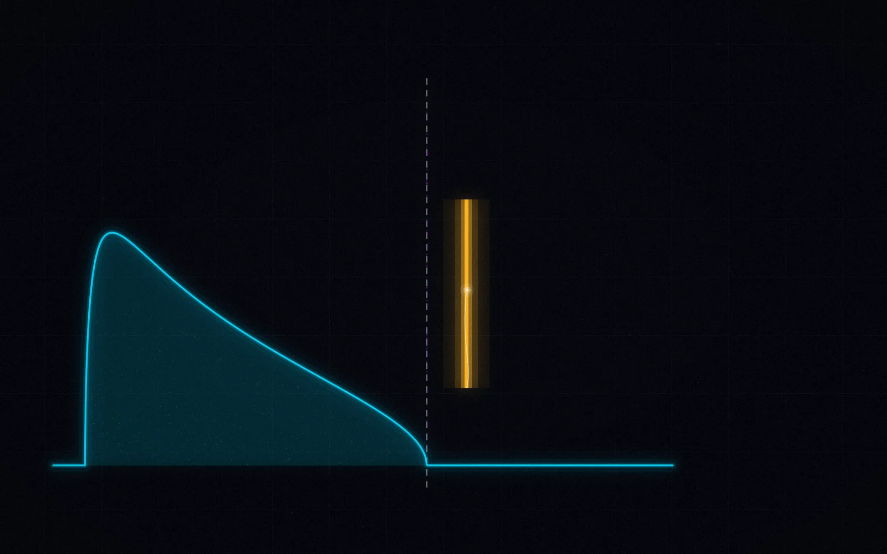

<p align="center">
  <a href="../../README.md"></a><br>
  
</p>

# rmt_llm — Core Verification Package

Pure-NumPy implementation of the mathematical framework applying Random
Matrix Theory (RMT) to the spectral analysis of LLM activations. This package
is the single source of truth for every formula: all other implementations
(Julia, Java, Go, Rust, C++, R) are cross-verified against it in CI.

## Contents

- [What this folder is](#what-this-folder-is)
- [Idea in 30 seconds](#idea-in-30-seconds)
- [Headline outputs](#headline-outputs)
- [Modules](#modules)
- [How the code works](#how-the-code-works)
- [Quick start](#quick-start)
- [Verification](#verification)
- [Reading paths](#reading-paths)

## What this folder is

This folder *is* the theory. Every number quoted in the root README —
the MP support `[0.4675, 1.7325]` for q = 0.1, the BBP threshold
θ_c = √q ≈ 0.3162, N_crit ≈ 114.5 — is computed here, by ~1,500 lines of
dependency-light NumPy, and pinned by 101 pytest tests. If a formula
appears anywhere in this repository or the monographs, its executable
form lives in this folder.

## Idea in 30 seconds

| Symbol | Value | Meaning | Defined in |
|---|---|---|---|
| θ_c | √q | BBP critical signal — the phase boundary | `bbp_transition.bbp_critical_theta` |
| N_crit | γ₁/(θ_b·π/180) ≈ 114.55 | Hallucination inevitability threshold | `caputo_fractional.caputo_n_crit` |
| β | 0.5 | Caputo memory parameter (RLHF collapse exponent) | `constants.BETA_CAPUTO` |
| γ₁ | 14.134725 | First Riemann zeta zero — the spectral gap | `constants.GAMMA_1` |
| F₂ mean / var | −1.7711 / 0.8132 | Tracy–Widom edge moments | `constants.TW_MEAN`, `TW_VARIANCE` |

## Headline outputs

| Output | Command | Pinned by |
|---|---|---|
| 5/5 module self-checks | `rmt-llm-verify verify` | `cli-doctor.yml` + `make verify-repo` |
| 101 test verdicts | `pytest src/rmt_llm/tests/` | `ci.yml`, codecov badge |
| JSON per command | `rmt-llm-verify mp --q 0.1` | schema-checked in `test_rmt_llm.py` |

## Modules

| Module | Content |
|---|---|
| `marchenko_pastur` | MP bounds and density — the noise floor of activation spectra |
| `bbp_transition` | BBP critical threshold theta_c — signal-vs-noise phase transition |
| `tracy_widom` | Tracy-Widom fluctuations of the largest eigenvalue |
| `nhse` | Non-Hermitian Skin Effect winding number criterion |
| `caputo_fractional` | Caputo fractional dynamics — entropic collapse timelines |
| `keating_snaith` | Keating-Snaith corrected gamma — N_crit estimation |
| `ep_surfaces` | Exceptional-point sensitivity surfaces |
| `thermodynamics` | Landauer cost and autoregressive irreversibility |
| `free_probability` | Free cumulants and multiplicative free convolution |
| `circular_ensembles` | Circular ensembles — spectral rigidity probes |
| `dyson_brownian` | Dyson Brownian motion — eigenvalue repulsion dynamics |
| `constants` | Shared physical and numerical constants (N_crit, gamma_1, ...) |

## Layout

```text
src/rmt_llm/
├── __init__.py        # public API
├── __main__.py        # `rmt-llm-verify` CLI entry point
├── tests/             # 101 pytest tests (unit + regression + cross-impl)
└── *.py               # the modules above
```

## How the code works

### `marchenko_pastur.py`

The null hypothesis of the whole program: what an activation spectrum
looks like when the model "does nothing but random projections".
Computes the MP support, density, CDF, samples eigenvalues of a random
covariance matrix, and evaluates the Stieltjes transform.

- **Math**: ρ(λ) = √((λ₊−λ)(λ−λ₋)) / (2πσ²λq), λ± = σ²(1±√q)².
- **In → Out**: aspect ratio `q`, variance `σ²` → bounds, density array,
  sampled eigenvalues (`mp_sample(300, 1000)` → 300 eigenvalues).
- **Key functions**: `mp_bounds`, `mp_density`, `mp_cdf`, `mp_sample`,
  `mp_stieltjes`.
- **Run**: `rmt-llm-verify mp --q 0.1` → `support: [0.4675, 1.7325]`.
- **Verified by**: 17 tests in `tests/test_rmt_llm.py`.

### `bbp_transition.py`

The phase transition that turns "noise" into "signal": for a rank-1
spiked covariance, the largest eigenvalue sticks to the MP edge until
the spike strength θ crosses √q, then detaches like a quantum jump.

- **Math**: λ_max → λ₊ (subcritical); λ_max → σ²(1 + θ²/q) (supercritical).
- **In → Out**: (θ, q, σ²) → outlier position, supercriticality verdict,
  fluctuation scaling (Tracy–Widom N^(−2/3) regime).
- **Key functions**: `bbp_critical_theta`, `bbp_lambda_max`,
  `bbp_signal_separation`, `bbp_is_supercritical`, `bbp_fluctuation_scaling`,
  `bbp_sample`.
- **Run**: `rmt-llm-verify bbp --theta 2.0` → `lambda_max=41.0`,
  `supercritical=true`.
- **Verified by**: 11 tests; the amber spike in every visual of this repo
  sits at exactly this λ_max.

### `caputo_fractional.py`

The hallucination clock. Models autoregressive degradation as
fractional-time (Caputo) dynamics with long memory; the RLHF drift term
shortens the mean time to collapse as a power law.

- **Math**: 〈T_crit〉 = c·μ_eff^(−1/β) with β = 0.5 → quadratic
  acceleration; N_crit = γ₁/(θ_b·π/180) ≈ 114.5.
- **In → Out**: drift strength μ_eff, β → collapse time; (θ_b, γ₁) →
  N_crit.
- **Key functions**: `caputo_mean_collapse_time`,
  `caputo_quadratic_acceleration`, `caputo_derivative`,
  `caputo_fokker_planck_drift`, `caputo_n_crit`.
- **Run**: `python -c "from rmt_llm.caputo_fractional import
  caputo_n_crit; print(caputo_n_crit())"` → `114.54881005347278`.
- **Verified by**: 9 tests + monograph M06 (the Caputo path).

### `thermodynamics.py`

The free-energy lens: factual generation is a crystal (low spectral
entropy), creative generation a gas. Also prices the irreversibility of
the erase-and-predict cycle with Landauer's principle and runs the RG
flow across transformer layers.

- **Math**: F = U − T·S_spec; Landauer cost n_bits·k_B·T·ln 2; RG flow
  across layers to its fixed point.
- **In → Out**: eigenvalue spectrum → spectral entropy → free energy →
  `cognitive_mode` verdict.
- **Key functions**: `free_energy`, `spectral_entropy`, `landauer_cost`,
  `rg_flow_lambda`, `rg_fixed_point`, `cognitive_mode`.
- **Run**: `rmt-llm-verify verify` (thermodynamics is in the self-check).
- **Verified by**: 12 tests.

### The remaining modules at a glance

| Module | Math | In → Out | Run |
|---|---|---|---|
| `tracy_widom` | F₂ CDF/PDF and moments of the bulk-edge fluctuations | s-value → CDF + moments | `rmt-llm-verify tw --s -1.5` → `0.031700` |
| `nhse` | Winding-number criterion for the non-Hermitian skin effect | (n_ratio, γ) → winding, skin strength, Im(λ) collapse | `rmt-llm-verify nhse --n-ratio 0.5 --gamma 3.0` |
| `keating_snaith` | γ₁(N) = 14.1347 + c₁/N + c₂/N² finite-context correction | N → corrected γ₁, N_crit | see `ks_n_crit_correction(1024)` → `114.5478` |
| `ep_surfaces` | δλ ~ ε^(1/k): exceptional-point amplification of rounding | ε, k → spectral shift | covered by the self-check |
| `free_probability` | Free cumulants, multiplicative free convolution | measure → cumulants | covered by the self-check |
| `circular_ensembles` | Circular ensembles, Wigner surmise for spectral rigidity | N, β → nearest-neighbor spacings | `rmt-llm-verify spacing --n 256 --beta 2` |
| `dyson_brownian` | Dyson Brownian motion — eigenvalue repulsion dynamics | time → eigenvalue trajectories | covered by the self-check |
| `constants` | Single source of truth for every number in this folder | — | `python -c "import rmt_llm.constants"` |

## Quick start

```bash
pip install -e ".[dev]"     # from the repository root
pytest src/rmt_llm/tests/   # run the verification suite → 101 passed
rmt-llm-verify              # run the verification CLI
rmt-llm-verify verify       # the 5/5 self-check used as a CI gate
```

Requires Python 3.10+ and NumPy only — no heavy scientific stack.

## Verification

| Guarantee | Machine check |
|---|---|
| Every formula behaves as the monographs state | 101 tests in [`tests/`](tests/README.md) (`ci.yml`, codecov) |
| The CLI never rots | `cli-doctor.yml` daily + `make verify-repo` smoke |
| Independent reimplementation agrees | Julia `RMTLLMVerify` + cross-impl tests (`test_cross.py`) |
| Visuals render the same math | the hero/cards/loops import *this* package (`scripts/gen_images.py`) |

## Reading paths

- 🕐 **15 minutes**: the [Idea in 30 seconds](#idea-in-30-seconds) table →
  `rmt-llm-verify verify`.
- 🌌 **deep dive**: [`marchenko_pastur.py`](marchenko_pastur.py) →
  [`bbp_transition.py`](bbp_transition.py) →
  [`caputo_fractional.py`](caputo_fractional.py), with monographs
  [`M01`](../../docs/monographs/M01_spectral_analysis/) and
  [`M06`](../../docs/monographs/M06_complex_hallucinations/) open.
- 🧪 **for coders**: [`tests/test_rmt_llm.py`](tests/test_rmt_llm.py) is the
  executable specification — read it next to each module.

<p align="center">
  
</p>

Author: Iskhak Hamzatovich Isaev · ORCID 0009-0003-7299-0701

---

<p align="center">
  <sub>
    <a href="../../README.md">🏠 repository root</a> · <a href="../../assets/README.md">🎨 branding</a> · <a href="../../assets/charts/README.md">📊 chart gallery</a>
  </sub>
</p>
